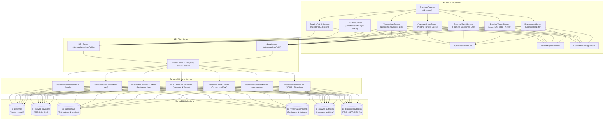

# 📐 Drawings & File Management Module — Full Architecture, Submodule Breakdown & UX Redesign Blueprint

> **System:** RebarOptima / CraveToBuild  
> **Module:** Engineering & Site Operations → Drawings & Files (`DrawingsPage`)  
> **Routes:** `/drawings`, `/drawings/matrix`, `/drawings/approvals`, `/drawings/transmittals`, `/drawings/activity`, `/drawings/plan-pass`, `/drawings/:id`, `/t/:token`  
> **Purpose:** Centralized, revision-controlled engineering drawing management for construction projects — architectural, structural, MEPF, statutory sanctioned plans (Plan Pass), revision history, CAD/DXF/PDF viewers, formal multi-party transmittals, and multi-tier approval workflows.

---

## 1. Executive Summary & Domain Scope

In construction engineering, **working from an outdated drawing revision is the #1 cause of catastrophic on-site rework and demolition**. 

The **Drawings Module** acts as the single source of truth for all engineering blueprints on site. It ensures that every project stakeholder (client, consultant, project manager, site engineer, bar bender, contractor) has real-time access to the latest **"Good For Construction" (GFC)** drawings while keeping a legally immutable audit log of all historical revisions.

```
┌─────────────────────────────────────────────────────────────────────────────┐
│                       CONSTRUCTION DRAWINGS LIFECYCLE                       │
├───────────────┬─────────────────┬─────────────────┬─────────────────────────┤
│  1. CREATION  │   2. REVIEW     │   3. APPROVAL   │     4. TRANSMITTAL      │
├───────────────┼─────────────────┼─────────────────┼─────────────────────────┤
│ • Upload DWG, │ • Lead Architect│ • Project Head  │ • Package GFC drawings  │
│   DXF, or PDF │   checks layout │   signs off     │ • Issue to Contractor   │
│ • Assign code │ • Structural    │ • Status:       │ • Public secure link    │
│   (AR-F-001)  │   engineer check│   "Approved"    │   for site teams        │
│ • Version R00 │ • Status:       │ • Version locked│ • Formal acknowledgment │
│   registered  │   "Under Review"│   as CURRENT    │   receipt tracked       │
└───────────────┴─────────────────┴─────────────────┴─────────────────────────┘
```

---

## 2. Complete Module Connection Map (Frontend ↔ Backend ↔ Database)



---

## 3. Deep Dive into Existing Submodules & Screens

The Drawing module currently contains **7 full screens** and **4 modals**:

### 1. Drawings List Screen (`DrawingsListScreen.jsx`) — Route: `/drawings`
- **Purpose:** Primary registry of all project drawings.
- **Current Features:**
  - 4 dropdown filters: Project, Block (`Block A`, `Block B`), Discipline (`ARCH`, `STR`, `MEPF`), Level/Floor (`B1`, `G`, `L1-L10`).
  - Sub-tabs: `Drawings`, `Plan Pass`, `Matrix View`.
  - Data table: Drawing No, Title, Current Version (R00, R01), Status badge, Last Updated, Updated By, Actions (`View`, `+ Version`, `Transmittal`, `Download`, `Void`).
  - Search-as-you-type bar (debounced 300ms).

### 2. Drawing Matrix Screen (`DrawingMatrixScreen.jsx`) — Route: `/drawings/matrix`
- **Purpose:** 2D bird's-eye view of drawing availability across the entire building.
- **Current Features:**
  - Rows: Drawing categories/types (e.g. Columns, Beams, Slabs, Plumbing).
  - Columns: Levels/Floors (`B2`, `B1`, `G`, `L1`, `L2`, `L3`... `Terrace`).
  - Cell status icons:
    * `✔` Green Check: Approved & Current (GFC).
    * `🟡` Yellow Dot: Under Review.
    * `—` Dash: Not uploaded yet (Clicking prompts upload for that specific floor).

### 3. Approvals Inbox (`ApprovalsInboxScreen.jsx`) — Route: `/drawings/approvals`
- **Purpose:** Dedicated review queue for lead architects, structural consultants, and project heads.
- **Current Features:**
  - Filters exclusively for drawings in `IN_REVIEW` or `PENDING_APPROVAL` status.
  - Quick action buttons to open `ReviewApprovalModal`:
    * **Approve** (marks revision as Approved / GFC).
    * **Request Changes** (returns to draft with feedback comments).
    * **Reject** (voids or blocks revision).

### 4. Transmittals Screen (`TransmittalsScreen.jsx`) — Route: `/drawings/transmittals`
- **Purpose:** Formal distribution ledger for sending drawing packages to third parties (contractors, clients, vendors).
- **Current Features:**
  - Transmittal package creator: Select recipient party, purpose (`FOR_CONSTRUCTION`, `FOR_APPROVAL`, `FOR_INFORMATION`, `AS_BUILT`), issue notes, and multi-select drawings.
  - Generates formal Transmittal Number (e.g., `TR-2026-004`).
  - **Public Link Generator (`/t/:token`):** Third-party contractors can open a dedicated client view without logging into RebarOptima, download the exact drawing files, and click "Acknowledge Receipt".
  - Recipient acknowledgment tracking table (tracks who viewed/acknowledged and when).

### 5. Plan Pass Screen (`PlanPassScreen.jsx`) — Route: `/drawings/plan-pass`
- **Purpose:** Municipal, government, and statutory compliance drawings.
- **Standard categories:**
  - Sanctioned Municipal Plan
  - Commencement Certificate (CC)
  - Fire NOC
  - Environmental Clearance
  - Occupancy / Completion Certificate

### 6. Interactive Drawing Viewer (`DrawingViewerScreen.jsx`) — Route: `/drawings/:id`
- **Purpose:** High-performance in-browser viewer for CAD & PDF files.
- **Current Features:**
  - Supports `.dwg`, `.dxf`, `.pdf`, `.png`, `.jpg`, `.svg`.
  - Zoom in/out, pan, rotate, fullscreen.
  - Sub-tabs inside viewer:
    * `viewer`: The CAD canvas or PDF renderer.
    * `details`: Drawing specifications, tags, assigned controller.
    * `history`: Full revision list (R00, R01, R02) with changelogs.
    * `activity`: Audit logs.
    * `distributions`: Transmittals containing this drawing.
  - Comparison mode: Visual diff between revision R01 and R00.

### 7. Drawing Activity Screen (`DrawingActivityScreen.jsx`) — Route: `/drawings/activity`
- **Purpose:** Complete security and operational audit trail.
- **Current Features:**
  - Action filters: `REVISION_UPLOADED`, `DECISION_APPROVED`, `DECISION_REJECTED`, `TRANSMITTAL_ISSUED`, `TRANSMITTAL_ACKNOWLEDGED`.
  - User names, timestamps, drawing references.

---

## 4. Current UX Problems & User Friction (Why It Needs Redesign)

As seen in your screenshot and user workflow testing:

| # | Current Problem | Impact on Site User / Engineer |
|---|-----------------|--------------------------------|
| **1** | **Cold, Confusing Empty State** | When no drawings match or on first load, it shows a blank box with "No Drawings Found". Users don't know what to do next. |
| **2** | **Navigation Fragmentation** | There are **3 different places for tabs**: Sidebar sub-menu (5 items) + Page top tabs (3 items) + Viewer sub-tabs (5 items). Users constantly lose context. |
| **3** | **Modal-upon-Modal Fatigue** | Clicking `+ New Drawing` opens a small form modal, which opens a file upload modal, which then navigates to the viewer screen. Too many clicks. |
| **4** | **Filter Clutter** | 4 full `<select>` dropdowns across the top consume precious vertical screen space on laptops and tablets, with zero tactile feedback. |
| **5** | **Approvals Hidden in Sidebar** | Site engineers and project heads don't see how many drawings are waiting for their signature unless they remember to click the sidebar "Approvals" menu item. |
| **6** | **Matrix Disconnected from Workflow** | The Drawing Matrix is treated as a separate screen rather than a visual overview of project progress. |
| **7** | **Mobile / Tablet Unfriendly** | The drawings table has 8 rigid columns that scroll horizontally on tablets and phones; touch targets are smaller than 36px in many places. |

---

## 5. Target UX Redesign Blueprint (The "Site Inventory" Pattern)

Just like we transformed Site Inventory into a fast, 4-hub tablet-ready system, we can apply the exact same battle-tested design patterns:

### 1. Sticky Header with Tactile Pills
- **Project Selector** (with project code & status)
- **Discipline Filter Pills** (Horizontally scrollable):
  `All (24) | 🏛️ Architectural (10) | 🏗️ Structural (8) | ⚡ MEPF (4) | 📜 Plan Pass (2)`
- **Block Pills**: `All Blocks | Block A | Block B | Tower 1`
- **Sync / Refresh Button**

### 2. Four Unified Hubs (Replacing 8 Fractured Tabs)
```
┌─────────────────────────────────────────────────────────────────────────────┐
│  ⚡ Register (Daily)  │  🗂️ Matrix (Grid)  │  ✍️ Approvals (3)  │  📤 Transmittals  │
└─────────────────────────────────────────────────────────────────────────────┘
```

1. **⚡ Register Hub (Daily & Search — Default Screen):**
   - **4 Tappable KPI Summary Cards:**
     * 📐 Total Registered Drawings (tap to show all)
     * 🟢 Good For Construction / Approved (tap to filter current GFC)
     * 🟡 Under Review / Pending Approval (tap to filter pending)
     * 🔴 Revisions Required / Changes Requested
   - **3 Big Quick-Action Buttons (Touch-friendly ≥ 60px):**
     * `[+ Upload Drawing]` (Opens single right-side drawer)
     * `[✍️ Review Approvals]` (Direct jump to pending sign-offs)
     * `[📤 Issue Transmittal]` (Package & distribute to contractor)
   - **Drawing Register Cards / Table:** Search-as-you-type, colored status badges, one-tap actions:
     `[👁️ View]` `[+ Rev]` `[📤 Send]` `[⬇️ Download]`.
   - **Recent Uploads & Revision Activity Stream** at bottom.

2. **🗂️ Matrix Hub (Interactive Floor × Discipline Map):**
   - Clean visual grid: Floors (B2 to Terrace) vs Disciplines/Categories.
   - Status color indicators:
     * 🟢 Green: Current GFC uploaded & approved.
     * 🟡 Yellow: Revision uploaded, waiting for sign-off.
     * ⚪ Dashed Empty: Missing drawing. **1-Tap click** directly opens the upload drawer with Block, Discipline, and Level pre-filled!

3. **✍️ Approvals Hub (1-Tap Sign-off Center):**
   - Clean workflow queue showing only drawings awaiting review/approval.
   - For each drawing: Shows drawing number, title, revision, submitter, and change notes.
   - Direct inline action buttons:
     * `[✔ Approve (GFC)]`
     * `[⚠️ Request Changes]`
     * `[✖ Reject]`
   - Site heads can clear their pending review backlog in 30 seconds!

4. **📤 Transmittals & Activity Hub (Distribution & Audit):**
   - History of formal transmittal issues (`TR-2026-001`, `TR-2026-002`).
   - Shows recipient organization, purpose, issued date, and acknowledgment status.
   - Instant buttons: `[Copy Public Link]`, `[View Slip / Voucher]`, `[Export Excel]`, `[Export PDF]`.

### 3. One Right-Side Slide-Over Drawer (Replaces All 4 Modals)
- Background stays visible (dimmed).
- **`UploadDrawingDrawer`**:
  * Drag-and-drop zone for DWG, DXF, PDF, PNG.
  * Discipline, Level, Block, Title, Drawing Number.
  * Required fields top; optional change description below.
- **`ApprovalDecisionDrawer`**:
  * Quick reviewer comments + decision radio pills.
- **`CreateTransmittalDrawer`**:
  * Select contractor/consultant, purpose, select drawings with checkboxes.
  * Auto-generates public link on submit.

### 4. Smart Defaults & Tablet Touch Optimization
- Remembers last selected discipline and block.
- Auto-suggests drawing numbers based on discipline conventions (e.g. `AR-L1-001`).
- Touch targets ≥ 44px throughout.
- Responsive card view on mobile screens (no horizontal table scrolling).
- Full dark mode support using CSS variables.

---

## 6. Implementation Scope & Component Breakdown

To keep code clean, scalable, and easy to maintain, we will split the Drawings module into modular files:

```
frontend/src/pages/DrawingsPage/
├── DrawingsPage.jsx                     (Main orchestrator & context state)
├── DrawingsPage.css                     (Modern responsive tokens & styles)
├── components/
│   ├── StickyHeader.jsx                 (Project + Discipline / Block pills)
│   ├── HubNavigation.jsx                (Register | Matrix | Approvals | Transmittals)
│   ├── DrawingKpiCards.jsx              (4 tappable KPI summary cards)
│   ├── QuickActionButtons.jsx           (3 big storekeeper/engineer action buttons)
│   ├── DrawingCardList.jsx              (Responsive table / card views)
│   └── TransmittalSlipModal.jsx         (Printable official issuance voucher)
├── hubs/
│   ├── RegisterHub.jsx                  (Drawings register, search, table/cards)
│   ├── MatrixHub.jsx                    (Floor vs Discipline visual grid)
│   ├── ApprovalsHub.jsx                 (Approval queue with 1-tap decisions)
│   └── TransmittalsHub.jsx              (Transmittal tracking, exports, audit log)
└── drawers/
    ├── DrawingDrawer.jsx                (Base right-side slide-over wrapper)
    ├── UploadDrawingDrawer.jsx          (New drawing & new revision upload)
    ├── ApprovalDecisionDrawer.jsx       (Approve / Reject / Changes requested)
    └── CreateTransmittalDrawer.jsx      (Pack and distribute drawings to contractor)
```

---

## 7. Next Step

We can implement this redesign **hub by hub** just like we did with Site Inventory:
1. **Step 1:** Sticky Header + 4-Hub Navigation + Register Hub + Shared Right-Side Upload Drawer.
2. **Step 2:** Interactive Matrix Hub (visual map with 1-tap empty slot upload).
3. **Step 3:** Approvals Hub (review queue with 1-tap decision drawer).
4. **Step 4:** Transmittals Hub (formal issuance, Excel/PDF export, public tracking).

