# 🏗️ CraveToBuild / RebarOptima — New Steel Module Architecture & Simplified Blueprint

> **Executive Summary for Product Leadership & Engineering**  
> This document details the modern, simplified architecture and user journey of the unified **Steel & Reinforcement Suite** in RebarOptima / CraveToBuild.  
> It explains how 5 previously disconnected screens have been reorganized into a single high-speed operations hub with zero sidebar clutter, slide-over side drawers, and automatic cross-tab state persistence.

---

## 1. Non-Technical Founder Overview

### 💡 WHAT Changed?
- **Unified Main Sidebar**: Removed the 4 nested sub-items (`Inventory`, `Material Ledger`, `Run Optimizer`, `Batch History`) that crowded the main sidebar. Replaced with one clean, primary **Steel** menu item.
- **Top Suite Header (`SteelHeader.jsx`)**: Once inside Steel, users switch seamlessly between the 5 operational areas via persistent top tabs.
- **Slide-Over Drawers**: Giant inline forms (such as the 7-row Inward Delivery Voucher, Scrap Sales, Scrap Rules, and Commit Batch) now open in slide-over drawers from the right. The user **never loses sight** of their live stock and data tables.
- **Draft & State Persistence**: If an engineer enters 20 cut lengths into the Optimizer and clicks to check the Inventory or Ledger, their entered work is **never lost**. It automatically stays saved in memory.
- **Safe Empty States**: If an engineer opens Results before running an optimization, they see a clean instructional card with a 1-click button to start, instead of broken visuals.

### 🎯 WHY Did We Change It?
1. **Speed & Ergonomics**: Construction site engineers and yard supervisors need to enter weights, check available stock, and generate cutting layouts rapidly without constant full-page reloads and scrolling.
2. **Context Preservation**: Entering a new steel shipment while looking at current yard levels prevents duplicate entries and ordering mistakes.
3. **Sidebar Cleanliness**: A bloated sidebar creates cognitive fatigue; a focused workspace where related tools live together makes the product feel enterprise-grade and cohesive.

---

## 2. Complete Information Architecture & Navigation

```mermaid
flowchart TD
    Sidebar["🏢 Main Sidebar: Steel Item"] --> SuiteHeader["Top Suite Navigation (SteelHeader.jsx)"]
    
    SuiteHeader --> S1["1. Rebar Inventory (/inventory)"]
    SuiteHeader --> S2["2. Cut Optimizer (/inputs)"]
    SuiteHeader --> S3["3. Results & Patterns (/results)"]
    SuiteHeader --> S4["4. Batch History (/history)"]
    SuiteHeader --> S5["5. Material Ledger (/ledger)"]

    subgraph Screen1["Screen 1: Inventory Hub"]
        S1 --> S1_Stock["Prime 12m Stock Table"]
        S1 --> S1_Remnants["Reusable Remnants & Clearance Matcher"]
        S1 --> S1_Scrap["Batch Scrap Records & Scrap Sales Portal"]
        S1 --> D1_Inward["Drawer: Inward Delivery Voucher (840px)"]
        S1 --> D1_ScrapSale["Drawer: Record / Edit Scrap Sale"]
        S1 --> D1_ScrapRules["Drawer: Scrap Classification Thresholds"]
    end

    subgraph Screen2["Screen 2: Optimizer Inputs"]
        S2 --> S2_Live["1-Click: Use Live Yard Stock"]
        S2 --> S2_BBS["1-Click: Pull from BBS Schedules"]
        S2 --> S2_Demand["Demand Cut Parts Table (Tab/Enter auto-add)"]
        S2 --> S2_Tuning["Saw Kerf & Margin Tolerances"]
    end

    subgraph Screen3["Screen 3: Results & Execution"]
        S3 --> S3_KPIs["5 Hero Wastage & Weight KPIs"]
        S3 --> S3_Bars["1D Proportional Cutting Visualizations"]
        S3 --> S3_BOM["Cutting Schedule & BOM"]
        S3 --> S3_Print["3-Mode Print (Foreman / Exec / Summary)"]
        S3 --> D3_Commit["Drawer: Save & Commit (3-Step Animated Deduct)"]
    end

    subgraph Screen4["Screen 4: History & Audits"]
        S4 --> S4_Search["Search-as-you-type & Dia Filters"]
        S4 --> S4_Clone["1-Click Edit / Clone back to Optimizer"]
        S4 --> S4_Delete["2-Option Deletion (Report Only vs Restore Stock)"]
    end

    subgraph Screen5["Screen 5: Double-Entry Ledger"]
        S5 --> S5_Journal["Audit Ledger (Flat vs Batch-Grouped)"]
        S5 --> S5_Cost["Inward Cost & Procurement Rate Matrix"]
        S5 --> S5_POs["Purchase Orders & Delivery Status"]
        S5 --> S5_Reqs["Site Requisitions & Pour Approvals"]
        S5 --> S5_PDF["Sign-off PDF Engine (Site Eng / Stores / PM)"]
    end
```



---

## 3. Deep Dive: The 5 Re-Oriented Screens

### 📦 SCREEN 1: Rebar Inventory (`/inventory`)

#### Purpose
Real-time control over physical steel lying in the yard, incoming mill shipments, reusable cut-offs, and commercial scrap.

#### Visual Layout & Key Sections
1. **Suite Header with Action Slot**:
   - `+ Add Inward`: Opens the wide delivery drawer instantly.
   - `Scrap Rules`: Opens the threshold configuration drawer.
2. **Executive KPI Cards (4)**:
   - `Total Available Yard Stock`: Metric Tonnes, kg, and % Remnants.
   - `Prime Standard Bars (12m)`: Total tonnage and full bar count.
   - `Reusable Remnants Yield`: Saved offcut tonnage and piece count.
   - `Estimated Inventory Asset Value`: Live procurement market asset valuation in ₹.
3. **Sub-View Tabs**:
   - `Stock List`: Combines Standard 12m stock and Remnants.
   - `Voucher Inward`: Opens the slide-over voucher drawer.
   - `Batch Scrap Records`: Complete datewise log of cutting scrap.
   - `Scrap Sales`: Commercial sale register and revenue recovery.
   - `Scrap Rules`: Per-diameter scrap cut thresholds.
4. **Standard 12m Stock Section**:
   - Diameter quick-filter chips (Ø8, 10, 12, 16, 20, 25, 32 mm).
   - Search box (`Search brand, vendor, dia...`).
   - Table columns: `Diameter`, `Length`, `Qty (Bars)`, `Total Weight`, `Cost/kg`, `Brand`, `Vendor`, `Inward Date`, `Actions`.
   - **Inline Edit & Delete**: Clicking the pencil turns quantity into an editable input with Save/Cancel. Clicking trash opens an inline `Delete? Yes / No` popover.
5. **Reusable Remnants & Smart Clearance Matcher**:
   - Category pills: `All`, `Short (<1m)`, `Medium (1-3m)`, `Long (>3m)`.
   - **Smart Clearance Matcher**: Enter required cut length (e.g. 2,150 mm) → discovers how many pieces can be extracted from current offcuts before cutting new 12m bars!
6. **Slide-Over Drawers (3)**:
   - **Inward Delivery Voucher Drawer (840px)**: 7 pre-populated diameter rows (8mm–32mm), auto-calculated 18% GST preview, total price, brand/vendor autocomplete suggestions from company history, and `Apply Brand/Vendor to All` button.
   - **Scrap Sale Drawer**: Record date, buyer, weight kg, and rate/kg with live revenue calculation preview.
   - **Scrap Rules Drawer**: Configure per-diameter minimum cut length thresholds (e.g. `< 1000mm` = scrap, `≥ 1000mm` = reusable remnant).

---

### ⚡ SCREEN 2: 1D Cut Optimizer Inputs (`/inputs`)

#### Purpose
The calculation engine where bar bending schedules (BBS) and cut parts demand meet available stock to minimize cutting scrap to $< 1.8\%$.

#### Visual Layout & Key Sections
1. **Top Header**:
   - Quick action: `Pull from BBS` (opens predefined templates modal).
   - Project name badge.
   - Batch Reference / Name input (defaults to `Batch #DD/MM/YYYY`).
2. **Section A: Available Yard Stock (Collapsible)**:
   - Checkbox: `Use Remnants from Inventory` (prioritizes offcuts first).
   - Shortcut Button: `Use Live Yard Stock` — 1-click reload pulling active standard stock and remnants from the yard database.
   - Stock Table: `Diameter`, `Stock Length mm` (12000), `Available Qty` (blank = unlimited), `Action`.
   - Keyboard Accelerator: Pressing `Tab` on the last cell or `Enter` auto-creates a new row.
3. **Section B: Required Cut Parts (Demand)**:
   - Button: `Pull from BBS / Predefined Cuts` (opens element library modal for Beams, Columns, Footings, Slabs).
   - Button: `+ Add Row`.
   - Demand Table: `Diameter`, `Cut Length mm`, `Required Qty`, `Bar Mark / Label`, `Action`.
   - Keyboard Accelerator: Pressing `Tab` on the last cell or `Enter` auto-creates a new row.
4. **Section C: Cutting Tolerances (Collapsible)**:
   - Kerf (saw blade cutting thickness in mm, default 2mm).
   - Trim margin (mill end cropping margin in mm, default 10mm).
5. **Cross-Tab Draft Persistence**:
   - Any cut parts or stock rows entered are cached in `sessionStorage` (`rebar_optimizer_draft`).
   - If an engineer navigates to Inventory or Ledger and returns, **zero data is lost**.
6. **Bottom Execution Bar**:
   - `[Calculate Cutting Plan]`: Executes the 1D bin-packing algorithm and transitions to `/results`.
   - `Recent Optimizations`: Quick cards showing the 5 most recent runs with 1-click restoration.

---

### 📊 SCREEN 3: Optimization Results & Visual Patterns (`/results`)

#### Purpose
Provides visual verification of cutting layouts, foreman cutting instructions, wastage metrics, and formal inventory commitment.

#### Visual Layout & Key Sections
1. **Safe Empty State**:
   - If opened without an active calculation, renders a clean guidance card with a 1-click button: `[Go to Run Optimizer]`.
2. **Top Action Bar**:
   - `← Back to Optimizations`: Preserves all cuts for re-tuning.
   - `Save & Commit Batch`: Opens the commit audit drawer.
   - `Print Options` (3 Modes):
     1. **Steel Foreman Cut-Sheet**: Layouts, bar marks, cutting order — zero financial rates to protect site privacy.
     2. **Complete Executive Report**: All KPIs, dimensional patterns, scrap weights, and procurement costs.
     3. **1-Page Summary Sheet**: Yield, scrap %, and offcut recovery overview.
   - `Download PDF` & `Download Excel`.
3. **Hero Wastage & Performance KPIs (5)**:
   - `Overall Wastage %`: Color-coded (Emerald $< 1.8\%$, Amber $1.8\%-3.5\%$, Red $> 3.5\%$).
   - `Total Stock Bars Used`: Full bars count and tonnage.
   - `Total Steel Weight Cut`: Metric Tonnes and kg.
   - `Reusable Remnants Yield`: Weight in kg and piece count saved for inventory.
   - `Total Scrap Generated`: Weight in kg and lost value.
4. **1D Proportional Cutting Pattern Bars**:
   - Full 12-meter horizontal graphical bars drawn to scale.
   - Cut pieces shown in distinct colors with bar mark label, length mm, and count.
   - Offcut tail end visual classification:
     - **Green diagonal stripes**: Reusable Remnant ($\ge$ threshold).
     - **Red diagonal stripes**: Scrap ($<$ threshold).
   - Multiplier header: e.g. `Pattern 1 — Repeat × 24 Bars`.
5. **Slide-Over Commit Batch Drawer (`CommitBatchDrawer.jsx`)**:
   - Batch name confirmation.
   - **Pre-Commit Material Audit**: Shows exactly how many 12m bars will be deducted, how much steel will be consumed, and which remnants will be added to the yard inventory.
   - **3-Step Animated Commit Progress**:
     1. *Step 1: Verify Material Allocation*
     2. *Step 2: Stock Deduction & Remnant Creation*
     3. *Step 3: Audit Ledger Transaction Commit*

---

### 📋 SCREEN 4: Batch History (`/history`)

#### Purpose
Permanent compliance archive of all executed steel cutting runs, providing forensic auditability and 1-click cloning.

#### Visual Layout & Key Sections
1. **Live Search & Filter Bar**:
   - Search-as-you-type box (filters batch name, reference, and date).
   - Diameter filter dropdown (filters batches containing Ø8mm, 10mm, 12mm, etc.).
   - Active batch count badge.
2. **Accordion Batch Cards**:
   - Card Header: Batch name + execution date + summary badges (Bars Used, Total Cut Weight, Utilization %).
   - **Inline Renaming**: Double-click or click pencil icon to rename with `Enter` (Save) / `Esc` (Cancel).
3. **Action Buttons per Batch**:
   - `Print Options`: Foreman sheet, Executive report, or Summary.
   - `Edit Batch`: Loads historical cuts and parameters directly back into `/inputs` for cloning or re-cutting.
   - `Delete Batch`: Protected by a popover offering **2 distinct choices**:
     1. **Delete Report Only**: Removes the log while leaving yard inventory untouched.
     2. **Delete & Restore Stock**: Reverses physical deductions, adds consumed bars back to stock, and deletes generated remnants.
4. **Expanded Card Content**:
   - Full dimensional visual 1D patterns.
   - Cutting schedule and BOM breakdown.
   - Consumed stock list and remnant recovery logs.

---

### 📖 SCREEN 5: Material Ledger & Procurement (`/ledger`)

#### Purpose
Double-entry material accounting tracking every kilogram of reinforcement steel entering the site, consumed in casting, sold as scrap, or remaining in stock.

#### Visual Layout & Key Sections
1. **Top Header & Printable Sign-off Export**:
   - `Print Report`: Generates formal PDF documentation with 3 physical sign-off lines:
     - *Site Reinforcement Engineer*
     - *Stores & Yard In-Charge*
     - *Project Manager*
2. **4 Sub-View Tabs**:
   - `Audit Ledger` (`ledger`): The core double-entry material journal.
   - `Inward Cost Report` (`inward-cost`): Procurement cost analytics and weighted rates.
   - `Batch Orders` (`orders`): Mill and distributor purchase orders.
   - `Order Requests` (`requests`): Site supervisor material requisitions.
3. **Audit Ledger Features**:
   - Summary tiles: Total Inward, Consumed Material, Scrap Recovered, Net Live Stock Balance.
   - Filter bar: Transaction type (`INWARD`, `CONSUMPTION`, `SCRAP_SALE`, `ADJUSTMENT`), Diameter, Vendor, Date Range.
   - Active filter badges with 1-click removal.
   - **View Toggle**:
     - *Flat Chronological Journal*: Traditional accounting transaction ledger.
     - *Group by Batch*: Summary row per cutting batch with expandable nested diameter breakdown.
4. **Inward Cost Analytics**:
   - Average rate per kg trends.
   - Diameter vs. Vendor cross-tabulation rate matrix.
   - Historical delivery receipts with GRN reference, weight, and GST.
5. **Site Requisitions & Pour Approvals**:
   - Form to request steel for upcoming pours (Diameter, Weight, Target Pour Location, Required Date).
   - Requisition approvals table with 1-click Approve / Reject actions.

---

## 4. End-to-End Data & Material Lifecycle

```
[1. Mill Shipment Arrives at Yard]
   │
   ▼
[Screen 1: Inward Voucher Drawer] ──> Standard Stock Updated (12m Prime Bars)
   │
   ▼
[Screen 2: Cut Optimizer Inputs] <─── Auto-Loads Available Yard Stock
   │   (Pulls BBS Schedules or Element Templates)
   ▼
[Screen 3: 1D Bin-Packing Algorithm]
   │
   ▼
[Screen 3: Visual Cutting Patterns (<1.8% Wastage)]
   │
   ▼
[Screen 3: Commit Batch Drawer]
   ├── Deducts 12m standard bars from Yard Inventory
   ├── Registers Reusable Remnants (≥ threshold) to Yard Inventory
   ├── Logs Scrap Weight (< threshold) to Scrap Audit
   └── Records Journal Entry in Material Ledger
   │
   ▼
[Screen 4: Permanent Batch History Archive] (Print Foreman Cut-Sheet)
   │
   ▼
[Screen 5: Material Ledger Journal] (Running Balance Updated)
   │
   ▼
[Screen 1: Scrap Sales Drawer] ──> Commercial Revenue Retrieved from Scrap Buyers
```

---

## 5. Technical Specifications & File Map

| Component / File | Purpose & Responsibilities |
| :--- | :--- |
| [SteelHeader.jsx](file:///Users/darshanpatel/Desktop/Projects%20/RebarOptima/frontend/src/components/Shared/SteelHeader.jsx) | Persistent top bar with 5 suite tabs, project context badge, and action slots. |
| [SideNavbar.jsx](file:///Users/darshanpatel/Desktop/Projects%20/RebarOptima/frontend/src/components/SideNavbar/SideNavbar.jsx) | Streamlined single `Steel` navigation item highlighting active across all 5 suite views. |
| [InventoryPage.jsx](file:///Users/darshanpatel/Desktop/Projects%20/RebarOptima/frontend/src/pages/InventoryPage/InventoryPage.jsx) | Rebar inventory hub managing 12m stock, remnants, matcher, and scrap registers. |
| [InwardVoucherDrawer.jsx](file:///Users/darshanpatel/Desktop/Projects%20/RebarOptima/frontend/src/pages/InventoryPage/components/InwardVoucherDrawer.jsx) | Wide 840px slide-over voucher entry for multi-diameter steel deliveries. |
| [ScrapSaleDrawer.jsx](file:///Users/darshanpatel/Desktop/Projects%20/RebarOptima/frontend/src/pages/InventoryPage/components/ScrapSaleDrawer.jsx) | Slide-over drawer for logging and editing commercial scrap sales. |
| [ScrapRulesDrawer.jsx](file:///Users/darshanpatel/Desktop/Projects%20/RebarOptima/frontend/src/pages/InventoryPage/components/ScrapRulesDrawer.jsx) | Slide-over drawer for per-diameter scrap classification thresholds. |
| [NewBatchPage.jsx](file:///Users/darshanpatel/Desktop/Projects%20/RebarOptima/frontend/src/pages/NewBatchPage/NewBatchPage.jsx) | 1D cut optimizer input studio with live yard stock auto-fill and BBS import. |
| [ResultsPage.jsx](file:///Users/darshanpatel/Desktop/Projects%20/RebarOptima/frontend/src/pages/ResultsPage/ResultsPage.jsx) | Interactive cutting results, 1D pattern bars, and safe empty state. |
| [CommitBatchDrawer.jsx](file:///Users/darshanpatel/Desktop/Projects%20/RebarOptima/frontend/src/pages/ResultsPage/components/CommitBatchDrawer.jsx) | Slide-over drawer for material deduction and 3-step animated database commit. |
| [BatchHistoryPage.jsx](file:///Users/darshanpatel/Desktop/Projects%20/RebarOptima/frontend/src/pages/BatchHistoryPage/BatchHistoryPage.jsx) | Permanent batch audit archive with search-as-you-type and two-mode deletion. |
| [LedgerPage.jsx](file:///Users/darshanpatel/Desktop/Projects%20/RebarOptima/frontend/src/pages/LedgerPage/LedgerPage.jsx) | Double-entry rebar journal, procurement rate matrix, and sign-off PDF generator. |

---

## 6. Ideas for Future Simplification (Optional Next Steps)

1. **Auto-Match Remnants on Inward**: When new shipments arrive, automatically highlight if pending BBS cut demands can immediately use remnants instead of unbundling new 12m bars.
2. **QR / Barcode Foreman Mobile Scanner**: Generate a small QR code on the Foreman Cutting Sheet that allows site workers to scan and mark a pattern as "Cut Complete" from their phone.
3. **One-Click Rebar Reorder Alert**: When yard stock for any diameter falls below a customizable project threshold (e.g. $< 5$ MT of Ø16mm), trigger an automatic procurement purchase requisition.

