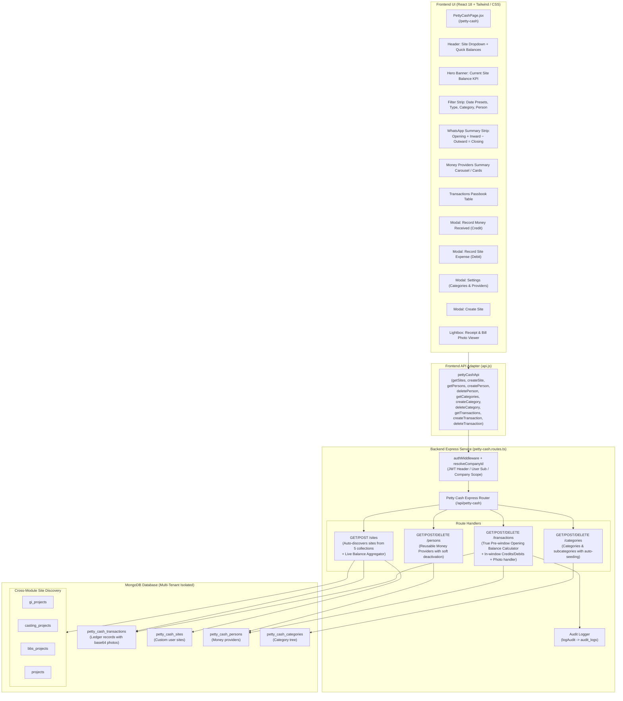

# 💵 Petty Cash & Site Expense Management — Full Architecture, Data Model & UX Redesign Blueprint

> **System:** RebarOptima / CraveToBuild  
> **Module:** Site Operations → Petty Cash (`PettyCashPage`)  
> **Route:** `/petty-cash`  
> **Target Audience:** Non-Technical Founders, UI/UX Product Designers, Frontend Developers, Mobile App Engineers, and Backend Architects.  
> **Version:** 1.0 (Production-Verified)  
> **Companion Files:**  
> - Frontend: [`frontend/src/pages/PettyCashPage/PettyCashPage.jsx`](file:///Users/darshanpatel/Desktop/Projects%20/RebarOptima/frontend/src/pages/PettyCashPage/PettyCashPage.jsx)  
> - Styles: [`frontend/src/pages/PettyCashPage/PettyCashPage.css`](file:///Users/darshanpatel/Desktop/Projects%20/RebarOptima/frontend/src/pages/PettyCashPage/PettyCashPage.css)  
> - API Utility: [`frontend/src/utils/api.js`](file:///Users/darshanpatel/Desktop/Projects%20/RebarOptima/frontend/src/utils/api.js) (`pettyCashApi`)  
> - Backend Routes: [`backend/src/petty-cash/petty-cash.routes.ts`](file:///Users/darshanpatel/Desktop/Projects%20/RebarOptima/backend/src/petty-cash/petty-cash.routes.ts)  
> - Reports Engine: [`backend/src/reports/reports.service.ts`](file:///Users/darshanpatel/Desktop/Projects%20/RebarOptima/backend/src/reports/reports.service.ts)

---

## 1. Executive Summary & Construction Domain Scope

In civil construction and infrastructure contracting, major purchases (TMT rebar, ready-mix concrete, heavy equipment rental) are settled via head-office Purchase Orders (PO) and formal RTGS/NEFT bank transfers. 

However, every active construction site requires a **daily physical cash float (Petty Cash)** to handle rapid, small-ticket, on-the-spot expenses that cannot wait for head-office billing cycles.

```
┌────────────────────────────────────────────────────────────────────────────────────────┐
│                              CONSTRUCTION FINANCIAL FLOWS                              │
├──────────────────────────────────────────┬─────────────────────────────────────────────┤
│         HEAD OFFICE ERP & PROCUREMENTS   │           ON-SITE PETTY CASH BOX            │
├──────────────────────────────────────────┼─────────────────────────────────────────────┤
│ • Bulk rebar deliveries (20-40 metric tons) • Emergency binding wire & nails from local shop│
│ • RMC transit mixers & concrete pumps   │ • Daily wage / daily 'Chai-Nashta' refreshments│
│ • Subcontractor RA Bills & Retention     │ • Unloading tempo / tractor carriage charges│
│ • Long-term bank reconciliation         │ • Diesel for site generator & vibrator needle│
│ • Multi-stage approval hierarchy        │ • Instant camera snap of kachha slip / bill │
└──────────────────────────────────────────┴─────────────────────────────────────────────┘
```

### The Imprest Cash Float Model
The module implements the standard construction industry **Imprest System**:
1. **Cash Inflow (Credit):** The company director, developer, or head-office accountant hands ₹25,000 to the site engineer or supervisor. This is logged as a **Credit** entry under the name of the money provider (e.g. *"Ramesh Director"*, *"HDFC Site Cash Withdrawal"*).
2. **Cash Outflow (Debit):** Throughout the day, the site engineer disburses cash for small needs (e.g. ₹400 for tempo freight, ₹350 for tea/snacks, ₹1,200 for emergency hardware). Each is recorded with an attached **photo of the receipt or handwritten voucher**.
3. **Daily Running Balance:** At any minute, the site supervisor's physical metal cash box must match:
   $$\text{Closing Balance} = \text{Opening Balance} + \sum \text{Credits (Money Received)} - \sum \text{Debits (Expenses)}$$
4. **Audit & Top-up:** When physical cash runs low, the supervisor submits the statement with bill attachments to head office for reimbursement.

---

## 2. Complete End-to-End System Connection Map



---

## 3. Database Architecture & Multi-Tenant Data Models

All collections strictly enforce **multi-tenant data isolation** via `companyId`. Queries utilize normalized string and `ObjectId` cross-matching (`companyFilter`) so data from one tenant can never be queried or viewed by another.

### Collection 1: `petty_cash_transactions`
The immutable financial ledger recording every cash inflow and expense.

| Field Name | Type | Required | Description | Example / Values |
| :--- | :--- | :---: | :--- | :--- |
| `_id` | `ObjectId` | Yes | Unique database transaction identifier | `ObjectId("67...39")` |
| `companyId` | `String / ObjectId` | Yes | Multi-tenant tenant identifier | `"cravora-org-01"` |
| `siteId` | `String` | Yes | Site identifier (or `'site-default'`) | `"gi_proj_101"` |
| `siteName` | `String` | Yes | Denormalized site name for fast querying | `"Skyline Tower A"` |
| `type` | `String` | Yes | Transaction nature | `'CREDIT'` (Inward) or `'DEBIT'` (Expense) |
| `date` | `String` | Yes | Calendar date in ISO format | `"2026-11-10"` |
| `amount` | `Number` | Yes | Monetary amount in INR (2 decimals) | `1500.00` |
| `category` | `String` | Yes | Main accounting category | `"Site Materials & Supplies"` |
| `subcategory` | `String` | No | Sub-classification | `"Binding Wire & Nails"` |
| `description` | `String` | Yes | Purpose / bill details / remarks | `"2 rolls binding wire & 1kg concrete nails"` |
| `personName` | `String` | Yes | **For Credit:** Provider. **For Debit:** Handler/Spender. | `"Ketan Patel (Site Engg)"` |
| `photos` | `Array<Object>` | No | Attached vouchers, cash slips, or material snaps | See photo sub-schema below |
| `photos[].dataUrl` | `String` | Yes | Base64 data URL or external asset link | `"data:image/jpeg;base64,/9j/4AAQ..."` |
| `photos[].name` | `String` | No | Original file name or generated tag | `"voucher_wire_receipt.jpg"` |
| `photos[].size` | `Number` | No | File size in bytes | `245100` |
| `photos[].uploadedAt`| `Date` | Yes | Timestamp of photo attachment | `ISODate("2026-11-10T09:30:00Z")` |
| `createdBy` | `String` | Yes | User ID who created the record | `"usr_98124"` |
| `createdByName` | `String` | Yes | Human-readable user name or email | `"darshan@cravora.com"` |
| `createdAt` | `Date` | Yes | Timestamp record created | `ISODate("2026-11-10T10:15:00Z")` |
| `updatedAt` | `Date` | Yes | Timestamp record last modified | `ISODate("2026-11-10T10:15:00Z")` |

#### Recommended Indexing Strategy
```javascript
db.petty_cash_transactions.createIndex({ companyId: 1, siteName: 1, date: 1 });
db.petty_cash_transactions.createIndex({ companyId: 1, type: 1, date: 1 });
db.petty_cash_transactions.createIndex({ companyId: 1, personName: 1 });
```

---

### Collection 2: `petty_cash_sites`
Custom sites created directly by the user within Petty Cash (supplements auto-discovered project sites).

| Field Name | Type | Required | Description |
| :--- | :--- | :---: | :--- |
| `_id` | `ObjectId` | Yes | Unique site ID |
| `companyId` | `String / ObjectId` | Yes | Multi-tenant tenant identifier |
| `name` | `String` | Yes | Site Name (unique case-insensitive per tenant) |
| `code` | `String` | No | Short code (e.g. `"SK-01"`, `"WH-04"`) |
| `location` | `String` | No | Site location or physical address |
| `createdAt` | `Date` | Yes | Creation timestamp |
| `updatedAt` | `Date` | Yes | Modification timestamp |

---

### Collection 3: `petty_cash_persons`
Reusable master directory of money providers (Directors, Partners, Clients, Bank float runners).

| Field Name | Type | Required | Description |
| :--- | :--- | :---: | :--- |
| `_id` | `ObjectId` | Yes | Unique person record ID |
| `companyId` | `String / ObjectId` | Yes | Tenant identifier |
| `name` | `String` | Yes | Person full name (case-insensitive unique) |
| `roleOrTitle`| `String` | No | Role designation (e.g. `"Managing Director"`, `"Site Supervisor"`) |
| `phone` | `String` | No | Contact phone number |
| `isActive` | `Boolean` | Yes | Soft-delete status (`true` = visible, `false` = archived) |
| `createdAt` | `Date` | Yes | Created timestamp |
| `updatedAt` | `Date` | Yes | Updated timestamp |

> **Automation Note:** When a user logs a **Credit** transaction with a newly typed person name, the backend automatically seeds them into `petty_cash_persons` so they appear in future dropdowns without manual setup.

---

### Collection 4: `petty_cash_categories`
Master category tree for construction expenses and income sources. Automatically seeded on first run if empty.

| Field Name | Type | Required | Description | Default Construction Categories |
| :--- | :--- | :---: | :--- | :--- |
| `_id` | `ObjectId` | Yes | Unique category ID | |
| `companyId` | `String / ObjectId` | Yes | Tenant identifier | |
| `name` | `String` | Yes | Category Name | 1. **Opening Balance** (`WhatsApp Carry-Forward`, `Bank Cash Withdrawal`)<br>2. **Site Materials & Supplies** (`Hardware & Tools`, `Binding Wire & Nails`, `Safety & PPE`, `Cement & Sand`)<br>3. **Labor & Unloading** (`Daily Wages`, `Material Unloading`, `Overtime Help`)<br>4. **Transport & Travel** (`Auto / Tempo Fare`, `Fuel for Generator / Bike`, `Courier / Delivery`)<br>5. **Site Refreshments** (`Tea & Snacks`, `Drinking Water (Jars/Cans)`, `Site Lunch`)<br>6. **Repairs & Maintenance** (`Machine Servicing`, `Electrical Repairs`, `Welding / Fitting`)<br>7. **Office & Admin** (`Stationery & Xerox`, `Mobile Recharge`, `Miscellaneous`) |
| `subcategories` | `Array<String>` | No | List of child subcategory tags | E.g. `["Hardware & Tools", "Binding Wire & Nails"]` |
| `createdAt` | `Date` | Yes | Creation timestamp | |
| `updatedAt` | `Date` | Yes | Modification timestamp | |

---

## 4. Backend API Specification & Financial Calculation Engine

Base Route: `/api/petty-cash`  
Authentication: Bearer JWT Token in `Authorization` header.

### Endpoint Matrix

| Method | Endpoint | Description | Request Body / Query Params |
| :--- | :--- | :--- | :--- |
| `GET` | `/sites` | Get all sites with real-time balance aggregation | None |
| `POST`| `/sites` | Create a new custom construction site | `{ name, code, location }` |
| `GET` | `/persons` | Get active money providers | None |
| `POST`| `/persons` | Create or reactivate money provider | `{ name, roleOrTitle, phone }` |
| `DELETE`| `/persons/:id` | Soft-deactivate money provider (`isActive: false`) | None |
| `GET` | `/categories` | Get category & subcategory tree (auto-seeds defaults) | None |
| `POST`| `/categories` | Create or update category | `{ id?, name, subcategories: [] }` |
| `DELETE`| `/categories/:id` | Delete an expense category | None |
| `GET` | `/transactions` | Retrieve ledger statement with live opening/closing balances | `?siteName=...&startDate=...&endDate=...&type=...&category=...&personName=...` |
| `POST`| `/transactions` | Record Credit (Money In) or Debit (Expense Out) | `{ siteId, siteName, type, date, amount, category, subcategory, description, personName, photos }` |
| `DELETE`| `/transactions/:id` | Delete a transaction entry with full audit trail | None |

---

### The Mathematical Balance & Reporting Engine (`GET /transactions`)

The statement calculation engine solves the classic accounting dilemma: **How to accurately calculate the Opening Balance for an arbitrary date window without storing fragile daily rollups.**

```
                                    TIME TIMELINE
◀─────────────────────────────────────────┼─────────────────────────────────────────▶
  PRIOR TRANSACTIONS (Before startDate)   │     CURRENT WINDOW (startDate to endDate)
                                          │
  Credits: +₹50,000                       │  In-Window Credits: +₹10,000
  Debits:  -₹32,000                       │  In-Window Debits:  -₹8,500
  ─────────────────────────────────────   │  ─────────────────────────────────────────
  Calculated Opening Balance = +₹18,000   │  Closing Balance = ₹18,000 + ₹10,000 - ₹8,500
                                          │                  = ₹19,500
```

#### Detailed Calculation Logic:
1. **Query Scope:** The server fetches all historical transactions for the selected `siteName` sorted chronologically (`date: 1, createdAt: 1`).
2. **Pre-Window Loop:** For every transaction where `date < startDate`:
   - If `type === 'CREDIT'`: `openingBalance += amount`
   - If `type === 'DEBIT'`: `openingBalance -= amount`
   - These transactions are **not** displayed in the statement table, but their net sum forms the accurate brought-forward **Opening Balance**.
3. **In-Window Loop:** For transactions where `startDate <= date <= endDate` (and passing `category`, `type`, `personName` filters):
   - If `type === 'CREDIT'`: `totalCredits += amount`
   - If `type === 'DEBIT'`: `totalDebits += amount`
   - Added to the `filteredTransactions` list.
4. **Closing Balance:**
   $$\text{closingBalance} = \text{openingBalance} + \text{totalCredits} - \text{totalDebits}$$
5. **Person Credit Breakdown:** Aggregates total credit contributions per money provider:
   $$\text{personCreditBreakdown} = \left[ \{ \text{personName: "Ketan Bhai", totalAmount: 40000, count: 3} \}, \dots \right]$$

---

## 5. UI/UX Information Architecture & Screen Wireframes

The UI is designed to solve a critical construction problem: **site supervisors are constantly on their feet, dealing with dusty environments, sunlight, and poor connectivity.** The interface balances high-density passbook clarity for desktop accountants with fast, frictionless touch targets for mobile supervisors.

### Master Screen Architecture (Single Page Hub)

```
┌──────────────────────────────────────────────────────────────────────────────────────────────────┐
│ [RebarOptima Logo]   Site Petty Cash & Expenses            [Site: Dashtech ▾] [⚙ Settings]       │
├──────────────────────────────────────────────────────────────────────────────────────────────────┤
│ ┌────────────────────────────────────────────────────────┬─────────────────────────────────────┐ │
│ │ CURRENT SITE CASH BALANCE                              │  [+ Money Received (Credit)]        │ │
│ │ ₹ 14,250.00                    [ 📍 Dashtech Site ]    │                                     │ │
│ │ Total Inward: ₹50,000 • Total Expenses: ₹35,750 • 24 Tx│  [− Record Site Expense (Debit)]    │ │
│ └────────────────────────────────────────────────────────┴─────────────────────────────────────┘ │
├──────────────────────────────────────────────────────────────────────────────────────────────────┤
│ FILTERS: [All Time] [Today] [Yesterday] [This Week] [This Month]   [ 📅 2026-11-01 to 2026-11-10 ]│
│ [All Entries] [Received (Credit)] [Expenses (Debit)]  [All Categories ▾] [All Providers ▾] [🔍 Search]│
├──────────────────────────────────────────────────────────────────────────────────────────────────┤
│ ┌───────────────────┐     ┌───────────────────┐     ┌───────────────────┐     ┌────────────────┐ │
│ │  OPENING BALANCE  │  +  │  MONEY RECEIVED   │  −  │  TOTAL EXPENSES   │  =  │ CLOSING BALANCE│ │
│ │     ₹ 5,000       │     │     ₹ 20,000      │     │     ₹ 10,750      │     │    ₹ 14,250    │ │
│ │  Brought forward  │     │   Total Credits   │     │   Total Debits    │     │ Carry forward  │ │
│ └───────────────────┘     └───────────────────┘     └───────────────────┘     └────────────────┘ │
├──────────────────────────────────────────────────────────────────────────────────────────────────┤
│ MONEY PROVIDERS SUMMARY (Click card to filter):                                                  │
│ ┌─────────────────────┐  ┌─────────────────────┐  ┌─────────────────────┐  ┌──────────────────┐  │
│ │ Ketan Dasalaniya    │  │ Ramesh Director     │  │ HDFC Bank Float     │  │ Patel & Sons     │  │
│ │ 3 entries  ₹ 25,000 │  │ 2 entries  ₹ 15,000 │  │ 1 entry    ₹ 10,000 │  │ 1 entry  ₹ 5,000 │  │
│ └─────────────────────┘  └─────────────────────┘  └─────────────────────┘  └──────────────────┘  │
├──────────────────────────────────────────────────────────────────────────────────────────────────┤
│ PETTY CASH STATEMENT (Showing 18 entries)                                          [ 🔄 Refresh ]│
│ ┌────────────┬───────────┬────────────────────────────────┬───────────────────┬────────┬─────────┐ │
│ │ DATE       │ TYPE      │ CATEGORY & DETAILS             │ PERSON / EMPLOYEE │ PHOTOS │ AMOUNT  │ │
│ ├────────────┼───────────┼────────────────────────────────┼───────────────────┼────────┼─────────┤ │
│ │ 2026-11-10 │ [CREDIT]  │ Opening Balance (Cash in hand) │ Ketan Dasalaniya  │ [📷 1] │+₹ 10,000│ │
│ │ 2026-11-10 │ [DEBIT]   │ Materials (Binding Wire 2kg)   │ Ramesh Supervisor │ [📷 2] │ −₹   360│ │
│ │ 2026-11-09 │ [DEBIT]   │ Refreshments (Worker Tea/Snack)│ Suresh Storekeeper│    —   │ −₹   240│ │
│ │ 2026-11-09 │ [DEBIT]   │ Transport (Auto tempo freight) │ Driver Raju       │ [📷 1] │ −₹   800│ │
│ └────────────┴───────────┴────────────────────────────────┴───────────────────┴────────┴─────────┘ │
└──────────────────────────────────────────────────────────────────────────────────────────────────┘
```

---

### Wireframe Breakdown: Modals & Overlays

#### 1. Record Money Received (Credit Modal)
```
┌─────────────────────────────────────────────────────────────┐
│ 🟢 Record Money Received (Credit)                       [×] │
├─────────────────────────────────────────────────────────────┤
│ ℹ️ Recording inward cash received into "Dashtech" cash box.  │
│                                                             │
│ ┌───────────────────────────┐   ┌─────────────────────────┐ │
│ │ Date Received *           │   │ Amount (₹) *            │ │
│ │ [ 2026-11-10           📅]│   │ [ 25000               ] │ │
│ └───────────────────────────┘   └─────────────────────────┘ │
│                                                             │
│ Person Who Provided Money *       [+ Enter new person name] │
│ ┌─────────────────────────────────────────────────────────┐ │
│ │ [ Select: Ketan Dasalaniya (Director)                 ▾]│ │
│ └─────────────────────────────────────────────────────────┘ │
│                                                             │
│ ┌───────────────────────────┐   ┌─────────────────────────┐ │
│ │ Category *                │   │ Subcategory (Optional)  │ │
│ │ [ Opening Balance       ▾]│   │ [ WhatsApp Float      ▾]│ │
│ └───────────────────────────┘   └─────────────────────────┘ │
│                                                             │
│ Description / Remarks *                                     │
│ ┌─────────────────────────────────────────────────────────┐ │
│ │ Cash given for weekly site labor & binding wire         │ │
│ └─────────────────────────────────────────────────────────┘ │
│                                                             │
│ Voucher / Cash Receipt Photographs                          │
│ ┌─────────────────────────────────────────────────────────┐ │
│ │ [ 📷 Take Photo / Choose Images ]                       │ │
│ │ ┌──────────┐  ┌──────────┐                              │ │
│ │ │ [Slip 1] │  │ [Slip 2] │                              │ │
│ │ └──────────┘  └──────────┘                              │ │
│ └─────────────────────────────────────────────────────────┘ │
│                                                             │
│ [ Cancel ]                       [ Record Money Received ]  │
└─────────────────────────────────────────────────────────────┘
```

#### 2. Record Site Expense (Debit Modal)
```
┌─────────────────────────────────────────────────────────────┐
│ 🔴 Record Site Expense (Debit)                          [×] │
├─────────────────────────────────────────────────────────────┤
│ ℹ️ Recording actual expense incurred at "Dashtech".         │
│                                                             │
│ ┌───────────────────────────┐   ┌─────────────────────────┐ │
│ │ Date of Expense *         │   │ Amount (₹) *            │ │
│ │ [ 2026-11-10           📅]│   │ [ 450                 ] │ │
│ └───────────────────────────┘   └─────────────────────────┘ │
│                                                             │
│ Employee Name (Who Handled Expense) *                       │
│ ┌─────────────────────────────────────────────────────────┐ │
│ │ [ Ramesh Site Supervisor                              ] │ │
│ └─────────────────────────────────────────────────────────┘ │
│                                                             │
│ ┌───────────────────────────┐   ┌─────────────────────────┐ │
│ │ Category *                │   │ Subcategory (Optional)  │ │
│ │ [ Site Refreshments     ▾]│   │ [ Tea & Snacks        ▾]│ │
│ └───────────────────────────┘   └─────────────────────────┘ │
│                                                             │
│ Expense Description / Bill Details *                        │
│ ┌─────────────────────────────────────────────────────────┐ │
│ │ Morning tea & biscuit snacks for 18 rebar workers       │ │
│ └─────────────────────────────────────────────────────────┘ │
│                                                             │
│ Attach Bill / Receipt / Material Photographs                │
│ ┌─────────────────────────────────────────────────────────┐ │
│ │ [ 📷 Capture Bill / Receipt Photo ]  (Multiple allowed)  │ │
│ └─────────────────────────────────────────────────────────┘ │
│                                                             │
│ [ Cancel ]                              [ Record Expense ]  │
└─────────────────────────────────────────────────────────────┘
```

#### 3. Settings Modal (Categories & Money Providers)
```
┌─────────────────────────────────────────────────────────────┐
│ ⚙️ Petty Cash Settings                                  [×] │
├─────────────────────────────────────────────────────────────┤
│ [ 🏷️ Categories & Subcategories ]   [ 👥 Money Providers ]   │
├─────────────────────────────────────────────────────────────┤
│ Add New Category:                                           │
│ ┌───────────────────────────┐   ┌─────────────────────────┐ │
│ │ Category Name             │   │ Subcategories (CSV)     │ │
│ │ [ Safety & PPE          ] │   │ [ Helmets, Boots, Vests ] │
│ └───────────────────────────┘   └─────────────────────────┘ │
│ [ + Add Category ]                                          │
│                                                             │
│ Configured Categories (7):                                  │
│ ┌─────────────────────────────────────────────────────────┐ │
│ │ Site Materials & Supplies                           [🗑] │ │
│ │ [Hardware & Tools] [Binding Wire] [Safety & PPE]        │ │
│ ├─────────────────────────────────────────────────────────┤ │
│ │ Transport & Travel                                  [🗑] │ │
│ │ [Auto / Tempo Fare] [Generator Fuel] [Courier]          │ │
│ └─────────────────────────────────────────────────────────┘ │
└─────────────────────────────────────────────────────────────┘
```

#### 4. Receipt Photo Lightbox Viewer
```
┌─────────────────────────────────────────────────────────────┐
│ Attached Receipts & Photographs (2)                     [×] │
├─────────────────────────────────────────────────────────────┤
│ ┌─────────────────────────────┐ ┌─────────────────────────┐ │
│ │                             │ │                         │ │
│ │        [BILL PHOTO]         │ │      [MATERIAL PHOTO]   │ │
│ │   "Hardware Store Slip"     │ │   "Binding Wire Rolls"  │ │
│ │                             │ │                         │ │
│ │ [⬇ Download receipt_1.jpg]  │ │ [⬇ Download photo_2.jpg]│ │
│ └─────────────────────────────┘ └─────────────────────────┘ │
└─────────────────────────────────────────────────────────────┘
```

---

## 6. UX Pain Points & Actionable Modern Redesign Blueprint

### Critical Pain Points Identified in Current Implementation:
1. **Desktop-First Modal Forms on Mobile Screens:**
   - *Issue:* In the field, opening a 600px desktop modal on an Android device causes scrolling jumps, hides the keyboard, and causes accidental cancels.
   - *Fix:* Replace modals on viewport `< 768px` with a **mobile-first Slide-Over Drawer** sliding from the bottom with fixed bottom CTA buttons.
2. **Missing Voucher Numbering:**
   - *Issue:* Currently, transactions only have an internal MongoDB `_id`. Construction auditors require a human-readable voucher number like `PC-DASH-2026-0042` to write with permanent marker on physical paper bills.
   - *Fix:* Auto-generate a sequential `voucherNo` per site (e.g. `PC-SITE-YYMM-####`).
3. **Heavy Base64 Image Storage:**
   - *Issue:* Storing high-res camera photos directly as raw Base64 strings in `petty_cash_transactions` documents can quickly hit the MongoDB 16MB document limit and slow down statement query performance.
   - *Fix:* Perform client-side canvas compression to max 1280px width (JPEG 75% quality) and migrate backend storage to GridFS or AWS S3 / Cloudflare R2 presigned URLs with light URL references in the transaction doc.
4. **WhatsApp Sharing & PDF Voucher Print:**
   - *Issue:* Daily at 7:00 PM, site supervisors are required to copy-paste the day's petty cash tally into the developer's WhatsApp group. Currently, they manually type this out.
   - *Fix:* Add a **"Copy WhatsApp Summary"** button that generates formatted WhatsApp text:
     ```
     🏗️ *DASHTECH SITE - PETTY CASH REPORT*
     📅 Date: 10 Nov 2026
     ━━━━━━━━━━━━━━━━━━━━━━
     Opening Balance : ₹ 5,000
     (+) Cash Received: ₹ 10,000 (Ketan Bhai)
     (−) Daily Expenses: ₹  3,450
     ━━━━━━━━━━━━━━━━━━━━━━
     💰 *Closing Cash : ₹ 11,550*
     ━━━━━━━━━━━━━━━━━━━━━━
     Expenses Summary:
     • Wire & Nails: ₹1,200
     • Worker Tea: ₹350
     • Tempo Freight: ₹800
     • Generator Fuel: ₹1,100
     ```
5. **Physical Box Cash Reconciliation & Denomination Tally:**
   - *Issue:* At the end of the day, supervisors count physical paper notes (₹500, ₹200, ₹100, ₹50, ₹20, ₹10, coins). A software balance doesn't tell them if physical notes were misplaced.
   - *Fix:* An optional **"Cash Tally Counter"** widget where typing note quantities checks for exact zero variance against the closing balance.

---

## 7. Non-Technical Founder Summary

### WHAT
We have documented the entire architectural, database, API, and UI/UX design blueprint for the **Site Petty Cash & Expense Management** module in [`docs/PETTY_CASH_MODULE_ARCHITECTURE_AND_UX_BLUEPRINT.md`](file:///Users/darshanpatel/Desktop/Projects%20/RebarOptima/docs/PETTY_CASH_MODULE_ARCHITECTURE_AND_UX_BLUEPRINT.md).

### WHY
To empower your design and product team to build high-fidelity wireframes and modern mobile-first UI components with complete clarity on how data flows from the construction site supervisor's phone to the database and head-office financial statements.

### HOW
The document provides:
1. Exact MongoDB schemas for transactions, custom sites, money providers, and construction categories.
2. All 11 REST API endpoints with request and response payloads.
3. The exact mathematical calculation engine for dynamic opening balances and person-wise credit splits.
4. Screen-by-screen ASCII wireframes for the passbook ledger, WhatsApp equation strip, quick filters, and all modal dialogs.
5. Actionable redesign recommendations (mobile slide-over drawers, auto voucher numbering, client-side photo compression, one-click WhatsApp text generator, and cash denomination reconciliation).

### RISK
**Zero.** This is a pure documentation and architectural blueprint. No database records were altered, and no working application code was broken.

### IMPACT
Your team now has a comprehensive blueprint to wireframe and build next-generation UI/UX improvements for Petty Cash, matching the standard established for Site Inventory and Drawings.

