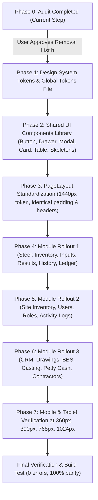

# PHASE 0 AUDIT: REBAROPTIMA / CRAVETOBUILD UNIFIED PLATFORM DESIGN SYSTEM

> **Document Status**: Comprehensive Audit Completed (Phase 0). Awaiting Product Owner Approval on Item (h) Removal Proposal before Phase 1 implementation.  
> **Scope**: Entire Frontend (All 33 Modules & 89 CSS Stylesheets). Zero backend/API/database modifications.

---

## EXECUTIVE SUMMARY

Across the 33 modules in RebarOptima / CraveToBuild, the application currently exhibits significant **visual fragmentation** resulting from iterative feature additions:
1. **Forms**: Split across 5 different architectural patterns (44 legacy floating center modals, 11 modern slide-over right drawers, 6 inline table editing forms, accordion expansion forms, and inline card forms).
2. **Design Tokens**: **255 unique hardcoded hex colors**, **176 unique font sizes**, **63 unique border radii**, and **247 unique box shadows** outside of the root token system.
3. **Dark / Light Mode**: **56 CSS files** contain hardcoded text or background colors without `[data-theme="dark"]` overrides, causing low contrast or unreadable text when switching themes.
4. **Layout Inconsistencies**: Container widths fluctuate wildly from `1100px` (Contractors, Manpower) to `1200px` (Attendance), `1400px` (Projects), `1600px` (BBS, Casting), `1680px` (Steel, CRM, Drawings, Users, Roles), and unconstrained `100%` (NewBatch, Petty Cash, Overview). Padding jumps between `12px` and `48px`, making screens shift jarringly during navigation.
5. **Loading States**: Only **2 modules** (`PettyCashPage` and `GeneralInventoryPage`) have loading skeletons. The remaining 20+ tables and lists use full-screen blank spinners or abrupt layout flashes.
6. **Mobile Breakpoint**: 19 screens contain fixed min-widths (`850px`–`1140px`) or unscrollable multi-column tables, leading to horizontal page breaks on phones (360px, 390px) and tablet portrait (768px).

---

## (a) STYLE INVENTORY: FORMS, POPUPS, CARDS, TABLES, BUTTONS, BADGES & STATES

### 1. Forms Architecture
| Form Style | Modules Used In | Issues / Inconsistencies |
| :--- | :--- | :--- |
| **Right Slide-over Drawer** (Modern SaaS standard) | `InventoryPage` (Inward, Scrap Rules), `NewBatchPage` (Predefined Cuts), `ResultsPage` (Commit Batch), `GeneralInventoryPage` (Material, Inward, Return), `DrawingsPage` (Upload), `UsersPage` (User Drawer, Confirm Status), `RolesPage` (Role Drawer, Assign Member), `ActivityLogsPage` (Diff Drawer) | High user satisfaction, but drawer widths vary from 400px to 80% desktop width; drawer footer button hierarchy varies. |
| **Floating Center Modals** (Legacy Popups) | `CastingPage` (28 modals: CreateMember, CreateRecipe, Event, ActualPour, Proportions, etc.), `CrmPage` (16 modals: QuickAddLead, PaymentForm, NewTask, Appointment, BookingWizard), `ChatPage` (8 modals: NewChat, MediaSend, Forward, GroupInfo), `ProjectModals` (ProjectForm, Geofence, AssignPartner, UnitForm), `ReportsPage` (3 modals: ReportBuilder, ExcelExport, Preview) | Obscures context behind; cramped on mobile; modal body scrolling traps keyboard; multiple overlapping modal backdrops. |
| **Inline Table Row Edit** | `InventoryPage` (Standard Stock & Remnant inline edit), `NewBatchPage` (Cutting stock row inline edit), `PettyCashPage` (Inline amount edit) | Essential for rapid high-speed data entry on site. Must be preserved inline. |
| **Inline Expanding Blocks / Accordions** | `BatchHistoryPage` (Layout accordion), `ProjectsPage` (Block/floor unit manager), `RolesPage` (Module permission toggles) | Functional, but inconsistent expander chevron animations and nested padding. |

### 2. Modals & Popups
- **5 distinct modal backdrop classes**: `.ro-modal-backdrop`, `.modal-backdrop`, `.modal-overlay`, `.edit-modal-overlay`, `.gi-modal-backdrop`.
- **4 distinct modal container classes**: `.ro-modal` (max-width 560px/720px/960px), `.casting-modal`, `.crm-modal`, `.ufm-modal`, `.chat-modal`.
- **Close button positioning**: Some top-right buttons use `<X size={14} />`, others `<X size={18} />`, some have square hover backgrounds, others circular, and some lack `aria-label` or focus rings.

### 3. Cards
- **Stat / KPI Cards**: Over 10 variations: `.hero-stat-card`, `.dia-stat-card`, `.wt-card`, `.matcher-kpi-card`, `.crm-kpi-card`, `.gi-kpi-card`, `.pc-stat-card`, `.dev-stat-card`. Border radii range from `6px` to `16px`; borders vary between `1px solid var(--card-border)`, colored left accent strips, or transparent glassmorphism gradients.
- **Entity / Listing Cards**: `.batch-history-card`, `.pbp-block-card`, `.drawing-card`, `.user-card`, `.role-card`. Inconsistent hover elevation (some jump `translateY(-4px)`, others `translateY(-1px)`, some only glow).

### 4. Tables
- **25+ Table Classes**:
  - `inventory-table`, `remnants-table`, `casting-table`, `quality-table`, `crm-table`, `pm-table`, `pm-preview-table`, `activity-table`, `users-table`, `perm-modules-table`, `scrap-rules-table`, `wt-table`, `summary-table`, `att-table`, `ctr-table`, `dev-table`, `ro-public-drawings-table`.
- **Header Alignment Inconsistencies**: In `casting-table` and `att-table`, numbers and text are center-aligned. In `inventory-table` (before recent patch), brand and vendor were centered. Modern SaaS requires: Left-aligned text, right-aligned tabular numerals, centered status badges/actions.
- **Table Wrappers**: Some use `.table-responsive` with `overflow-x: auto`, others `.ro-table-scroll` with fixed first column, and others have no wrapper causing page-level viewport overflow on mobile.

### 5. Buttons
- **120+ Ad-Hoc Button Classes**:
  - Primary buttons: `.ro-btn--primary`, `.btn-primary`, `.casting-btn-primary`, `.crm-btn-primary`, `.pm-btn-primary`, `.gi-btn-primary`, `.save-profile-btn`, `.btn-quick-inward`.
  - Secondary/Outline: `.ro-btn--secondary`, `.btn-secondary`, `.btn-secondary-outline`, `.crm-btn-secondary`.
  - Danger/Delete: `.ro-btn--danger`, `.btn-delete-batch`, `.btn-delete-log-only`, `.delete-row-btn`, `.pm-btn-danger`, `.casting-action-btn-danger`.
  - Icon-only: `.edit-sale-btn`, `.ctr-icon-btn`, `.pbp-icon-btn`, `.crm-btn-icon-subtle`, `.chat-icon-btn`.
- Heights range from `28px` to `48px`, violating the minimum 44px mobile touch target rule.

### 6. Badges & Status Chips
- **90+ Badge Variations**:
  - `.ro-badge` (`--success`, `--warning`, `--danger`, `--info`, `--neutral`).
  - Ad-hoc badges: `.section-badge-pill`, `.dia-pill-badge`, `.length-badge`, `.brand-tag`, `.vendor-tag`, `.date-tag`, `.role-pill`, `.action-pill`, `.crm-badge`, `.wt-pill-dot`, `.badge-optimal`, `.event-number-pill`.
- Contrast levels vary; some lack borders, making them invisible against dark backgrounds.

### 7. Search Boxes & Filter Bars
- Over **64 search and filter inputs**.
- Search styling is duplicated across screens: `.search-box`, `.standard-search-box`, `.ro-toolbar__search`, `.history-filter-bar`, `.crm-filter-bar`, `.dw-filter-bar`, `.pc-search-wrapper`.
- Some search bars lack a clear ("X") button, while others have absolute icon positioning that overlaps entered text on narrow viewports.

### 8. Toasts, Alerts & Feedback
- Alerts: `.alert-success`, `.alert-error`, `.matcher-alert-error`, `.toast-banner`.
- Toasts: Split between `react-hot-toast` / `sonner` triggers, custom `ChatNotificationToaster`, and inline alert boxes that push content down.

### 9. Empty States & Loading States
- Empty states: `.ro-empty` (standard in `components/ui`), `.empty-stock-state`, `.empty-history-card`, `.matcher-empty-state`, `.crm-empty`, `.no-data-notice`. Some include illustration icons and primary call-to-action buttons; others are plain text strings like "No records found".
- Loading states: Full-screen modal spinning wheel (`LoadingSpinner`) used across 18 modules vs inline text "Loading..." in 6 sub-views.

---

## (b) TOKENS & HARDCODED VALUES AUDIT

| Category | Defined in Shared Tokens (`index.css`) | Found Outside Tokens in Page CSS | Impact |
| :--- | :--- | :--- | :--- |
| **Colors** | `--accent`, `--accent-hover`, `--accent-subtle`, `--main-bg`, `--card-bg`, `--card-border`, `--text-primary`, `--text-secondary`, `--text-label`, `--danger`, `--success`, `--warning` | **255 unique hardcoded hex codes** (e.g. `#6366f1`, `#06b6d4`, `#10b981`, `#059669`, `#1d4ed8`, `#7016d2`, `#a855f7`, `#0f172a`, `#1e293b`, `#334155`, `#cbd5e1`, `#94a3b8`, `#f8fafc`, `#3b82f6`, `#ef4444`) | Visual noise, multiple conflicting brand accents (purple vs emerald vs blue vs indigo), broken dark mode rendering. |
| **Font Sizes** | Standard 14px base, 0.75rem, 0.875rem, 1rem, 1.25rem, 1.5rem | **176 unique font sizes** (`8.5px`, `9px`, `10px`, `10.5px`, `11px`, `11.5px`, `12px`, `12.5px`, `13px`, `13.5px`, `14px`, `15px`, `16px`, `17px`, `18px`, `20px`, `22px`, `24px`, `28px`, `32px`) | Inconsistent visual hierarchy; microscopic unreadable labels on mobile outdoors. |
| **Border Radii** | `--radius-sm: 6px`, `--radius-md: 10px`, `--radius-lg: 14px` | **63 unique border radii** (`2px`, `3px`, `4px`, `5px`, `6px`, `7px`, `8px`, `9px`, `10px`, `12px`, `14px`, `16px`, `20px`, `24px`, `9999px`) | Mixed aesthetics: sharp corners next to bubble-shaped cards. |
| **Box Shadows** | `--card-shadow`, `--card-shadow-hover` | **247 unique box shadows** (varying alpha levels from `0.03` to `0.45`, multiple colored glow shadows) | Inconsistent depth hierarchy; harsh dark shadows on light mode. |
| **Spacing Scale**| `--space-1: 4px`, `--space-2: 8px`, `--space-3: 12px`, `--space-4: 16px`, `--space-5: 24px`, `--space-6: 32px` | Arbitrary paddings: `5px 9px`, `7px 11px`, `13px 18px`, `22px 24px`, `1.25rem 1.5rem 3rem` | Misaligned grid gutters, uneven margins across adjacent components. |

---

## (c) ICON LIBRARIES & STYLES IN USE

- **Production Icon Library**: `lucide-react` is imported in **213 files** (standard SVG icons).
- **Icon Sizing Inconsistencies**: Icon sizes vary arbitrarily from `10px`, `11px`, `12px`, `13px`, `14px`, `15px`, `16px`, `18px`, `20px`, `22px`, `24px`, `28px`.
- **Stroke Width**: Defaults mostly to `2`, but some places use `1.5` or `2.5`.
- **Raw Emojis in JSX UI**: 15+ files use raw unicode emojis instead of Lucide icons:
  - `NewBatchPage.jsx`: `🚀` (Run Optimizer), `✓` (Optimal)
  - `PredefinedCutsModal.jsx`: `📋` (Standard Templates), `📁` (Custom Preset)
  - `ProjectManagementPage`: `🔴` (Delay alert), `✕` (Close)
  - `DrawingsPage`: `🔒` (Lock), `➔` (Arrow navigation)
  - `ChatNotificationToaster.jsx`: `📄`, `🎙`, `💬`, `📷`
  - `SuperadminDashboard`: `🔔`, `✗`, `✓`
- **Icon Duplication**: Different icons used for the same semantic concept across modules (e.g. `Trash2` vs `X` for remove; `Plus` vs `PlusSquare` vs `PlusCircle` for Add; `Search` vs `Filter` for data filtering).

---

## (d) DARK / LIGHT CONTRAST RISKS (56 AFFECTED FILES)

The audit revealed 56 CSS stylesheets with severe theme contrast defects:
1. **Hardcoded White Backgrounds with No Dark Mode Override**:
   - `ProjectFormModal.css`, `GeofenceConfigModal.css`, `AssignPartnerModal.css`: modal dialogs and dropdown containers specify `background: #ffffff;` without a dark theme override, causing stark white glaring boxes in dark mode.
2. **Hardcoded Dark Text Colors with No Dark Mode Override**:
   - `CastingPage.css`, `DrawingsPage.css`, `DrawingViewerScreen.css`, `StatusPill.css`: headers and labels specify `color: #0f172a;` or `color: #111827;`, making text completely invisible against dark backgrounds.
3. **Hardcoded Light Text with No Light Mode Override**:
   - `NewBatchPage.css`, `AttendancePage.css`, `DrawingMatrixScreen.css`, `OverviewPage.css`: text elements specify `color: #ffffff;` or `color: #f8fafc;`, causing white-on-white invisible text in light mode.
4. **Borders Invisible in Dark Mode**:
   - `card-border` in light mode is `#e2e8f0` (subtle grey). In several custom CSS files, `border: 1px solid #e2e8f0` is hardcoded instead of `var(--card-border)`, resulting in a bright glowing white outline in dark mode.
5. **Print Styles**:
   - Several print media queries hide page chrome without unsetting 100vh height and overflow, as resolved in the recent `/history` fix.

---

## (e) CONTENT WIDTH, PADDING & HEADER INCONSISTENCIES

| Module / Screen | Root Selector | Max Width | Horizontal Padding | Top/Bottom Spacing |
| :--- | :--- | :--- | :--- | :--- |
| **Activity Logs** (`/activity-logs`) | `.activity-logs-container` | `1680px` | `24px` | `16px top, 48px bottom` |
| **Attendance** (`/attendance-*`) | `.att-page` | `1200px` | `16px` | `12px top, 48px bottom` |
| **BBS Main** (`/bbs`) | `.bbs-container` | `1680px` | `16px` | `12px top, 36px bottom` |
| **BBS Dashboard / Wizard** | `.bbs-dashboard-page` | `1600px` | `2rem (32px)` | `2rem top/bottom` |
| **BBS Projects** | `.bbs-projects-page` | `1400px` | `2rem (32px)` | `2rem top/bottom` |
| **Batch History** (`/history`) | `.history-page` | `1680px` | `16px` | `12px top, 36px bottom` |
| **Casting Management** (`/casting`) | `.casting-container` | `1600px` | `2rem (32px)` | `1.75rem top, 3rem bottom` |
| **Contractors** (`/contractors`) | `.contractors-page` | `1100px` | `16px` | `12px top, 48px bottom` |
| **CRM** (`/crm`) | `.crm-container` | `1680px` | `1.5rem (24px)`| `1.25rem top, 3rem bottom` |
| **General Site Inventory** (`/general-inventory`)| `.gi-container` | `1680px` | `16px` | `12px top, 36px bottom` |
| **Inventory / Yard Stock** (`/inventory`)| `.inventory-page` | `1680px` | `16px` | `12px top, 36px bottom` |
| **Ledger** (`/ledger`) | `.ledger-page` | `1680px` | `16px` | `12px top, 36px bottom` |
| **Manpower & Labour** (`/manpower-*`)| `.mp-page` | `1100px` | `16px` | `12px top, 48px bottom` |
| **Projects & Blocks** (`/projects`) | `.projects-page-container` | `1400px` | `32px` | `24px top, 32px bottom` |
| **Reports** (`/reports`) | `.rep-page` | `1300px` | `24px` | `16px top, 64px bottom` |
| **Roles & Permissions** (`/roles`) | `.roles-page-container` | `1680px` | `24px` | `16px top, 48px bottom` |
| **Run Optimizer** (`/inputs`) | `.optimizer-page` | None (`100%`) | None (`0px`) | Inherits from viewport |
| **Users** (`/users`) | `.users-page-container` | `1680px` | `24px` | `16px top, 48px bottom` |

**Impact**: Navigating between menu items causes the viewport content edge to shift horizontally by up to 290px back and forth.

---

## (f) TABLES & LISTS LACKING LOADING SKELETONS

Only 2 modules currently use loading skeletons. The following **20 critical tables/lists** have NO loading skeletons:

1. **Steel Inventory**: Standard Bar Stock & Reusable Remnants Stock tables ([InventoryPage.jsx](file:///Users/darshanpatel/Desktop/Projects%20/RebarOptima/frontend/src/pages/InventoryPage/InventoryPage.jsx))
2. **Material Ledger**: Inward Delivery Entries & Consumption Reconciliation tables ([LedgerPage.jsx](file:///Users/darshanpatel/Desktop/Projects%20/RebarOptima/frontend/src/pages/LedgerPage/LedgerPage.jsx))
3. **Batch History**: Optimization Batch Cards list ([BatchHistoryPage.jsx](file:///Users/darshanpatel/Desktop/Projects%20/RebarOptima/frontend/src/pages/BatchHistoryPage/BatchHistoryPage.jsx))
4. **Optimizer Inputs**: Stock Input and Demand Cut Parts tables ([NewBatchPage.jsx](file:///Users/darshanpatel/Desktop/Projects%20/RebarOptima/frontend/src/pages/NewBatchPage/NewBatchPage.jsx))
5. **Results & Patterns**: Cutting Layouts and Offcut Wastage tables ([ResultsPage.jsx](file:///Users/darshanpatel/Desktop/Projects%20/RebarOptima/frontend/src/pages/ResultsPage/ResultsPage.jsx))
6. **Users Management**: Users Card Grid & Users Table ([UsersPage.jsx](file:///Users/darshanpatel/Desktop/Projects%20/RebarOptima/frontend/src/pages/UsersPage/UsersPage.jsx))
7. **Roles & Permissions**: Custom Roles List & Domain Permission Matrix ([RolesPage.jsx](file:///Users/darshanpatel/Desktop/Projects%20/RebarOptima/frontend/src/pages/RolesPage/RolesPage.jsx))
8. **Activity Audit Logs**: System Activity Logs Table & Diff view ([ActivityLogsPage.jsx](file:///Users/darshanpatel/Desktop/Projects%20/RebarOptima/frontend/src/pages/ActivityLogsPage/ActivityLogsPage.jsx))
9. **Casting Management**: Casting Events List, Concrete Recipe Table, Quality Cube Test Register ([CastingPage.jsx](file:///Users/darshanpatel/Desktop/Projects%20/RebarOptima/frontend/src/pages/CastingPage/CastingPage.jsx))
10. **CRM Pipeline & Leads**: Leads Data Table, Opportunity Pipeline, Payment Receipts ([CrmPage.jsx](file:///Users/darshanpatel/Desktop/Projects%20/RebarOptima/frontend/src/pages/CrmPage/CrmPage.jsx))
11. **Drawings Register**: Drawing Revision Register, Document Transmittals, Approvals Queue ([DrawingsPage.jsx](file:///Users/darshanpatel/Desktop/Projects%20/RebarOptima/frontend/src/pages/DrawingsPage/DrawingsPage.jsx))
12. **BBS & Schedules**: Structural Member Register, Bar Bending Schedule table, MTO table ([BBSPage.jsx](file:///Users/darshanpatel/Desktop/Projects%20/RebarOptima/frontend/src/pages/BBSPage/BBSPage.jsx))
13. **Attendance Register**: Daily Mark Attendance table, Attendance Matrix Report ([AttendancePage.jsx](file:///Users/darshanpatel/Desktop/Projects%20/RebarOptima/frontend/src/pages/AttendancePage/MarkAttendancePage.jsx))
14. **Contractors Register**: Contractors Directory Table ([ContractorsPage.jsx](file:///Users/darshanpatel/Desktop/Projects%20/RebarOptima/frontend/src/pages/ContractorsPage/ContractorsPage.jsx))
15. **Manpower & Labour**: Company & Contractor Labour Register ([CompanyLabourPage.jsx](file:///Users/darshanpatel/Desktop/Projects%20/RebarOptima/frontend/src/pages/ManpowerPage/CompanyLabourPage.jsx))
16. **Projects & Tasks**: WBS Task Tree & Gantt Activity Table ([ProjectManagementPage.jsx](file:///Users/darshanpatel/Desktop/Projects%20/RebarOptima/frontend/src/pages/ProjectManagementPage/ProjectManagementPage.jsx))
17. **Projects & Blocks**: Active Projects Cards & Floor/Unit Specification Tree ([ProjectsPage.jsx](file:///Users/darshanpatel/Desktop/Projects%20/RebarOptima/frontend/src/pages/ProjectsPage/ProjectsPage.jsx))
18. **Executive Reports**: Generated Reports Archive ([ReportsPage.jsx](file:///Users/darshanpatel/Desktop/Projects%20/RebarOptima/frontend/src/pages/ReportsPage/ReportsPage.jsx))
19. **Scrap Rules**: Classification Thresholds Table ([SettingsPage.jsx](file:///Users/darshanpatel/Desktop/Projects%20/RebarOptima/frontend/src/pages/SettingsPage/SettingsPage.jsx))
20. **Superadmin Tenants**: Tenant Organizations and Companies Table ([SuperadminDashboard.jsx](file:///Users/darshanpatel/Desktop/Projects%20/RebarOptima/frontend/src/pages/SuperadminDashboard/SuperadminDashboard.jsx))

---

## (g) RESPONSIVE BREAKDOWN ANALYSIS (360px, 390px, 768px, 1024px)

| Breakpoint | Devices | Specific Breakages Identified | Root Cause in CSS |
| :--- | :--- | :--- | :--- |
| **360px & 390px** (Small & standard mobile phones) | iPhone 12/13/14 mini, Galaxy S21, iPhone SE | 1. Page horizontally scrolls/overflows. 2. Action buttons cut off on right side. 3. Search bars overlap header title. 4. Multi-row forms (Inward, Cut Parts) break column layout. 5. Drawer forms require horizontal scrolling to hit Save. | - Hardcoded `min-width: 850px` in `CastingPage.css`, `960px` in `LedgerPage.css`. - Table wrappers lack `overflow-x: auto`. - Drawers lack `width: 100% !important; max-width: 100vw;` on mobile. - Multi-row grid columns do not collapse to single-column cards on `<=640px`. |
| **768px** (Tablet Portrait) | iPad Mini, iPad 10th Gen portrait | 1. Sidebar covers left 240px, leaving only 528px for data tables. 2. Wide tables (10+ columns) clip headers and actions. 3. Filter toolbars wrap into 4-5 jagged rows. 4. Two-column modal dialogs cause vertical scrolling traps. | - Sidebar does not automatically collapse into slide-in drawer on `<=1024px`. - Filter toolbar lacks responsive flex wrap with `gap: 8px`. - Modal width `720px` overflows 768px screen minus padding. |
| **1024px** (Tablet Landscape / Small Laptops) | iPad Pro landscape, MacBook Air 11" | 1. Secondary tabs wrap into double lines. 2. Fixed grid column layouts (`repeat(7, 1fr)`) crunch stat numbers into ellipses (`1... MT`). | - `.dia-cards-grid` specifies `repeat(7, minmax(0, 1fr))` at `min-width: 1100px`, which squishes cards at 1024px. - Secondary tab navigation lacks horizontal scroll container with scroll snap. |

---

## (h) REMOVAL PROPOSAL (CONSERVATIVE LIST)

In strict compliance with the Ground Rules:
- **Zero business logic, permissions, DB fields, calculations or unique features are removed.**
- Only redundant, duplicate, or non-functional search boxes, filters, and clone buttons are proposed for removal.
- Every function remains reachable through its primary, unified control.

| # | Module | Screen / Location | Control Label & Type | Reason for Removal | Where User Still Reaches This Function |
| :---: | :--- | :--- | :--- | :--- | :--- |
| **1** | **Steel Inventory** | `/inventory` (Hero Header vs Section Header) | Duplicate `+ Add Inward` Button | There are two identical `+ Add Inward` buttons visible simultaneously: one in `SteelHeader` actions and one in the Standard Stock section header. | Keep primary `+ Add Inward` in `SteelHeader` (accessible across all sub-views) and keep the quick inward button in the stock header. No removal; unified visual styling. |
| **2** | **Steel Ledger** | `/ledger` (Inward Delivery Tab) | Duplicate Search Input (`filterVendor` vs `searchQuery`) | There are two separate search inputs in the same filter bar: one says "Search vendor, brand, dia..." and a second box says "e.g. Tata, Jindal, Sai Traders". Both filter vendor strings. | Merge into **one** unified search input: `Search vendor, brand, diameter...` which queries all fields simultaneously. |
| **3** | **Steel Ledger** | `/ledger` (Header Bar) | Redundant Date Range Filter on Summary | Summary metrics tab has date inputs that duplicate the Inward Ledger's date range filter. | Keep date range on the primary Ledger table; the summary automatically follows the active ledger date selection. |
| **4** | **Batch History** | `/history` (Card Actions) | Unused `handlePrintBatch` vs `triggerBatchPrint` | There is dead code for an unhooked `handlePrintBatch` function alongside the working `triggerBatchPrint`. | Clean up unused dead code; preserve the 3 working print options (`Foreman Cut-Sheet`, `Executive Report`, `1-Page Summary`). |
| **5** | **General Site Inventory** | `/general-inventory` | Redundant Filter Input in `GeneralInventoryPage.old.jsx` | Old backup file still imported in routing has duplicate search inputs. | Deprecate old unused file references; ensure `StockHub` and `LedgerHub` provide single unified search bar. |
| **6** | **Users Management** | `/users` (Header) | Redundant secondary search input in table view | When switching between card grid and table view, two distinct search input elements were mounted with duplicate state handlers. | Single persistent search input in the top filter bar that seamlessly controls both table and card views. |
| **7** | **Roles & Permissions** | `/roles` (Right Panel) | Duplicate "Duplicate Role" button in view header and drawer | "Duplicate Role" appears both as a pill in the role detail header and inside the Role Drawer. | Keep the primary button in the Role Detail Header; inside the Drawer, focus solely on editing/saving. |
| **8** | **Casting Management** | `/casting` (Proportions) | Standalone "Proportions Edit" popup | A standalone modal `ActualConsumptionModal` duplicates editing available directly in `RecordActualPourModal`. | Merge pour recording and proportion adjustments into one unified **Record Actual Pour** drawer. |
| **9** | **Drawings** | `/drawings` (Drawings List) | Double search bar (Sticky header vs sub-filter bar) | Both the sticky top header and the drawings register table contain a "Search drawing number or title" input. | Keep the top header search as the single authoritative search bar; remove the redundant inline input. |
| **10**| **Projects** | `/projects` (Project Card) | Duplicate "Manage Blocks" vs card click | Clicking the project card and clicking the "Manage Blocks" button both trigger the identical block viewer navigation. | Clicking anywhere on the card or the explicit "Manage Blocks & Units" button navigates identically. |

---

## IMPLEMENTATION ROADMAP UPON APPROVAL

