# RebarOptima — Complete Product & Feature Flow Guide

> **Enterprise Construction ERP, 1D Cutting Stock Optimization, Bar Bending Schedule (BBS), Precast Casting, and Real Estate Management Platform**

---

## 📑 Table of Contents

1. [Product Overview & Executive Summary](#1-product-overview--executive-summary)
   - [1.1 The Core Problem in Construction](#11-the-core-problem-in-construction)
   - [1.2 The RebarOptima Solution](#12-the-rebaroptima-solution)
   - [1.3 Target Audience & Key User Personas](#13-target-audience--key-user-personas)
2. [High-Level System Architecture](#2-high-level-system-architecture)
   - [2.1 Architectural Flow Diagram](#21-architectural-flow-diagram)
   - [2.2 Project-First Multi-Tenant Data Model](#22-project-first-multi-tenant-data-model)
   - [2.3 Technology Stack Breakdown](#23-technology-stack-breakdown)
3. [Global Project Lifecycle & User Journey](#3-global-project-lifecycle--user-journey)
   - [3.1 Sign-Up to Project Provisioning Flow](#31-sign-up-to-project-provisioning-flow)
   - [3.2 The Project-First Gatekeeper & Active Project Context](#32-the-project-first-gatekeeper--active-project-context)
   - [3.3 Navigation & Breadcrumb System](#33-navigation--breadcrumb-system)
4. [Deep Dive: Feature-by-Feature Operational Flows](#4-deep-dive-feature-by-feature-operational-flows)
   - [Feature 1: 1D Cutting Stock Problem (1D-CSP) Optimizer](#feature-1-1d-cutting-stock-problem-1d-csp-optimizer)
   - [Feature 2: Steel Inventory, Remnants & Procurement Ledger](#feature-2-steel-inventory-remnants--procurement-ledger)
   - [Feature 3: Bar Bending Schedule (BBS) & Shape Deduction Engine](#feature-3-bar-bending-schedule-bbs--shape-deduction-engine)
   - [Feature 4: Precast & In-Situ Casting Management](#feature-4-precast--in-situ-casting-management)
   - [Feature 5: Site Inventory / General Inventory (GI)](#feature-5-site-inventory--general-inventory-gi)
   - [Feature 6: Real Estate CRM & Unit Sales](#feature-6-real-estate-crm--unit-sales)
   - [Feature 7: Project & Task Management (CPM Scheduling)](#feature-7-project--task-management-cpm-scheduling)
   - [Feature 8: Structural Drawings & Document Transmittals](#feature-8-structural-drawings--document-transmittals)
   - [Feature 9: Site Petty Cash & Expense Management](#feature-9-site-petty-cash--expense-management)
   - [Feature 10: Role-Based Access Control (RBAC) & Tenant Settings](#feature-10-role-based-access-control-rbac--tenant-settings)
5. [End-to-End Workflow Integration: A Real Construction Story](#5-end-to-end-workflow-integration-a-real-construction-story)
6. [Data Safety, Maker-Checker Gates & Production Invariants](#6-data-safety-maker-checker-gates--production-invariants)
7. [Glossary of Industry & Engineering Terms](#7-glossary-of-industry--engineering-terms)

---

# 1. Product Overview & Executive Summary

### 1.1 The Core Problem in Construction
In structural construction, **steel reinforcement (rebar)** represents 15% to 25% of total project expenditure. Steel mills produce and deliver standard straight bars in fixed stock lengths (standard **12,000 mm / 12 meters**). 

However, structural drawings require hundreds of varying cut lengths (e.g., $2,450\text{ mm}$, $4,120\text{ mm}$, $850\text{ mm}$) to build beams, columns, slabs, and footings.

When steel fabricators cut bars manually on site without mathematical planning:
- They cut pieces haphazardly, generating off-cuts between $500\text{ mm}$ and $3,000\text{ mm}$.
- These valuable pieces are abandoned as scrap or sold to scrap merchants at 80% below procurement value.
- Typical construction scrap ranges from **8% to 15%**, wasting tens of thousands of dollars per building.
- Furthermore, site teams lack real-time visibility into concrete pours, material deliveries, drawings revisions, and project task schedules.

### 1.2 The RebarOptima Solution
**RebarOptima** is an enterprise-grade cloud ERP designed specifically for civil engineers, contractors, fabricators, and project managers. 

It solves this industry dilemma by integrating:
1. **Mathematical Cutting Stock Optimization (1D-CSP)** using the First Fit Decreasing (FFD) heuristic to push steel utilization above **98%**, saving tons of steel per project.
2. **Automated Remnant Recycling**: Classifies off-cuts by minimum length thresholds; usable pieces are automatically saved to warehouse stock and prioritized for future cutting jobs.
3. **Bar Bending Schedule (BBS) Engine**: 50+ standard CAD shape templates (compliant with IS 2502 and BS 8666) with automated bend deductions and seamless one-click handoff to the cutting optimizer.
4. **Casting & Pour Lifecycle Tracking**: Concrete mix designs, multi-stage pour inspections, maker-checker stock consumption gates, curing logs, and compressive strength cube testing (7, 14, 28 days).
5. **Project-First Site Operations**: Site inventory, real estate CRM unit sales, CPM critical path scheduling, revision-controlled engineering drawings, and site petty cash vouchers.

---

### 1.3 Target Audience & Key User Personas

| Persona | Typical Role | Core Needs in RebarOptima |
| :--- | :--- | :--- |
| **Site Engineer / Detailer** | Prepares BBS and oversees daily fabrication. | Quick CAD shape selection, bend deductions, and one-click transfer to cutting optimizer. |
| **Shop-Floor Machine Operator** | Operates bar shears and bending machines. | Clear, high-contrast, visual cutting tickets with bar segment millimeter dimensions. |
| **Store & Yard Manager** | Manages warehouse steel, cement, tools, and consumables. | Inward delivery vouchers (GRN), remnant off-cut categorization, inter-store transfers, and scrap sales records. |
| **Project Manager / Checker** | Supervises timeline, costs, and quality. | Maker-checker approvals for concrete pours and petty cash, CPM critical path task schedules, and delay alerts. |
| **Real Estate Sales Team** | Sells residential / commercial units. | Lead pipeline, site visit booking, construction-linked payment milestones, and unit availability matrices. |
| **Executive / Founder / Owner** | High-level company oversight. | Overall financial scrap loss vs. revenue recovery, multi-project progress, and tenant user administration. |

---

# 2. High-Level System Architecture

RebarOptima is structured as a **modular monorepo** with a clean separation of concerns:
- **Frontend**: Single Page Application (SPA) built with React, Vite, Redux Toolkit, and standard industrial CSS tokens.
- **Backend**: Enterprise REST API built on NestJS / Express, structured by functional domain modules.
- **Database**: MongoDB with Mongoose object modeling, enforcing strict multi-tenant and project-first data isolation.

### 2.1 Architectural Flow Diagram

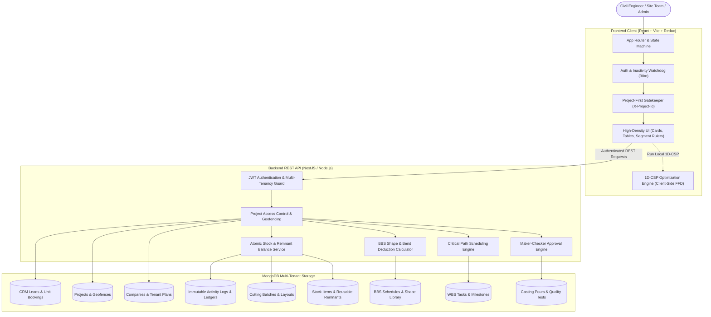

---

### 2.2 Project-First Multi-Tenant Data Model

Every single piece of business data in RebarOptima follows a strict **Two-Tier Scoping Hierarchy**:

1. **Company Scope (`companyId`)**: All data belongs to a tenant organization. Users from Company A can never view or modify records from Company B.
2. **Project Scope (`projectId`)**: Within a company, operational data is locked to a specific physical construction project (e.g., "Skyline Tower", "Metro Rail Flyover").
   - Requests to project-scoped endpoints must supply the active project ID in the HTTP header: `X-Project-Id: <id>`.
   - The backend checks whether the authenticated user is explicitly authorized to access that project.
   - Company Admins and Owners can access all company projects.
   - Sub-contractors or site teams assigned the `PROJECT_PARTNER_ADMIN` role only see the project assigned to them, keeping company-wide financial, CRM, and setting details private.

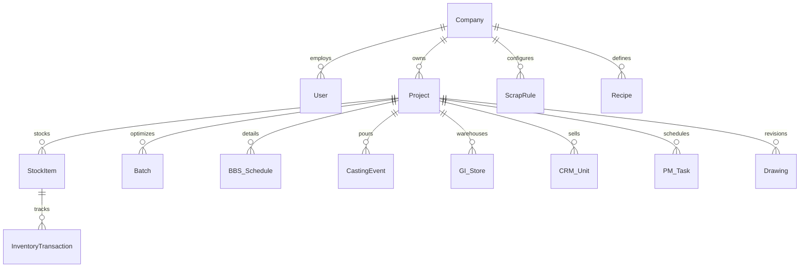

---

### 2.3 Technology Stack Breakdown

| Layer | Technology | Primary Function |
| :--- | :--- | :--- |
| **Frontend Framework** | React 18 + Vite | Blazing fast client rendering, reactive UI updates. |
| **State Management** | Redux Toolkit | Central store for Auth, Permissions, Project Context, and Navigation. |
| **Styling & Tokens** | Pure Vanilla CSS & CSS Variables | Industrial engineering aesthetic with 3 switchable palettes (Slate Emerald, Steel Blue, Classic Purple) and dark/light modes. |
| **Vector Visuals** | SVG & Canvas | Bar cutting segment rulers, CAD shape geometry diagrams, scrap trend graphs. |
| **Backend Runtime** | Node.js + NestJS / Express | Enterprise modular micro-architecture with TypeScript typings. |
| **Database** | MongoDB + Mongoose | Highly flexible document storage supporting complex nested BBS schedules and inventory ledgers. |
| **Report Generation** | `html2pdf.js`, SheetJS (XLSX) | Shop-floor cutting tickets, executive PDF summaries, and spreadsheet exports. |

---

# 3. Global Project Lifecycle & User Journey

### 3.1 Sign-Up to Project Provisioning Flow

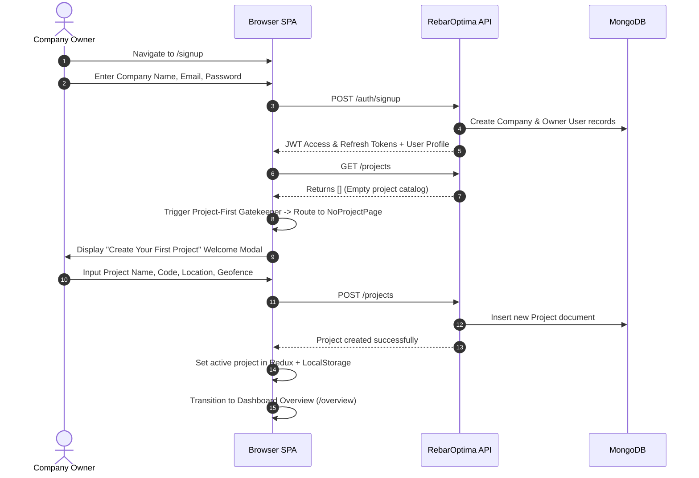

### 3.2 The Project-First Gatekeeper & Active Project Context
To prevent data contamination and accidental writes to wrong construction sites:
1. **The Guard**: Whenever an authenticated user opens RebarOptima, the frontend checks if an active project is selected.
2. **Zero Project State**: If the company has no projects, all core functional modules are locked behind `NoProjectPage`, which prompts the user to create a project first.
3. **Project Switcher**: The sidebar includes an interactive dropdown selector (`ProjectSelector.jsx`). Switching projects instantly:
   - Updates the active project in Redux.
   - Synchronizes `X-Project-Id` on all subsequent API calls.
   - Clears stale client-side caches and reloads data scoped exclusively to the selected project.
4. **Session Timeout Protection**: An automatic activity listener monitors mouse clicks, keypresses, and scrolling. If no activity is detected for 30 minutes, the session is cleared and the user is redirected to the sign-in screen for security.

### 3.3 Navigation & Breadcrumb System
The sidebar navigation groups modules logically for construction teams:
- **Dashboard Overview**: 6 high-level KPI cards, diawise stock distribution, and 30-day scrap trends.
- **Projects Catalog**: Project listings, partner assignments, and geofence GPS coordinates.
- **Steel Group (Accordion)**:
  - *Inventory*: Live stock bars, remnants, inward vouchers, scrap sales.
  - *Ledger & Procurement*: Immutable double-entry transaction log.
  - *Run Optimizer*: The 1D-CSP cutting layout calculation engine.
  - *Batch History*: Historical cut jobs, re-usable cutting tickets, and reprints.
- **BBS (Bar Bending Schedule)**: Structural elements, shape library, bend deductions, optimizer handoff.
- **Casting Management**: Concrete mix designs, pour schedules, maker-checker inventory consumption, curing, cube tests.
- **Site Inventory**: General inventory (cement, sand, aggregate, tools, safety gear, store transfers).
- **Real Estate CRM**: Units catalog, lead pipeline, site visits, booking agreements, installment payments.
- **Projects & Tasks (PM)**: WBS milestones, Gantt charts, and Critical Path Method (CPM) calculations.
- **Drawing & Files**: Discipline categorization (Architectural, Structural, MEP), revision tracking, and transmittals.
- **Petty Cash**: Site cash floats, micro-expense vouchers, maker-checker approvals.
- **Administration**: User profiles, custom role permissions (RBAC), and company settings.

---

# 4. Deep Dive: Feature-by-Feature Operational Flows

---

## Feature 1: 1D Cutting Stock Problem (1D-CSP) Optimizer

The core engine of RebarOptima that eliminates rebar scrap.


### How It Works (Step-by-Step)
1. **Input Stage (`NewBatchPage.jsx`)**:
   - The user selects the rebar diameter (e.g., $16\text{ mm}$).
   - The system automatically queries the live database and loads all available standard bars and existing remnant offcuts for that diameter.
   - The user enters required cut lengths and quantities (e.g., 50 pcs of $3,200\text{ mm}$, 30 pcs of $1,850\text{ mm}$).
   - Users can paste data directly from Excel or upload a CSV file.
   - The user adjusts the **Saw Blade Kerf** (e.g., $3\text{ mm}$ deducted per cut) and **End Trim Margin** (e.g., $50\text{ mm}$ discarded off mill-damaged bar ends).
2. **Algorithmic Execution (`optimizer.js`)**:
   - The engine expands all requested quantities into individual cut pieces and sorts them in descending order (longest cuts first).
   - **Remnant Priority**: The algorithm attempts to fit cuts into existing warehouse remnants first to clear old off-cuts.
   - **First Fit Decreasing (FFD)**: Pieces are packed into available stock bars. If a bar runs out of remaining capacity, the next stock bar is utilized.
   - **Virtual Bar Generation**: If the job requires more steel than what exists in the warehouse, the algorithm automatically creates "Virtual Stock Bars" (highlighted in red). This guarantees the estimator still gets a complete, mathematically optimal cutting plan and knows exactly how many additional standard bars to purchase.
3. **Results & Visual Inspection (`ResultsPage.jsx`)**:
   - **Visual Segment Ruler**: Each unique cutting pattern is drawn as a proportional horizontal bar. Each cut piece is rendered in a distinct color with its length stamped in millimeters.
   - **Remnant vs. Scrap Classification**: The remaining piece at the end of each bar is evaluated against the diameter's Scrap Rule:
     - If remaining length $\ge$ threshold (e.g., $\ge 1,500\text{ mm}$ for $16\text{ mm}$ bar): tagged as **Reusable Remnant** (green badge).
     - If remaining length $<$ threshold: tagged as **Scrap** (red badge).
4. **Saving to Database**:
   - Clicking "Save Batch to Database" executes atomic backend transactions:
     - Deducts consumed standard bars and remnants from inventory.
     - Adds newly created reusable remnants to the warehouse with their exact lengths.
     - Logs cumulative scrap weight to historical analytics.
5. **Print & Export**:
   - **Workshop Cutting Ticket**: High-contrast, black-and-white printable card handed directly to machine operators at the cutting bench.
   - **Foreman View**: Complete segment breakdown with remnant collection tags.
   - **Executive Summary PDF**: Tonnage, yield percentage, and financial loss metrics.

---

## Feature 2: Steel Inventory, Remnants & Procurement Ledger

Tracks physical steel deliveries, remnant off-cut stacks, scrap sales, and immutable stock ledgers.

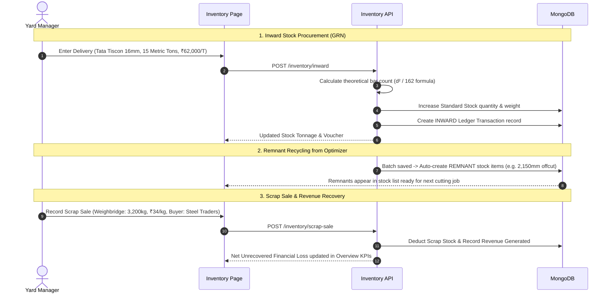

### Key Sub-Modules
- **Stock List**: Dual-view table segregating Virgin 12m Bars vs Reusable Remnant pieces. Remnants are filterable by length brackets ($<1\text{m}$, $1\text{--}3\text{m}$, $>3\text{m}$).
- **Inward Stock Voucher (GRN)**: Records incoming steel trucks, vendor names, brand, heat numbers, mill test certificates, price per ton, and GST. Auto-computes bar counts using the universal formula:
  $$\text{Unit Weight } (kg/m) = \frac{\text{Diameter}^2}{162}$$
- **Scrap Rules Configuration**: Customizable minimum length threshold per diameter (e.g., $8\text{ mm} \rightarrow 800\text{ mm}$, $20\text{ mm} \rightarrow 1,800\text{ mm}$, $32\text{ mm} \rightarrow 2,500\text{ mm}$).
- **Scrap Sales Portal**: Weighbridge ticket entries recording scrap sold and revenue recovered.
- **Inventory Ledger**: An immutable, tamper-proof journal recording every inward delivery, cutting consumption, remnant return, and scrap sale with running balance stamps.

---

## Feature 3: Bar Bending Schedule (BBS) & Shape Deduction Engine

Translates architectural/structural drawings into fabrication-ready rebar schedules.

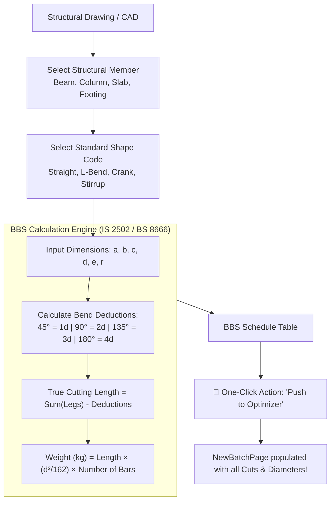

### Key Capabilities
- **Standard Shape Library**: Over 50 standard shapes including straight bars, U-bars, cranks, column ties, helical spirals, and diamond stirrups.
- **Interactive SVG Renderer**: Real-time parametric visualization showing leg letters ($a, b, c, d$), hook extensions, and bend radii.
- **Bend Deduction Accuracy**: When rebar is bent around a mandrel, the steel stretches along its outer radius. If fabricators cut the gross sum of dimensions, the bent bar will be oversized and collide with formwork. RebarOptima deducts exact standard bend allowances automatically.
- **One-Click Handoff to Optimizer**: Eliminates manual data reentry. Clicking "Push to Optimizer" instantly transfers the calculated cutting lengths, bar counts, and diameters directly into `NewBatchPage` for mathematical nesting.

---

## Feature 4: Precast & In-Situ Casting Management

Controls the lifecycle of concrete pours, structural member casting, and quality assurance.

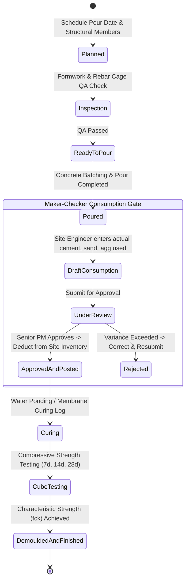

### Critical Sub-Modules & Quality Safeguards
- **Mix Design Recipes**: Pre-configured recipes (e.g., M25, M30, M40, M50) specifying required cement (bags), sand (ton/cft), aggregate (ton/cft), water (liters), and plasticizers per cubic meter ($m^3$).
- **Maker-Checker Consumption Gate**:
  - Site engineers cannot unilaterally modify warehouse inventory.
  - The site engineer (Maker) enters actual materials consumed. The system displays theoretical vs. actual variance.
  - The Project Manager (Checker) reviews the variance. Upon approval, stock is atomically deducted from site inventory.
- **Cube Testing & Compressive Strength QA**:
  - Concrete test cubes ($150\text{ mm} \times 150\text{ mm} \times 150\text{ mm}$) are tracked at 7, 14, and 28-day intervals.
  - Records crushing machine load ($kN$) and computes compressive strength ($N/mm^2$).
  - Automatic validation against target design strength ($f_{ck}$) with non-conformance alerts.

---

## Feature 5: Site Inventory / General Inventory (GI)

A full warehouse management system for all non-rebar materials, tools, and consumables.

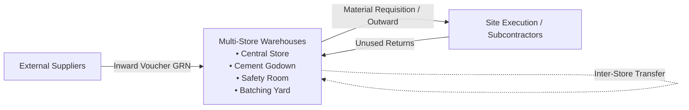

### Core Operations
1. **Multi-Store Segmentation**: Organizes site materials into physical locations (Central Store, Cement Godown, Batching Plant Store, Safety & Consumables Room, Mechanical Yard).
2. **Materials Catalog**: Tracks Cement (OPC 43/53, PPC), Sand, Aggregates (10mm, 20mm, 40mm), Chemical Admixtures, Binding Wire, Plywood, Shuttering Oil, Power Tools, and PPE.
3. **Goods Received Note (GRN)**: Inward recording with vehicle number, PO number, delivery challan, received quantity, and rejection count.
4. **Outward Issue Slip**: Material issuance tagged to specific structural elements, subcontractors, and site supervisors.
5. **Reorder & Safety Stock Alerts**: Automatically triggers visual warnings when cement bags or fuel levels fall below minimum safety thresholds.

---

## Feature 6: Real Estate CRM & Unit Sales

Empowers developer firms to manage buyer inquiries, inventory availability, and sales agreements.

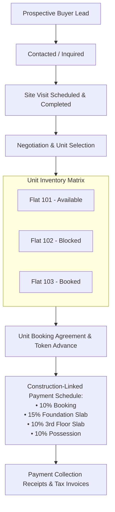

### Key Capabilities
- **Unit Inventory Matrix**: Interactive visual grid of building floors and units (Flats, Offices, Shops, Villas). Displays area (Carpet, Built-up, Super built-up), orientation, base rate, and live status (Available, Blocked, Booked, Registered, Sold).
- **Price Sheet Calculator**: Automatically computes Total Consideration including Base Price, Floor Rise, Preferential Location Charges (PLC), Car Parking, Club Membership, GST, and Stamp Duty.
- **Construction-Linked Payment Plans (CLP)**: Automatically triggers installment demand letters to buyers when the civil team completes corresponding construction milestones.

---

## Feature 7: Project & Task Management (CPM Scheduling)

Enterprise schedule planning with the Critical Path Method (CPM) to prevent construction delays.

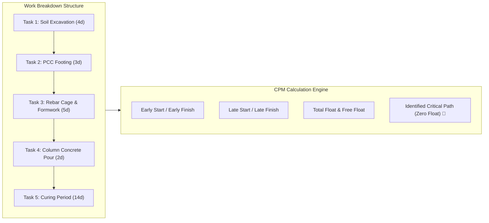

### Key Capabilities
- **CPM Calculation Engine (`pm.cpm.engine.ts`)**:
  - Implements standard forward-pass and backward-pass graph algorithms.
  - Computes Early Start ($ES$), Early Finish ($EF$), Late Start ($LS$), Late Finish ($LF$), and Total Float ($TF$).
  - Automatically highlights **Critical Path Tasks**: activities with zero float where any delay directly delays project handover.
- **Interactive Gantt & Kanban**: Visual timelines, task dependencies (Finish-to-Start, Start-to-Start), milestone completion flags, and progress sliders.

---

## Feature 8: Structural Drawings & Document Transmittals

Eliminates the #1 cause of site rework: teams building from obsolete or superseded drawings.

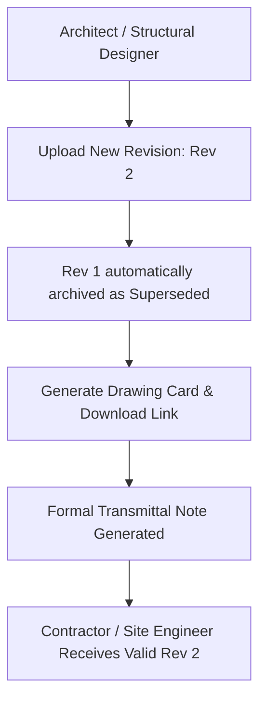

### Key Capabilities
- **Discipline Categorization**: Architectural, Structural, Civil / Foundations, MEP (Mechanical, Electrical, Plumbing), Fire Safety, and As-Built drawings.
- **Strict Revision Control**: When `Rev 2` is released, `Rev 1` is visually watermarked as **SUPERSEDED** to prevent accidental site execution.
- **Formal Transmittals**: Digital records documenting who sent which drawing, to which contractor, on what date, and for what purpose (For Review, For Approval, For Construction).

---

## Feature 9: Site Petty Cash & Expense Management

Provides on-site cash floats for micro-purchases with fraud-prevention controls.

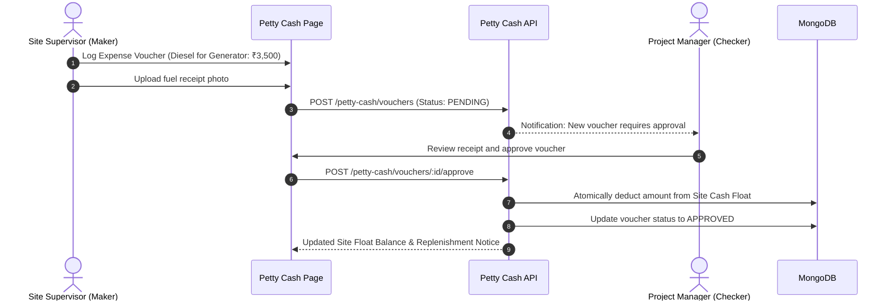

---

## Feature 10: Role-Based Access Control (RBAC) & Tenant Settings

Protects enterprise data and provides custom authorization matrices for every user.

```
┌──────────────────────────┬───────┬───────┬─────────┬──────────┬──────────┬────────┐
│ Module / Action          │ OWNER │ ADMIN │ PARTNER │ ENGINEER │ OPERATOR │ VIEWER │
├──────────────────────────┼───────┼───────┼─────────┼──────────┼──────────┼────────┤
│ Dashboard Overview       │   ✅  │   ✅  │    ✅   │    ✅    │    ✅    │   ✅   │
│ Projects Catalog         │   ✅  │   ✅  │  Assigned│  Assigned│  Assigned│Assigned│
│ Steel Cutting Optimizer  │   ✅  │   ✅  │    ✅   │    ✅    │    ✅    │  View  │
│ Steel Inventory & Ledger │   ✅  │   ✅  │    ✅   │    ✅    │   View   │  View  │
│ Bar Bending Schedule(BBS)│   ✅  │   ✅  │    ✅   │    ✅    │   View   │  View  │
│ Casting Maker (Draft)    │   ✅  │   ✅  │    ✅   │    ✅    │    ❌    │   ❌   │
│ Casting Checker (Approve)│   ✅  │   ✅  │    ❌   │    ❌    │    ❌    │   ❌   │
│ Site / General Inventory │   ✅  │   ✅  │    ❌   │    ✅    │    ❌    │  View  │
│ Real Estate CRM          │   ✅  │   ✅  │    ❌   │    ❌    │    ❌    │   ❌   │
│ Project & Tasks (PM)     │   ✅  │   ✅  │    ✅   │    ✅    │   Tasks  │  View  │
│ Drawing Management       │   ✅  │   ✅  │    ✅   │    ✅    │   View   │  View  │
│ Petty Cash Approval      │   ✅  │   ✅  │    ❌   │    ❌    │    ❌    │   ❌   │
│ User & Role Admin        │   ✅  │   ✅  │    ❌   │    ❌    │    ❌    │   ❌   │
│ Company Settings         │   ✅  │   ✅  │    ❌   │    ❌    │    ❌    │   ❌   │
└──────────────────────────┴───────┴───────┴─────────┴──────────┴──────────┴────────┘
```

---

# 5. End-to-End Workflow Integration: A Real Construction Story

To see how all modules work together harmoniously, let's follow the construction of **Level 3 Slabs & Columns** in a high-rise building project:

```
[1. Structural Drawings]
Architect uploads Rev 2 Column & Slab Drawings -> Formal Transmittal issued to site.
       │
       ▼
[2. Bar Bending Schedule (BBS)]
Site Engineer details 16mm Column rebars and 10mm Slab stirrups -> 
Engine calculates bend deductions -> Clicks "Push to Optimizer".
       │
       ▼
[3. Steel Optimization & Cutting]
Optimizer loads live 12m steel stock -> Prioritizes warehouse remnants ->
Computes cutting layouts with 98.4% yield -> Prints Workshop Cutting Tickets.
       │
       ▼
[4. Inventory Deduction & Remnant Generation]
Batch saved to database -> Standard 12m stock deducted -> 
Newly created reusable offcuts saved to warehouse -> Scrap recorded.
       │
       ▼
[5. Casting Preparation & Pour]
Rebar cages installed -> Site Engineer selects M30 Concrete Recipe ->
Concrete poured -> Site Engineer enters consumed cement & aggregate (Maker).
       │
       ▼
[6. Maker-Checker Approval]
Project Manager reviews actual vs. theoretical concrete variance ->
Approves consumption -> Site inventory balances atomically updated.
       │
       ▼
[7. Concrete Quality Control]
Concrete cubes tested at 7, 14, and 28 days -> Crushing load verifies M30 strength.
       │
       ▼
[8. CPM Task Update & CRM Billing]
Level 3 Slab task marked complete in CPM Schedule -> 
Real Estate CRM automatically generates Level 3 Slab Installment Demand Notices to buyers!
```

---

# 6. Data Safety, Maker-Checker Gates & Production Invariants

RebarOptima enforces strict architectural safety rules to protect business continuity:

1. **Non-Destructive Inventory Operations**:
   - Stock cannot be deleted; adjustments are recorded as new compensating transactions.
   - Every modification has a permanent voucher reference, timestamp, and user signature.
2. **Maker-Checker Segregation**:
   - The user who drafts a concrete consumption record or petty cash voucher cannot approve their own submission. An independent Checker (PM/Admin) must approve it.
3. **Posting Idempotency Protection**:
   - Network timeouts or double-clicking approval buttons can never create duplicate stock deductions. Requests contain unique idempotency keys.
4. **Insufficient Stock Rollback**:
   - If an approved pour demands more cement bags than exist in warehouse inventory, the entire transaction is rolled back with an explanatory error. Partial or negative stock balances are strictly blocked.
5. **Atomic Reversal Engine**:
   - If an approved transaction is subsequently voided due to site error, a 100% compensating reversal transaction is generated, preserving the historical audit trail.

---

# 7. Glossary of Industry & Engineering Terms

- **1D-CSP (One-Dimensional Cutting Stock Problem)**: The mathematical problem of cutting standard lengths of material (such as 12m rebar) into required smaller lengths while minimizing scrap off-cuts.
- **BBS (Bar Bending Schedule)**: A detailed structural schedule listing rebar bar marks, diameters, shapes, bending dimensions, cut lengths, and total weight.
- **Bend Deduction**: The reduction subtracted from a rebar's nominal cut length to compensate for the physical stretching of the steel bar during bending.
- **CPM (Critical Path Method)**: A mathematical scheduling algorithm that identifies the sequence of dependent tasks that directly dictates the overall project completion date.
- **FFD (First Fit Decreasing)**: A greedy heuristic algorithm that sorts parts from longest to shortest and packs each piece into the first available container that has sufficient space.
- **GRN (Goods Received Note)**: A formal site receipt confirming the delivery, inspection, and acceptance of incoming materials.
- **Kerf**: The thickness of material removed by the cutting tool or saw blade on every cut (typically $2\text{ to }5\text{ mm}$).
- **Maker-Checker**: A dual-authorization workflow where one person creates an entry (Maker) and a different authorized supervisor approves it (Checker) before it affects system state.
- **PLC (Preferential Location Charges)**: An additional premium charged on real estate units with premium views (e.g. corner flats, park-facing, pool-facing).
- **Remnant**: An off-cut piece that is long enough to meet the minimum threshold for reuse in future cutting jobs.
- **Scrap**: A small off-cut that is too short for structural reuse, destined for recycling or scrap sale.
- **Virtual Stock**: A simulated stock bar generated by the optimization algorithm when requested parts exceed available physical stock, informing estimators of the exact additional material required.
- **WBS (Work Breakdown Structure)**: A hierarchical decomposition of the total project scope into distinct phases, deliverables, and tasks.

---

*Document Version 1.0 — RebarOptima Engineering & Product Architecture*

