# 🏢 Real Estate CRM & Property Inventory — Full Architecture, Data Model & UX Blueprint

> **System:** RebarOptima / CraveToBuild Enterprise Suite  
> **Module:** Sales & Operations → Real Estate CRM (`CrmPage`)  
> **Route:** `/crm`  
> **Target Audience:** Non-Technical Founders, Real Estate Sales Directors, UI/UX Product Designers, Frontend Engineers, Full-Stack Developers, and QA Engineers.  
> **Version:** 1.0 (Production-Verified Architecture & UI Specification)  
> **Companion Codebase Files:**  
> - Frontend Master Hub: [`frontend/src/pages/CrmPage/CrmPage.jsx`](file:///Users/darshanpatel/Desktop/Projects%20/RebarOptima/frontend/src/pages/CrmPage/CrmPage.jsx)  
> - Stylesheet: [`frontend/src/pages/CrmPage/CrmPage.css`](file:///Users/darshanpatel/Desktop/Projects%20/RebarOptima/frontend/src/pages/CrmPage/CrmPage.css)  
> - API Client Adapter: [`frontend/src/utils/crmApi.js`](file:///Users/darshanpatel/Desktop/Projects%20/RebarOptima/frontend/src/utils/crmApi.js)  
> - Domain Types & Interfaces: [`backend/src/crm/crm.types.ts`](file:///Users/darshanpatel/Desktop/Projects%20/RebarOptima/backend/src/crm/crm.types.ts)  
> - Express Master Router: [`backend/src/crm/crm.routes.ts`](file:///Users/darshanpatel/Desktop/Projects%20/RebarOptima/backend/src/crm/crm.routes.ts)  
> - Customer Sub-router: [`backend/src/crm/crm.customer.routes.ts`](file:///Users/darshanpatel/Desktop/Projects%20/RebarOptima/backend/src/crm/crm.customer.routes.ts)  
> - Inventory & Units Sub-router: [`backend/src/crm/crm.project-unit.routes.ts`](file:///Users/darshanpatel/Desktop/Projects%20/RebarOptima/backend/src/crm/crm.project-unit.routes.ts)  
> - Sales Pipeline & Leads Sub-router: [`backend/src/crm/crm.lead.routes.ts`](file:///Users/darshanpatel/Desktop/Projects%20/RebarOptima/backend/src/crm/crm.lead.routes.ts)  
> - Booking Engine Sub-router: [`backend/src/crm/crm.booking.routes.ts`](file:///Users/darshanpatel/Desktop/Projects%20/RebarOptima/backend/src/crm/crm.booking.routes.ts)  
> - Inward Payments & Receipts Sub-router: [`backend/src/crm/crm.payment.routes.ts`](file:///Users/darshanpatel/Desktop/Projects%20/RebarOptima/backend/src/crm/crm.payment.routes.ts)  
> - Site Visits & Task Scheduling Sub-router: [`backend/src/crm/crm.visit-task.routes.ts`](file:///Users/darshanpatel/Desktop/Projects%20/RebarOptima/backend/src/crm/crm.visit-task.routes.ts)  
> - Executive Reports Sub-router: [`backend/src/crm/crm.report.routes.ts`](file:///Users/darshanpatel/Desktop/Projects%20/RebarOptima/backend/src/crm/crm.report.routes.ts)  
> - Configuration & Settings Sub-router: [`backend/src/crm/crm.settings.routes.ts`](file:///Users/darshanpatel/Desktop/Projects%20/RebarOptima/backend/src/crm/crm.settings.routes.ts)  
> - Financial Calculation Engine: [`backend/src/crm/crm.calculation.service.ts`](file:///Users/darshanpatel/Desktop/Projects%20/RebarOptima/backend/src/crm/crm.calculation.service.ts)  
> - Reservation & Hold Service: [`backend/src/crm/crm.reservation.service.ts`](file:///Users/darshanpatel/Desktop/Projects%20/RebarOptima/backend/src/crm/crm.reservation.service.ts)  
> - Enterprise Data Seeder: [`backend/src/crm/crm.seed.service.ts`](file:///Users/darshanpatel/Desktop/Projects%20/RebarOptima/backend/src/crm/crm.seed.service.ts)

---

## 1. Executive Summary & Real Estate Domain Scope

In property development, construction contracting, and builder operations, selling real estate is vastly different from traditional retail or generic B2B CRM software:

```
┌─────────────────────────────────────────────────────────────────────────────────────────┐
│                      GENERIC CRM vs. REAL ESTATE DEVELOPER CRM                          │
├──────────────────────────────────────────┬──────────────────────────────────────────────┤
│               GENERIC CRM                │           REAL ESTATE DEVELOPER CRM          │
├──────────────────────────────────────────┼──────────────────────────────────────────────┤
│ • Fast checkout / digital cart flow      │ • High-ticket sales cycle (₹50 Lakhs – ₹10 Cr)│
│ • Commodity inventory (stock count)      │ • Unique physical inventory (Tower/Floor/Unit)│
│ • Single point-in-time payment           │ • Construction-linked milestone billing (CLP)│
│ • Contact-centric email blast marketing  │ • Physical site visit walkthroughs & escrow  │
│ • Simple deal stages (Lead ➔ Closed)     │ • 48-hr temporary holds, lockouts & approvals│
│ • Basic invoice generation               │ • Official RERA payment receipts & reversals │
└──────────────────────────────────────────┴──────────────────────────────────────────────┘
```

### The Real Estate Sales & Fulfillment Lifecycle
A property transaction spans 3 to 18 months, requiring synchronization across sales agents, channel partners, site supervisors, and financial accounting:

```
┌─────────────────┐     ┌───────────────────┐     ┌───────────────────┐     ┌───────────────────┐
│ 1. INTAKE       │ ──> │ 2. QUALIFICATION  │ ──> │ 3. SITE WALK      │ ──> │ 4. UNIT SELECTION │
│ Walk-in, Portal,│     │ Phone triage,     │     │ Scheduled visit,  │     │ Floorplan review, │
│ Channel Partner │     │ Budget & Timeline │     │ Physical tour     │     │ 48h temp hold lock│
└─────────────────┘     └───────────────────┘     └───────────────────┘     └───────────────────┘
                                                                                      │
┌─────────────────┐     ┌───────────────────┐     ┌───────────────────┐               │
│ 7. POSSESSION   │ <── │ 6. CLP MILESTONES │ <── │ 5. UNIT BOOKING   │ <─────────────┘
│ Keys handover,  │     │ Slab/Plinth demand│     │ Booking deposit,  │
│ Final statement │     │ letters & receipts│     │ Builder-buyer agmt│
└─────────────────┘     └───────────────────┘     └───────────────────┘
```

1. **Lead Intake & Duplicate Guard:** Inquiries arrive from walk-ins, digital ads, and channel partners. Phone and email numbers are normalized and checked to prevent commission disputes and double-entry.
2. **Consultative Qualification:** The salesperson assesses budget, financing pre-approval, and property preferences (e.g., 2BHK/3BHK corner unit, Vastu-compliant east facing).
3. **Physical Site Walkthrough:** Construction site visits are scheduled, confirmed, and tracked with recorded buyer feedback.
4. **Unit Availability Matrix & 48-Hour Temporary Hold:** Units are displayed in an interactive color-coded matrix. A prospect can place a unit on **Held** status for 48 hours to secure financing without risk of double-selling.
5. **Formal Booking Agreement:** When the token deposit is paid, the unit status transitions to **Booked**, generating an official reference (`BK-YYYY-XXXX`).
6. **Construction-Linked Payment (CLP) Schedule:** Automatically schedules installment milestones (Token, Agreement, Plinth, Slabs, Finishing, Handover) with overdue tracking.
7. **Official Payment Receipts:** Inward payments generate tamper-proof receipts (`REC-YYYY-XXXX`) and transaction ledger entries (`TXN-YYYY-XXXX`).

---

## 2. Complete End-to-End System Architecture

```mermaid
flowchart TD
    subgraph Client["Frontend UI (React 18 + Vite + CSS)"]
        CRM["CrmPage.jsx (/crm)"]
        
        subgraph Tabs["8 Active Functional Modules"]
            T_DASH["1. Executive Dashboard (KPIs, Charts, Pipeline Distribution)"]
            T_CUST["2. Customer Directory (Search, Filters, Pager)"]
            T_PIPE["3. Sales Pipeline (9-Stage Kanban Board)"]
            T_INVN["4. Unit Inventory Matrix (Towers, Floors, Availability Badges)"]
            T_VISI["5. Site Visits & Follow-up Tasks (Walkthroughs & Priority)"]
            T_BOOK["6. Bookings & Payments Hub (Contracts, CLP Milestones, Ledger)"]
            T_REPO["7. Reports & Analytics (Forecast, Conversions, Rep Leaderboard)"]
            T_SETT["8. Configuration (Stages, Sources, CLP Milestone Templates)"]
        end

        subgraph DrawersModals["Drawers, Modals & Inspection Overlays"]
            D_360["Customer 360 Fullscreen Drawer\n(Profile, Activity Composer, Feed, Leaf360 Sync)"]
            D_UNIT["Unit Wise Profile Modal\n(Specs, Pricing, Financials, Action Controls)"]
            D_RCPT["Official Payment Receipt Dialog\n(Printable RERA-compliant receipt)"]
            M_CUST["Modal: Register Customer Profile"]
            M_LEAD["Modal: Link Property Interest / Lead"]
            M_VISI["Modal: Schedule Site Walkthrough"]
            M_TASK["Modal: Create Follow-up Task"]
            M_BOOK["Modal: Initiate Property Unit Booking"]
            M_PAYM["Modal: Record Inward Customer Payment"]
            M_BLCK["Modal: Block / Management Hold Unit"]
            M_BLCKT["Modal: Add Block / Tower Batch Generator"]
            M_UNITN["Modal: Add Individual Unit"]
        end
    end

    subgraph API["Frontend API Adapter (crmApi.js)"]
        C_API["crmApi Wrapper\n(35+ endpoints: search, customers, projects, blocks, units, leads, visits, tasks, bookings, payments, reports, settings)"]
    end

    subgraph Backend["Backend Express Service (crm.routes.ts)"]
        AUTH["authMiddleware + resolveCompanyId\n(JWT Header / User Sub / Tenant Scope)"]
        ROUTER["CRM Master Router (/api/crm)"]

        subgraph SubRouters["Domain Sub-Routers"]
            R_CUST["/customers (Customer 360, Duplicates, Interests, Activities)"]
            R_PROJ["/projects, /blocks, /units (Matrix, 48h Hold, Batch Generator)"]
            R_LEAD["/leads (Kanban Stage Progression, Sales Rep Reassignment)"]
            R_VISI["/visits, /tasks (Walkthroughs, Status, Rep Task Queue)"]
            R_BOOK["/bookings (Contracts, Milestone Schedules, Cancellation)"]
            R_PAYM["/payments (Ledger, Receipt Generator, Payment Reversal)"]
            R_REPO["/reports (Revenue Forecast, Velocity, Conversion Funnel)"]
            R_SETT["/settings (Pipelines, Sources, Milestone Templates)"]
        end

        subgraph CoreServices["Domain Calculation & Business Services"]
            S_CALC["crm.calculation.service.ts\n(calculateBookingFinancials, roundCurrency, CLP Schedule)"]
            S_RESV["crm.reservation.service.ts\n(normalizePhone, evaluateUnitAvailability, checkDuplicateCustomer)"]
            S_SEED["crm.seed.service.ts\n(Enterprise sample data generator)"]
        end

        AUD["Audit Logger (logAudit -> audit_logs)"]
    end

    subgraph DB["MongoDB Database (Multi-Tenant Isolated via companyId)"]
        COL_CUST[("crm_customers")]
        COL_PROJ[("crm_projects")]
        COL_BLCK[("crm_blocks")]
        COL_UNIT[("crm_units")]
        COL_INTS[("crm_unit_interests")]
        COL_ACTV[("crm_activities")]
        COL_VISI[("crm_site_visits")]
        COL_TASK[("crm_follow_ups")]
        COL_BOOK[("crm_bookings")]
        COL_SCHD[("crm_payment_schedules")]
        COL_PAYM[("crm_payments")]
        COL_SETT[("crm_settings")]
    end

    CRM --> Tabs
    Tabs --> DrawersModals
    DrawersModals --> C_API
    Tabs --> C_API
    C_API --> AUTH
    AUTH --> ROUTER
    ROUTER --> SubRouters
    SubRouters --> CoreServices
    SubRouters --> AUD
    SubRouters --> DB
```



---

## 3. Database Architecture & Multi-Tenant Data Models

All CRM database collections enforce strict **tenant data isolation** via `companyId`. Queries accept both string IDs and MongoDB `ObjectId` types to prevent data leakage between client organizations.

### Collection 1: `crm_customers`
The master directory of all real estate buyers, prospective leads, and investors.

| Field Name | Type | Required | Description | Example / Values |
| :--- | :--- | :---: | :--- | :--- |
| `_id` | `ObjectId` | Yes | Unique database customer record ID | `ObjectId("67...01")` |
| `companyId` | `ObjectId / String` | Yes | Organization identifier for multi-tenant isolation | `"cravora-org-01"` |
| `customerCode` | `String` | Yes | Human-readable sequential reference | `"CUST-1001"` |
| `fullName` | `String` | Yes | Client's full legal name | `"Vikramaditya Singhania"` |
| `phone` | `String` | Yes | Primary contact phone number (10 digits) | `"9820123456"` |
| `altPhone` | `String` | No | Secondary contact or spouse phone | `"9820199999"` |
| `email` | `String` | No | Primary email address | `"vikram@singhaniagroup.com"` |
| `address` | `String` | No | Current residential address | `"Flat 402, Sea Green Apts, Worli"` |
| `city` | `String` | No | City of residence | `"Mumbai"` |
| `preferredContactMethod` | `String` | No | Preferred channel | `'Phone'`, `'WhatsApp'`, `'Email'`, `'In Person'` |
| `leadSource` | `String` | Yes | Acquisition source | `'Website'`, `'Walk-in'`, `'Channel Partner'`, `'Hoarding'` |
| `campaign` | `String` | No | Marketing campaign identifier | `"Diwali Pre-Launch 2026"` |
| `budgetMin` | `Number` | No | Minimum budget capacity in INR | `10000000` (₹1.0 Cr) |
| `budgetMax` | `Number` | No | Maximum budget capacity in INR | `15000000` (₹1.5 Cr) |
| `preferredLocation` | `String` | No | Desired micro-market | `"Bandra West"` |
| `preferredPropertyType`| `String` | No | Preferred configuration | `'2BHK'`, `'3BHK'`, `'Penthouse'`, `'Commercial'` |
| `assignedSalespersonId`| `String` | No | User ID of primary sales representative | `"usr_sales_01"` |
| `assignedSalespersonName`| `String` | No | Sales representative's name | `"Ketan Dasalaniya"` |
| `notes` | `String` | No | Internal background & buyer preferences | `"Pre-approved loan with HDFC Bank"` |
| `communicationConsent` | `Boolean` | No | Explicit opt-in for WhatsApp & SMS alerts | `true` |
| `createdAt` | `Date` | Yes | Creation timestamp | `ISODate("2026-11-09T10:00:00Z")` |
| `updatedAt` | `Date` | Yes | Modification timestamp | `ISODate("2026-11-10T14:30:00Z")` |

---

### Collection 2: `crm_projects`
Master record of real estate developments, towers, and commercial townships.

| Field Name | Type | Required | Description | Example / Values |
| :--- | :--- | :---: | :--- | :--- |
| `_id` | `ObjectId` | Yes | Project identifier | `ObjectId("67...02")` |
| `companyId` | `ObjectId / String` | Yes | Tenant organization identifier | `"cravora-org-01"` |
| `projectCode` | `String` | Yes | Short unique code | `"PRJ-01"` |
| `name` | `String` | Yes | Project commercial title | `"Skyline Horizon Towers"` |
| `developerName` | `String` | No | Legal developer entity | `"Skyline Infra Developers LLP"` |
| `address` | `String` | No | Site parcel address | `"Plot 42, Sector 18, Kharghar"` |
| `city` | `String` | No | Project city | `"Navi Mumbai"` |
| `propertyCategory` | `String` | Yes | Asset class | `'Residential'`, `'Commercial'`, `'Mixed Use'`, `'Plotted'` |
| `configurations` | `Array<String>` | Yes | Available apartment types | `["2BHK", "3BHK", "4BHK Penthouse"]` |
| `projectStatus` | `String` | Yes | Development phase | `'Planning'`, `'Under Construction'`, `'Ready to Move'`, `'Sold Out'` |
| `totalUnitsCount` | `Number` | No | Total unit inventory count | `120` |
| `bannerUrl` | `String` | No | Hero image or rendering visual | `"https://.../skyline_banner.jpg"` |
| `createdAt` / `updatedAt` | `Date` | Yes | Audit timestamps | System auto-managed |

---

### Collection 3: `crm_blocks`
Structural towers, wings, or sectors within a project development.

| Field Name | Type | Required | Description | Example / Values |
| :--- | :--- | :---: | :--- | :--- |
| `_id` | `ObjectId` | Yes | Block record identifier | `ObjectId("67...03")` |
| `companyId` | `ObjectId / String` | Yes | Tenant identifier | `"cravora-org-01"` |
| `projectId` | `ObjectId / String` | Yes | Parent project reference | `ObjectId("67...02")` |
| `projectName` | `String` | Yes | Denormalized parent project name | `"Skyline Horizon Towers"` |
| `name` | `String` | Yes | Wing or Tower designation | `"Tower A"` |
| `floorsCount` | `Number` | Yes | Total physical habitable floors | `20` |
| `unitsPerFloor` | `Number` | Yes | Number of apartments per floor level | `4` |
| `description` | `String` | No | Tower notes | `"East Wing with Clubhouse access"` |

---

### Collection 4: `crm_units`
The core property inventory matrix representing every individual saleable unit.

| Field Name | Type | Required | Description | Values / Constraints |
| :--- | :--- | :---: | :--- | :--- |
| `_id` | `ObjectId` | Yes | Unit record identifier | `ObjectId("67...04")` |
| `companyId` | `ObjectId / String` | Yes | Tenant organization identifier | `"cravora-org-01"` |
| `projectId` | `ObjectId / String` | Yes | Parent project identifier | `ObjectId("67...02")` |
| `projectName` | `String` | Yes | Project title for indexing | `"Skyline Horizon Towers"` |
| `unitCode` | `String` | Yes | Unique inventory identifier | `"A-1203"` |
| `buildingTower` | `String` | Yes | Tower or wing reference | `"Tower A"` |
| `floorNumber` | `Number` | Yes | Physical floor level | `12` |
| `unitNumber` | `String` | Yes | Door/Unit number | `"1203"` |
| `configuration` | `String` | Yes | Typology | `'1BHK'`, `'2BHK'`, `'3BHK'`, `'Penthouse'` |
| `carpetAreaSqFt` | `Number` | Yes | RERA certified net carpet area | `850` |
| `saleableAreaSqFt`| `Number` | Yes | Super built-up / chargeable area | `1210` |
| `basePrice` | `Number` | Yes | Minimum baseline price | `11500000` |
| `askingPrice` | `Number` | Yes | Quoted marketing price | `12200000` |
| `availabilityStatus`| `String` | Yes | State in inventory lifecycle | `'Available'`, `'Held'`, `'Reserved'`, `'Booked'`, `'Blocked'`, `'Sold'` |
| `heldUntil` | `Date` | No | Expiration timestamp for temporary hold | `ISODate("2026-11-13T10:00:00Z")` |
| `heldByCustomerId` | `String` | No | Prospect customer ID holding unit | `"67...01"` |
| `activeBookingId` | `String` | No | Confirmed booking reference ID | `"BK-2026-0001"` |
| `facing` | `String` | No | Orientation / view | `'North'`, `'East'`, `'Garden'`, `'Sea View'` |
| `notes` | `String` | No | Unit remarks or lock reason | `"Blocked by Management for Investor Batch"` |

---

### Collection 5: `crm_unit_interests`
Links a prospective customer to a specific property or general project inquiry (Leads Pipeline).

| Field Name | Type | Required | Description | Values / Workflow |
| :--- | :--- | :---: | :--- | :--- |
| `_id` | `ObjectId` | Yes | Lead interest ID | `ObjectId("67...05")` |
| `companyId` | `ObjectId / String` | Yes | Tenant identifier | `"cravora-org-01"` |
| `customerId` | `ObjectId / String` | Yes | Customer reference ID | `ObjectId("67...01")` |
| `customerName` | `String` | Yes | Denormalized customer full name | `"Vikramaditya Singhania"` |
| `customerPhone` | `String` | Yes | Customer primary phone | `"9820123456"` |
| `projectId` | `ObjectId / String` | Yes | Project reference ID | `ObjectId("67...02")` |
| `projectName` | `String` | Yes | Project name | `"Skyline Horizon Towers"` |
| `unitId` | `ObjectId / String` | No | Optional targeted unit reference | `ObjectId("67...04")` |
| `unitCode` | `String` | No | Targeted unit code | `"A-1203"` |
| `stage` | `String` | Yes | Pipeline Kanban stage | `'New'`, `'Contacted'`, `'Qualified'`, `'Visit Scheduled'`, `'Visited'`, `'Negotiation'`, `'Booked'`, `'Lost'`, `'On Hold'` |
| `assignedSalespersonName`| `String` | No | Sales representative | `"Ketan Dasalaniya"` |
| `budget` | `Number` | No | Expected deal budget in INR | `12500000` |
| `priority` | `String` | Yes | Follow-up urgency | `'Low'`, `'Medium'`, `'High'`, `'Urgent'` |
| `lostReason` | `String` | No | Mandatory when moving to 'Lost' | `"Budget exceeded by 15%"`, `"Opted for competitor"` |

---

### Collection 6: `crm_activities`
Immutable chronological audit stream of all customer interactions, notes, calls, emails, and stage updates.

| Field Name | Type | Required | Description | Values |
| :--- | :--- | :---: | :--- | :--- |
| `_id` | `ObjectId` | Yes | Activity record ID | `ObjectId("67...06")` |
| `companyId` | `ObjectId / String` | Yes | Tenant identifier | `"cravora-org-01"` |
| `customerId` | `ObjectId / String` | Yes | Target customer ID | `ObjectId("67...01")` |
| `unitInterestId` | `ObjectId / String` | No | Related lead interest ID | `ObjectId("67...05")` |
| `activityType` | `String` | Yes | Channel / Type | `'Call'`, `'Meeting'`, `'Site Visit'`, `'WhatsApp'`, `'Email'`, `'Note'`, `'Stage Change'`, `'Booking Action'` |
| `title` | `String` | Yes | Activity summary title | `"Outbound Discovery Call"` |
| `description` | `String` | Yes | Detailed log / message body | `"Customer requested revised payment milestone plan"` |
| `performedByName`| `String` | Yes | Rep who took the action | `"Ketan Dasalaniya"` |
| `metadata` | `Object` | No | Structured parameters | `{ duration: 180, previousStage: "New", nextStage: "Contacted" }` |
| `createdAt` | `Date` | Yes | Timestamp of interaction | System recorded |

---

### Collection 7: `crm_site_visits`
Physical property walkthroughs scheduled for prospective buyers.

| Field Name | Type | Required | Description | Values |
| :--- | :--- | :---: | :--- | :--- |
| `_id` | `ObjectId` | Yes | Site visit ID | `ObjectId("67...07")` |
| `companyId` | `ObjectId / String` | Yes | Tenant identifier | `"cravora-org-01"` |
| `customerId` | `ObjectId / String` | Yes | Customer ID | `ObjectId("67...01")` |
| `customerName` | `String` | Yes | Buyer's name | `"Vikramaditya Singhania"` |
| `projectId` / `projectName`| `String` | Yes | Site development | `"Skyline Horizon Towers"` |
| `unitCode` | `String` | No | Specific sample/actual flat | `"A-1203"` |
| `visitDateTime` | `Date / String`| Yes | Scheduled date and time | `"2026-11-12T14:30:00Z"` |
| `assignedSalespersonName`| `String` | Yes | Site escort / executive | `"Ramesh Sharma"` |
| `status` | `String` | Yes | Execution state | `'Scheduled'`, `'Confirmed'`, `'Completed'`, `'Rescheduled'`, `'Cancelled'`, `'No Show'` |
| `outcome` | `String` | No | Post-visit assessment | `"Client loved the 12th-floor sunrise view; requested pricing discussion"` |
| `nextAction` | `String` | No | Agreed next step | `"Send cost sheet with parking breakdown"` |

---

### Collection 8: `crm_follow_ups`
Task queue for sales representatives to manage calls, documents, and meetings.

| Field Name | Type | Required | Description | Values |
| :--- | :--- | :---: | :--- | :--- |
| `_id` | `ObjectId` | Yes | Task record ID | `ObjectId("67...08")` |
| `companyId` | `ObjectId / String` | Yes | Tenant identifier | `"cravora-org-01"` |
| `customerId` | `ObjectId / String` | Yes | Target customer | `ObjectId("67...01")` |
| `title` | `String` | Yes | Task description | `"Collect PAN Card & Salary Slips for Loan Pre-approval"` |
| `dueDateTime` | `Date / String`| Yes | Deadline for task | `"2026-11-14T11:00:00Z"` |
| `priority` | `String` | Yes | Urgency rating | `'Low'`, `'Medium'`, `'High'`, `'Urgent'` |
| `taskType` | `String` | Yes | Nature of task | `'Phone Call'`, `'WhatsApp'`, `'Email'`, `'Document Collection'`, `'Site Visit Prep'`, `'Payment Follow-up'` |
| `status` | `String` | Yes | Completion state | `'Pending'`, `'In Progress'`, `'Completed'`, `'Deferred'`, `'Cancelled'` |
| `assignedToName`| `String` | Yes | Assigned sales rep | `"Ketan Dasalaniya"` |
| `completedAt` | `Date` | No | Timestamp of completion | `ISODate("2026-11-14T10:45:00Z")` |

---

### Collection 9: `crm_bookings`
Formal property purchase contracts between developer and buyer.

| Field Name | Type | Required | Description | Values / Formulas |
| :--- | :--- | :---: | :--- | :--- |
| `_id` | `ObjectId` | Yes | Booking record ID | `ObjectId("67...09")` |
| `companyId` | `ObjectId / String` | Yes | Tenant identifier | `"cravora-org-01"` |
| `bookingReference`| `String` | Yes | Collision-resistant reference | `"BK-2026-0001"` |
| `customerId` | `ObjectId / String` | Yes | Buyer ID | `ObjectId("67...01")` |
| `customerName` | `String` | Yes | Buyer legal name | `"Vikramaditya Singhania"` |
| `projectId` / `projectName`| `String` | Yes | Project details | `"Skyline Horizon Towers"` |
| `unitId` / `unitCode` | `String` | Yes | Property unit details | `"A-1203"` |
| `agreementPrice`| `Number` | Yes | Base contract value | `12000000` (₹1.20 Cr) |
| `discountAmount`| `Number` | No | Special developer discount | `200000` (₹2.0 Lakhs) |
| `taxAmount` | `Number` | No | Statutory GST / local taxes | `600000` (5% GST) |
| `netBookingValue`| `Number` | Yes | Final payable value | $\text{Agreement} - \text{Discount} + \text{Tax}$ |
| `bookingDepositRequired`| `Number` | Yes | Initial token / earnest money | `500000` (₹5.0 Lakhs) |
| `bookingDate` | `Date / String`| Yes | Date of reservation signing | `"2026-11-10"` |
| `status` | `String` | Yes | Booking lifecycle state | `'Draft'`, `'Pending Approval'`, `'Reserved'`, `'Confirmed'`, `'Cancelled'`, `'Refunded'` |
| `cancellationReason`| `String` | No | Required if cancelled | `"Bank home loan rejected"` |

---

### Collection 10: `crm_payment_schedules`
Construction-Linked Payment (CLP) milestones for a confirmed booking.

| Field Name | Type | Required | Description | Example Values |
| :--- | :--- | :---: | :--- | :--- |
| `_id` | `ObjectId` | Yes | Milestone record ID | `ObjectId("67...10")` |
| `companyId` | `ObjectId / String` | Yes | Tenant identifier | `"cravora-org-01"` |
| `bookingId` | `ObjectId / String` | Yes | Parent booking reference | `ObjectId("67...09")` |
| `bookingReference`| `String` | Yes | Parent booking code | `"BK-2026-0001"` |
| `milestoneName` | `String` | Yes | Stage trigger | `"Booking Token Amount"`, `"Plinth / Foundation Level"`, `"12th Floor Slab Casting"`, `"Handover"` |
| `milestonePercentage`| `Number` | Yes | Percentage of total net value | `10`, `15`, `25` |
| `dueAmount` | `Number` | Yes | Monetary demand amount in INR | `1240000.00` |
| `dueDate` | `Date / String`| Yes | Payment deadline date | `"2026-12-15"` |
| `paidAmount` | `Number` | Yes | Total credited against milestone | `1240000.00` |
| `status` | `String` | Yes | Milestone collection status | `'Scheduled'`, `'Due'`, `'Partially Paid'`, `'Paid'`, `'Overdue'` |
| `sortOrder` | `Number` | Yes | Sequential display index | `1, 2, 3, 4, 5, 6` |

---

### Collection 11: `crm_payments`
Financial receipts for all inward money transfers received from buyers.

| Field Name | Type | Required | Description | Values |
| :--- | :--- | :---: | :--- | :--- |
| `_id` | `ObjectId` | Yes | Payment transaction ID | `ObjectId("67...11")` |
| `companyId` | `ObjectId / String` | Yes | Tenant identifier | `"cravora-org-01"` |
| `paymentReference`| `String` | Yes | Ledger transaction code | `"TXN-2026-0001"` |
| `receiptNumber` | `String` | Yes | Official tax receipt number | `"REC-2026-0001"` |
| `bookingId` | `ObjectId / String` | Yes | Associated booking contract | `ObjectId("67...09")` |
| `bookingReference`| `String` | Yes | Booking code | `"BK-2026-0001"` |
| `customerId` / `customerName`| `String` | Yes | Remitter details | `"Vikramaditya Singhania"` |
| `milestoneScheduleId`| `String` | No | Milestone settled | `ObjectId("67...10")` |
| `amount` | `Number` | Yes | Amount received in INR | `500000.00` |
| `currency` | `String` | Yes | Currency code | `"INR"` |
| `paymentMethod` | `String` | Yes | Instrument type | `'Bank Transfer (NEFT/RTGS)'`, `'Cheque'`, `'UPI'`, `'Demand Draft'`, `'Credit/Debit Card'`, `'Cash'` |
| `transactionReference`| `String`| Yes | Bank UTR or Cheque Number | `"HDFC000192847291"` |
| `paymentDate` | `Date / String`| Yes | Value date of credit | `"2026-11-10"` |
| `receivedByName`| `String` | Yes | Cashier / accountant | `"Darshan Patel"` |
| `paymentStatus` | `String` | Yes | Transaction state | `'Paid'`, `'Reversed'`, `'Refunded'` |
| `reversalReason`| `String` | No | Mandatory if reversed | `"Cheque dishonoured / signature mismatch"` |

---

### Collection 12: `crm_settings`
Tenant-level configuration parameters, customized pipeline stages, and CLP templates.

| Field Name | Type | Required | Description | Default Values |
| :--- | :--- | :---: | :--- | :--- |
| `_id` | `ObjectId` | Yes | Settings record ID | `ObjectId("67...12")` |
| `companyId` | `ObjectId / String` | Yes | Tenant identifier | `"cravora-org-01"` |
| `defaultReservationHours`| `Number` | Yes | Temporary hold window | `48` (hours) |
| `leadSources` | `Array<String>` | Yes | Configured acquisition channels | `["Website", "Referral", "Walk-in", "Channel Partner", "Social Media", "Print Ad"]` |
| `lostReasons` | `Array<String>` | Yes | Dropdown options for lost deals | `["Budget Mismatch", "Location Dislike", "Competitor Project", "Loan Rejection", "Delayed Handover"]` |
| `pipelineStages` | `Array<Object>` | Yes | Ordered Kanban board stages | 9 standard stages (`New` to `Booked` / `Lost`) |
| `milestoneTemplates`| `Array<Object>` | Yes | Default CLP breakdown | Token (10%), Agreement (15%), Plinth (15%), Slab (25%), Finishing (20%), Possession (15%) |

---

### Recommended Database Indexing Strategy
```javascript
// Customer Deduplication & Search
db.crm_customers.createIndex({ companyId: 1, phone: 1 });
db.crm_customers.createIndex({ companyId: 1, email: 1 });
db.crm_customers.createIndex({ companyId: 1, customerCode: 1 }, { unique: true });

// Inventory Units Matrix
db.crm_units.createIndex({ companyId: 1, projectId: 1, unitCode: 1 }, { unique: true });
db.crm_units.createIndex({ companyId: 1, projectId: 1, buildingTower: 1, floorNumber: 1 });
db.crm_units.createIndex({ companyId: 1, availabilityStatus: 1, heldUntil: 1 });

// Pipeline & Follow-up Tasks
db.crm_unit_interests.createIndex({ companyId: 1, stage: 1, assignedSalespersonName: 1 });
db.crm_follow_ups.createIndex({ companyId: 1, assignedTo: 1, status: 1, dueDateTime: 1 });

// Bookings & Financial Ledger
db.crm_bookings.createIndex({ companyId: 1, bookingReference: 1 }, { unique: true });
db.crm_payments.createIndex({ companyId: 1, paymentReference: 1 }, { unique: true });
db.crm_payments.createIndex({ companyId: 1, bookingId: 1, paymentDate: -1 });
db.crm_payment_schedules.createIndex({ companyId: 1, bookingId: 1, sortOrder: 1 });
```

---

## 4. Backend API Specification & Business Logic Engines

Base Router: `/api/crm`  
Authentication: JWT Bearer Token in `Authorization` header (`Bearer <token>`).

### Complete Endpoint Reference Matrix

| Sub-Router | Method | Endpoint | Description | Request Body / Query Params |
| :--- | :--- | :--- | :--- | :--- |
| **Global** | `GET` | `/search` | Cross-module global search | `?q=singhania` |
| **Global** | `POST`| `/seed-sample-data` | Seeds non-destructive enterprise demo data | None |
| **Customers**| `GET` | `/customers` | List customers with search & pagination | `?search=...&leadSource=...&page=1` |
| **Customers**| `GET` | `/customers/:id` | Customer 360 full dossier | None |
| **Customers**| `POST`| `/customers` | Register customer profile | `{ fullName, phone, email, budgetMax, ... }` |
| **Customers**| `PUT` | `/customers/:id` | Update customer record | `{ address, notes, preferredContactMethod, ... }` |
| **Customers**| `POST`| `/customers/check-duplicate` | Live phone/email collision check | `{ phone: "9820123456", email: "..." }` |
| **Customers**| `POST`| `/customers/:id/interests`| Link project or unit interest | `{ projectId, unitId, budget, stage }` |
| **Customers**| `POST`| `/customers/:id/activities` | Log note, call, WhatsApp, or email | `{ activityType: "Call", title, description }` |
| **Projects** | `GET` | `/projects` | Get all projects with summary unit counts | None |
| **Projects** | `GET` | `/projects/:id` | Get project detail by ID | None |
| **Projects** | `POST`| `/projects` | Create a new project development | `{ name, projectCode, propertyCategory, ... }` |
| **Blocks** | `GET` | `/blocks` | Get towers/wings for project | `?projectId=...` |
| **Blocks** | `POST`| `/blocks` | Add tower with batch unit generator | `{ projectId, name, floorsCount, unitsPerFloor }` |
| **Units** | `GET` | `/units` | Get unit matrix with live hold checks | `?projectId=...&tower=...&status=...` |
| **Units** | `GET` | `/units/:id` | Get unit profile with financial specs | None |
| **Units** | `POST`| `/units` | Add individual custom unit | `{ projectId, unitCode, carpetAreaSqFt, ... }` |
| **Units** | `PUT` | `/units/:id` | Update unit pricing or specs | `{ askingPrice, basePrice, notes }` |
| **Units** | `POST`| `/units/:id/reserve` | Place unit on 48-hour temporary hold | `{ customerId, holdDurationHours: 48 }` |
| **Units** | `POST`| `/units/:id/release` | Release hold back to 'Available' | None |
| **Units** | `POST`| `/units/:id/block` | Management lock / block unit | `{ blockReason: "VIP Investor Allocation" }` |
| **Units** | `POST`| `/units/:id/unblock` | Unblock unit to 'Available' | None |
| **Leads** | `GET` | `/leads` | Get sales pipeline leads | `?projectId=...&stage=...&priority=...` |
| **Leads** | `GET` | `/leads/pipeline-stats` | Aggregated lead counts & value by stage | `?projectId=...` |
| **Leads** | `GET` | `/leads/:id` | Get individual lead detail | None |
| **Leads** | `PUT` | `/leads/:id/stage` | Advance or change Kanban stage | `{ stage: "Negotiation", notes: "...", lostReason: "..." }` |
| **Leads** | `POST`| `/leads/:id/activities` | Add activity entry to lead | `{ activityType, title, description }` |
| **Leads** | `PUT` | `/leads/:id/assign` | Reassign lead to different sales rep | `{ assignedSalespersonId, assignedSalespersonName }` |
| **Visits** | `GET` | `/visits` | Get scheduled property walkthroughs | `?projectId=...&status=...&date=...` |
| **Visits** | `POST`| `/visits` | Schedule a new site visit | `{ customerId, projectId, unitCode, visitDateTime, ... }` |
| **Visits** | `PUT` | `/visits/:id/status` | Mark visit completed, cancelled, no-show | `{ status: "Completed", outcome: "...", nextAction: "..." }` |
| **Tasks** | `GET` | `/tasks` | Get salesperson follow-up task queue | `?status=...&priority=...&assignedTo=...` |
| **Tasks** | `POST`| `/tasks` | Create a follow-up action task | `{ customerId, title, dueDateTime, priority, taskType }` |
| **Tasks** | `PUT` | `/tasks/:id/complete`| Mark follow-up task completed | `{ completionNotes: "Done" }` |
| **Bookings** | `GET` | `/bookings` | List master bookings with live financials | `?projectId=...&status=...` |
| **Bookings** | `GET` | `/bookings/:id` | Booking details with CLP schedules & ledger | None |
| **Bookings** | `POST`| `/bookings` | Create formal unit booking contract | `{ customerId, unitId, agreementPrice, discount, ... }` |
| **Bookings** | `PUT` | `/bookings/:id/confirm` | Confirm booking & lock unit as 'Booked' | None |
| **Bookings** | `PUT` | `/bookings/:id/cancel` | Cancel booking & release unit | `{ cancellationReason: "Home loan rejected" }` |
| **Payments** | `GET` | `/payments` | Master inward payment transactions | `?bookingId=...&paymentStatus=...` |
| **Payments** | `POST`| `/payments` | Record receipt of payment installment | `{ bookingId, amount, paymentMethod, transactionReference, ... }` |
| **Payments** | `GET` | `/payments/:id/receipt`| Generate official RERA receipt view | None |
| **Payments** | `PUT` | `/payments/:id/reverse`| Reverse payment with audit trail | `{ reversalReason: "Cheque bounced" }` |
| **Reports** | `GET` | `/reports/dashboard` | Executive KPI analytics & sales velocity | `?projectId=...&timeframe=30d` |
| **Reports** | `GET` | `/reports/salespersons`| Rep leaderboards, conversion rates | None |
| **Settings** | `GET` | `/settings` | Retrieve tenant pipeline & milestone configs | None |
| **Settings** | `PUT` | `/settings` | Update pipeline stages, sources, hold hours | `{ defaultReservationHours: 72, ... }` |

---

### Core Business Logic Engines

#### 1. Phone Normalization & Duplicate Customer Detection
Real estate inquiries often suffer from duplicate entries due to variations in phone number formats (e.g. `+91 98201 23456`, `09820123456`, `98201-23456`). The system cleans all inputs down to a 10-digit standard format:

```typescript
export function normalizePhone(phone: string): string {
  if (!phone) return '';
  let cleaned = String(phone).replace(/[^\d]/g, '');
  if (cleaned.length === 12 && cleaned.startsWith('91')) {
    cleaned = cleaned.substring(2);
  }
  if (cleaned.length === 11 && cleaned.startsWith('0')) {
    cleaned = cleaned.substring(1);
  }
  return cleaned;
}
```

When creating a customer, `checkDuplicateCustomer` performs an automatic collision check against existing records:
- Identical primary or alternate phone numbers trigger a warning preventing double-entry.
- Prevents sales commission disputes between channel partners and in-house sales executives.

#### 2. Atomic 48-Hour Unit Availability & Auto-Hold Expiration
Double-booking a luxury apartment destroys buyer confidence and creates legal liability. The system resolves this with real-time hold evaluation:

```
[Available Unit] ──(Sales Rep places Hold)──> [Held Status (heldUntil = now + 48h)]
       ▲                                                          │
       │                                                          ▼
  (Hold Expires or Released)                       (Buyer pays booking token)
       │                                                          │
       └───────────────────────────────────────────── [Booked Status (Locked)]
```

When querying units, the database automatically verifies `heldUntil`:
```typescript
export function evaluateUnitAvailability(unit: any): {
  isAvailable: boolean;
  status: UnitAvailabilityStatus;
  isHoldExpired: boolean;
} {
  const now = new Date();
  let isHoldExpired = false;

  if (unit.availabilityStatus === 'Held' && unit.heldUntil) {
    const holdDate = new Date(unit.heldUntil);
    if (holdDate < now) {
      isHoldExpired = true;
      return { isAvailable: true, status: 'Available', isHoldExpired: true };
    }
  }

  const isAvailable = unit.availabilityStatus === 'Available' || isHoldExpired;
  return { isAvailable, status: isHoldExpired ? 'Available' : unit.availabilityStatus, isHoldExpired };
}
```
If a customer fails to deposit earnest money within 48 hours, the unit automatically returns to **Available** without requiring manual manager intervention.

#### 3. Financial Calculation & Rounding Engine
JavaScript floating-point arithmetic introduces rounding drift (e.g., `0.1 + 0.2 = 0.30000000000000004`). In high-ticket real estate transactions, a 1-paisa error can invalidate an audit. The system applies strict 2-decimal rounding:

$$\text{roundCurrency}(x) = \frac{\text{Math.round}(x \times 100)}{100}$$

Financial summaries recalculate dynamically on every ledger transaction:
- **Net Booking Value:** $\text{Agreement Price} - \text{Discount} + \text{Tax}$
- **Total Outstanding:** $\max(0, \text{Net Booking Value} - \text{Total Received})$
- **Overdue Inward Amount:** Sum of remaining unpaid amounts on milestones where $\text{dueDate} < \text{today}$.
- **Collection Progress Percentage:** $\min\left(100, \frac{\text{Total Received}}{\text{Net Booking Value}} \times 100\right)$

---

## 5. UI/UX Information Architecture & Screen Wireframes

The UI is built as an enterprise cockpit with high data density, instant filters, and quick-action modals designed for real estate sales desks and on-site sales galleries.

### Master Screen Architecture: Header & Tab Navigation

```
┌──────────────────────────────────────────────────────────────────────────────────────────────────┐
│ [🏢 CraveToBuild] Real Estate CRM & Property Inventory           [Project: Skyline Towers ▾] [🔍] │
├──────────────────────────────────────────────────────────────────────────────────────────────────┤
│ [📊 Dashboard] [👥 Customers] [🎯 Pipeline] [🏢 Inventory] [📅 Visits & Tasks] [📄 Bookings] ...   │
└──────────────────────────────────────────────────────────────────────────────────────────────────┘
```

---

### Tab 1: Executive Analytics Dashboard (`activeTab === 'dashboard'`)

```
┌──────────────────────────────────────────────────────────────────────────────────────────────────┐
│ ┌───────────────────┐  ┌───────────────────┐  ┌───────────────────┐  ┌────────────────────────┐  │
│ │ TOTAL PIPELINE    │  │ BOOKINGS VALUE    │  │ ACTIVE LEADS      │  │ CONVERSION RATE        │  │
│ │ ₹ 48.50 Cr        │  │ ₹ 14.20 Cr        │  │ 42 Active         │  │ 18.4%                  │  │
│ │ +12% from last mo │  │ 11 Units Booked   │  │ 18 High Priority  │  │ Lead to Booking Ratio  │  │
│ └───────────────────┘  └───────────────────┘  └───────────────────┘  └────────────────────────┘  │
├─────────────────────────────────────────────────┬────────────────────────────────────────────────┤
│ 📈 SALES VELOCITY & REVENUE PROJECTIONS         │ 🏢 INVENTORY AVAILABILITY STATUS               │
│                                                 │                                                │
│  Value                                          │   [🟢 Available: 48 units (40%)]               │
│   (Cr)                                          │   [🟡 Held: 8 units (7%)]                      │
│   15 │            ╭──╮                          │   [🔵 Reserved: 12 units (10%)]                │
│   10 │      ╭──╮  │  │                          │   [🟣 Booked: 32 units (27%)]                  │
│    5 │  ╭──╮│  │  │  │  ╭──╮                     │   [🔴 Sold: 14 units (12%)]                    │
│    0 └──┴──┴┴──┴──┴──┴──┴──┴───────────────     │   [⚫ Blocked: 6 units (4%)]                   │
│         Aug Sep   Oct   Nov                     │                                                │
├─────────────────────────────────────────────────┴────────────────────────────────────────────────┤
│ ⚡ RECENT PIPELINE ACTIVITIES & MILESTONES                                                        │
│ • [Call] Ketan D. logged call with Vikramaditya Singhania (Budget ₹1.2 Cr approved)   10 mins ago│
│ • [Booking] Unit A-1203 confirmed with ₹5,00,000 token deposit                         2 hrs ago │
│ • [Visit] Scheduled walkthrough for Skyline Tower B with Dr. Ananya Sen                Today, 3pm│
└──────────────────────────────────────────────────────────────────────────────────────────────────┘
```

---

### Tab 2: Customer Directory (`activeTab === 'customers'`)

```
┌──────────────────────────────────────────────────────────────────────────────────────────────────┐
│ CUSTOMER DIRECTORY                                            [🔍 Search by Name / Phone / Code] │
│ Filters: [All Sources ▾] [All Budgets ▾] [Assigned Rep ▾]              [+ Register Customer Profile]│
├───────────────┬─────────────────────────────┬──────────────┬──────────────┬─────────────┬────────┤
│ CUSTOMER CODE │ FULL NAME & CONTACT         │ LEAD SOURCE  │ MAX BUDGET   │ STAGE       │ ACTION │
├───────────────┼─────────────────────────────┼──────────────┼──────────────┼─────────────┼────────┤
│ CUST-1001     │ Vikramaditya Singhania      │ Walk-in      │ ₹1,50,00,000 │ Negotiation │ [360°] │
│               │ 📞 9820123456 • Worli       │              │ (3BHK Flat)  │             │        │
├───────────────┼─────────────────────────────┼──────────────┼──────────────┼─────────────┼────────┤
│ CUST-1002     │ Dr. Ananya Sen              │ Website Form │ ₹1,20,00,000 │ Visited     │ [360°] │
│               │ 📞 9819876543 • Bandra      │              │ (2BHK Flat)  │             │        │
├───────────────┼─────────────────────────────┼──────────────┼──────────────┼─────────────┼────────┤
│ CUST-1003     │ Rajesh & Priya Mehta        │ Channel Ptnr │ ₹2,10,00,000 │ Booked      │ [360°] │
│               │ 📞 9833445566 • Andheri     │ (SquareYards)│ (Penthouse)  │             │        │
└───────────────┴─────────────────────────────┴──────────────┴──────────────┴─────────────┴────────┘
  Showing 1 - 3 of 42 Customers                                           [ < Page 1 of 14 > ]
```

---

### The Customer 360 Fullscreen Dossier (Screenshot 4 Architecture)
Clicking `[360°]` or any customer row opens an enterprise 3-column dossier:

```
┌──────────────────────────────────────────────────────────────────────────────────────────────────┐
│ 👤 People / Clients > Vikramaditya Singhania  [CUST-1001]              < Person 1 of 42 >    [×] │
├──────────────────────────┬───────────────────────────────────────┬───────────────────────────────┤
│ COLUMN 1: IDENTITY       │ COLUMN 2: ACTIVITY COMPOSER & FEED    │ COLUMN 3: LEAF360 & UNITS     │
├──────────────────────────┼───────────────────────────────────────┼───────────────────────────────┤
│ [VS] Vikramaditya S.     │ [📝 Note] [✉️ Email] [💬 WA] [📞 Call] │ 🏢 Leaf360 - Agent & Lender   │
│ Active: Today            │ ┌───────────────────────────────────┐ │ Home | Status | Calculator    │
│                          │ │ Log call notes, objections or     │ │ ┌───────────────────────────┐ │
│ 📞 9820123456 (mobile)   │ │ follow-up commitments...          │ │ │ SEND MESSAGE TO AGENT     │ │
│ ✉️ vikram@singhania.com  │ └───────────────────────────────────┘ │ │ "Rahul visited yesterday; │ │
│ 🏠 Worli, Mumbai         │ [@ Team Mentions]    [ Create Call ]  │ │ requested revised plan."  │ │
│                          ├───────────────────────────────────────┤ │ └───────────────────────────┘ │
│ RELATIONSHIPS [+]        │ FEED: [All (12)] [Notes] [WA] [Calls] │                               │
│ • Priya S. (Spouse/Co-app│ ┌───────────────────────────────────┐ │ OUTBOUND COMMUNICATION        │
│                          │ │ 📞 Call • Outbound Discovery      │ │ 📞 Calls: 4   💬 WA: 6      │
│ CUSTOM FIELDS            │ │ Ketan D. • Today, 11:30 AM        │ │ ✉️ Emails: 2  📍 Visits: 2  │
│ • PAN: ABCDE1234F        │ │ "Discussed payment terms for      │ │                               │
│ • Aadhaar: •••• 9821     │ │ Unit A-1203. Client agreed on CLP"│ │ PROPERTY INTERESTS (1)      │
│ • Loan: HDFC Pre-approved│ └───────────────────────────────────┘ │ ┌───────────────────────────┐ │
│                          │ ┌───────────────────────────────────┐ │ │ Unit A-1203 (Tower A)     │ │
│ PREFERENCES              │ │ 📍 Site Visit • Walkthrough Done  │ │ │ ₹1.25 Cr • Stage: Negotiat│ │
│ 3BHK Corner, East facing │ │ Ramesh S. • Yesterday, 4:00 PM    │ │ │ [View Unit] [Hold Unit]   │ │
│ Budget: ₹1.5 Cr max      │ │ "Inspected 12th-floor sample flat"│ │ └───────────────────────────┘ │
└──────────────────────────┴───────────────────────────────────────┴───────────────────────────────┘
```

---

### Tab 3: Sales Pipeline Kanban Board (`activeTab === 'pipeline'`)

```
┌──────────────────────────────────────────────────────────────────────────────────────────────────┐
│ PROPERTY SALES PIPELINE (42 Leads • ₹48.5 Cr Pipeline)                 [+ Link Property Interest]│
├──────────────┬──────────────┬──────────────┬──────────────┬──────────────┬──────────────┬────────┤
│ NEW (8)      │ CONTACTED(6) │ QUALIFIED(7) │ VISIT SCHED(4│ VISITED (6)  │ NEGOTIATE(5) │ BOOKED │
│ ₹9.2 Cr      │ ₹7.1 Cr      │ ₹8.4 Cr      │ ₹4.8 Cr      │ ₹7.2 Cr      │ ₹6.5 Cr      │ ₹14.2Cr│
├──────────────┼──────────────┼──────────────┼──────────────┼──────────────┼──────────────┼────────┤
│ ┌──────────┐ │ ┌──────────┐ │ ┌──────────┐ │ ┌──────────┐ │ ┌──────────┐ │ ┌──────────┐ │ ┌────┐ │
│ │Vikram S. │ │ │Rohit M.  │ │ │Dr. Sen   │ │ │Sameer K. │ │ │Pooja V.  │ │ │Karan J.  │ │ │Meht│ │
│ │A-1203    │ │ │B-0402    │ │ │A-0801    │ │ │B-1104    │ │ │A-1502    │ │ │A-1203    │ │ │A-10│ │
│ │₹1.25 Cr  │ │ │₹85 L     │ │ │₹1.20 Cr  │ │ │₹95 L     │ │ │₹1.35 Cr  │ │ │₹1.25 Cr  │ │ │₹2.1│ │
│ │[High]    │ │ │[Medium]  │ │ │[Urgent]  │ │ │Tomorrow  │ │ │Feedback+ │ │ │Offer Sent │ │ │Book│ │
│ └──────────┘ │ └──────────┘ │ └──────────┘ │ └──────────┘ │ └──────────┘ │ └──────────┘ │ └────┘ │
└──────────────┴──────────────┴──────────────┴──────────────┴──────────────┴──────────────┴────────┘
```

---

### Tab 4: Unit Inventory Matrix (`activeTab === 'inventory'`)

```
┌──────────────────────────────────────────────────────────────────────────────────────────────────┐
│ PROPERTY INVENTORY MATRIX                    [Tower A ▾] [All Statuses ▾] [Add Block] [Add Unit] │
│ Legend: [🟢 Available] [🟡 Held (48h)] [🔵 Reserved] [🟣 Booked] [🔴 Sold] [⚫ Blocked]         │
├──────────────────────────────────────────────────────────────────────────────────────────────────┤
│ FLOOR 14 │ [ 1401 • 3BHK 🟢 ]  [ 1402 • 2BHK 🟢 ]  [ 1403 • 2BHK 🟡 ]  [ 1404 • 3BHK 🟣 ]       │
│          │   ₹1.30 Cr • 950sft   ₹95 L • 720sft      Held: 18h left      Booked (Mehta)          │
├──────────┼───────────────────────────────────────────────────────────────────────────────────────┤
│ FLOOR 12 │ [ 1201 • 3BHK 🔴 ]  [ 1202 • 2BHK 🟢 ]  [ 1203 • 3BHK 🟡 ]  [ 1204 • 3BHK 🟢 ]       │
│          │   Sold Out            ₹92 L • 720sft      Held (Singhania)    ₹1.25 Cr • 920sft       │
├──────────┼───────────────────────────────────────────────────────────────────────────────────────┤
│ FLOOR 10 │ [ 1001 • 3BHK 🟣 ]  [ 1002 • 2BHK ⚫ ]  [ 1003 • 2BHK 🟢 ]  [ 1004 • 3BHK 🔴 ]       │
│          │   Booked              Management Hold     ₹90 L • 720sft      Sold Out                │
└──────────┴───────────────────────────────────────────────────────────────────────────────────────┘
```

---

### Tab 6: Master Bookings & Inward Payments Ledger (`activeTab === 'bookings'`)

```
┌──────────────────────────────────────────────────────────────────────────────────────────────────┐
│ MASTER PROPERTY BOOKINGS                                              [+ New Unit Booking]       │
├───────────┬────────────────────────┬─────────────┬────────────┬───────────┬──────────────┬───────┤
│ BOOKING ID│ BUYER NAME             │ PROJECT/UNIT│ AGMT VALUE │ NET VALUE │ COLLECTION   │ STATUS│
├───────────┼────────────────────────┼─────────────┼────────────┼───────────┼──────────────┼───────┤
│BK-2026-001│ Vikramaditya Singhania │ Skyline     │ ₹1,20,00,000₹1,24,00,000Rec: ₹15,00,000│Confirm│
│           │ 📞 9820123456          │ Unit A-1203 │ (Incl Tax) │ (Net CLP) │Bal: ₹1,09,000│ed     │
├───────────┼────────────────────────┼─────────────┼────────────┼───────────┼──────────────┼───────┤
│BK-2026-002│ Rajesh & Priya Mehta   │ Skyline     │ ₹2,10,00,000₹2,18,00,000Rec: ₹50,00,000│Confirm│
│           │ 📞 9833445566          │ Penthouse 1 │ (Incl Tax) │ (Net CLP) │Bal: ₹1,68,000│ed     │
└───────────┴────────────────────────┴─────────────┴────────────┴───────────┴──────────────┴───────┘
```

---

## 6. Modal Dialogs & Interactive Overlays (Wireframes)

### 1. Register Customer Profile Modal
```
┌─────────────────────────────────────────────────────────────┐
│ 👥 Register Customer Profile                            [×] │
├─────────────────────────────────────────────────────────────┤
│ Full Name *                         Phone Number *          │
│ [ Vikramaditya Singhania          ] [ 9820123456          ] │
│                                                             │
│ Email Address                       Alternate Phone         │
│ [ vikram@singhania.com            ] [ 9820199999          ] │
│                                                             │
│ Lead Source *                       Assigned Sales Rep      │
│ [ Walk-in Direct                ▾ ] [ Ketan Dasalaniya    ▾]│
│                                                             │
│ Budget Maximum (INR)                Preferred Property Type │
│ [ 15000000                        ] [ 3BHK Apartment      ▾]│
│                                                             │
│ [ Cancel ]                             [ Save & View 360° ] │
└─────────────────────────────────────────────────────────────┘
```

---

### 2. Unit Wise Profile Modal
```
┌─────────────────────────────────────────────────────────────┐
│ 🏢 Unit Profile — Skyline Horizon Towers: Unit A-1203   [×] │
├─────────────────────────────────────────────────────────────┤
│ Status: [🟡 HELD BY PROSPECT (31 hrs remaining)]            │
│ Held By: Vikramaditya Singhania (CUST-1001)                 │
│                                                             │
│ SPECIFICATIONS                                              │
│ • Typology: 3BHK Luxury Corner      • Floor Level: 12th Flr │
│ • Carpet Area: 850 Sq.Ft. (RERA)    • Super Area: 1210 Sq.Ft│
│ • Orientation: East / Sunrise       • Balcony: Double Deck  │
│                                                             │
│ FINANCIAL SPECIFICATIONS                                    │
│ • Base Asking Price: ₹1,22,00,000   • Statutory GST: 5%     │
│ • Estimated Stamp Duty: 6%          • Parking Charges: Inc. │
│                                                             │
│ [ Release Hold ]   [ Block Unit ]   [ Convert to Booking ]  │
└─────────────────────────────────────────────────────────────┘
```

---

### 3. Record Payment & Generate Receipt Modal
```
┌─────────────────────────────────────────────────────────────┐
│ 💰 Record Inward Customer Payment                       [×] │
├─────────────────────────────────────────────────────────────┤
│ Booking Contract *                                          │
│ [ BK-2026-0001 — Vikramaditya Singhania (Unit A-1203)     ▾]│
│                                                             │
│ Payment Milestone Allocation                                │
│ [ Foundation / Plinth Level (Due: ₹12,40,000)             ▾]│
│                                                             │
│ Amount Received (INR) *             Payment Date *          │
│ [ 1240000.00                      ] [ 2026-11-10         📅]│
│                                                             │
│ Payment Method *                    Bank Reference / UTR *  │
│ [ Bank Transfer (NEFT/RTGS)     ▾ ] [ HDFC000192847291    ] │
│                                                             │
│ [ Cancel ]                             [ Issue Tax Receipt ]│
└─────────────────────────────────────────────────────────────┘
```

---

### 4. Official Printable Payment Receipt View
```
┌─────────────────────────────────────────────────────────────┐
│ 🖨️ Official Payment Receipt: REC-2026-0001              [×] │
├─────────────────────────────────────────────────────────────┤
│                    CRAVETOBUILD DEVELOPERS LLP              │
│                RERA Reg No: PRM/KA/RERA/1251/2026           │
│                                                             │
│ Receipt No: REC-2026-0001              Date: 10 Nov 2026    │
│ Booking Ref: BK-2026-0001              Unit: Tower A, A-1203│
│ Received From: Vikramaditya Singhania                       │
│                                                             │
│ Amount: INR 12,40,000.00                                    │
│ In Words: Twelve Lakhs Forty Thousand Rupees Only           │
│ Payment Mode: NEFT/RTGS (Ref: HDFC000192847291)             │
│ Milestone: Foundation / Plinth Level                        │
│                                                             │
│ Authorized Signatory: Darshan Patel    [ 🖨️ Print Receipt ] │
└─────────────────────────────────────────────────────────────┘
```

---

## 7. UX Pain Points & Actionable Modern Redesign Blueprint

### Critical Pain Points Identified in Current Implementation:
1. **Monolithic Frontend Architecture (`CrmPage.jsx` is 3,750 Lines):**
   - *Current State:* All 8 tabs, 3 drawers, and 10 modals exist in a single file. This increases re-render overhead and makes testing individual flows difficult.
   - *Blueprint Refactor:* Modularize into clean component folders following the proven Petty Cash model:
     - `frontend/src/pages/CrmPage/components/Customer360Drawer.jsx`
     - `frontend/src/pages/CrmPage/components/PipelineKanban.jsx`
     - `frontend/src/pages/CrmPage/components/UnitMatrixGrid.jsx`
     - `frontend/src/pages/CrmPage/components/BookingsLedger.jsx`
2. **Mobile Field Experience for Site Sales Representatives:**
   - *Issue:* Sales executives escorting buyers on construction site visits carry Android smartphones. A full 10-column table is difficult to navigate on small screens.
   - *Fix:* Responsive switch: on screen widths `< 768px`, show a **Mobile Touch Card List** with 1-tap call/WhatsApp buttons and direct camera upload for site visit selfies and KYC documents.
3. **1-Click WhatsApp Milestone Cost Sheet Generator:**
   - *Issue:* Prospects constantly request price quotes on WhatsApp during site visits. Currently, sales reps type these numbers manually.
   - *Fix:* Add a **"Share via WhatsApp"** button on the Unit Profile drawer that formats a clean breakdown:
     ```
     🏢 *SKYLINE HORIZON TOWERS - UNIT A-1203*
     📍 Location: Kharghar Sector 18
     📐 Carpet Area: 850 Sq.Ft (3BHK East Facing)
     ━━━━━━━━━━━━━━━━━━━━━━
     Agreement Value : ₹ 1,20,00,000
     GST (5%)        : ₹    6,00,000
     Total Package   : ₹ 1,26,00,000
     ━━━━━━━━━━━━━━━━━━━━━━
     48-Hr Hold Token: ₹    5,00,000
     ```
4. **Interactive CAD / Floorplan Overlay Integration:**
   - *Opportunity:* RebarOptima already possesses a high-performance WebGL CAD/DWG viewer in the Drawings module (`CADViewer.jsx`).
   - *Future Enhancement:* Clicking a unit in the Inventory Matrix can directly launch the unit's CAD floorplan drawing with zoom, pan, and dimensions.

---

## 8. Non-Technical Founder Summary

### WHAT
We have authored the comprehensive technical and UI/UX blueprint for the **Real Estate CRM & Property Inventory** module in [`docs/REAL_ESTATE_CRM_MODULE_ARCHITECTURE_AND_UX_BLUEPRINT.md`](file:///Users/darshanpatel/Desktop/Projects%20/RebarOptima/docs/REAL_ESTATE_CRM_MODULE_ARCHITECTURE_AND_UX_BLUEPRINT.md).

### WHY
High-ticket real estate sales require specialized workflows (48-hour temporary inventory locks, construction-linked milestone payment schedules, duplicate phone collision guards, and RERA-compliant payment receipts) that standard generic CRMs cannot handle. This document provides an architectural and visual guide for founders, designers, and developers.

### HOW
The document details:
1. **Database Schema:** Full field definitions and compound indexes for all 12 MongoDB collections with multi-tenant company isolation.
2. **REST API Matrix:** All 35+ backend endpoints across 8 domain sub-routers.
3. **Core Business Engines:** Duplicate customer phone normalization, atomic 48-hour hold expiration, and financial milestone precision calculators.
4. **UI/UX Cockpit:** Complete ASCII wireframes for the 8 primary tabs, the 3-column Customer 360 drawer, interactive floor inventory matrix, and printable payment receipt.
5. **Actionable Roadmap:** Modularization plan, mobile card view for site walkthroughs, and CAD floorplan integration.

### RISK
**Zero.** This is an architectural, technical, and UI specification document. No production database records were altered, and existing application behavior remains completely preserved.

### IMPACT
Your engineering and product design teams now have a reference blueprint to wireframe, build, and scale the Real Estate CRM module with clarity and alignment.

