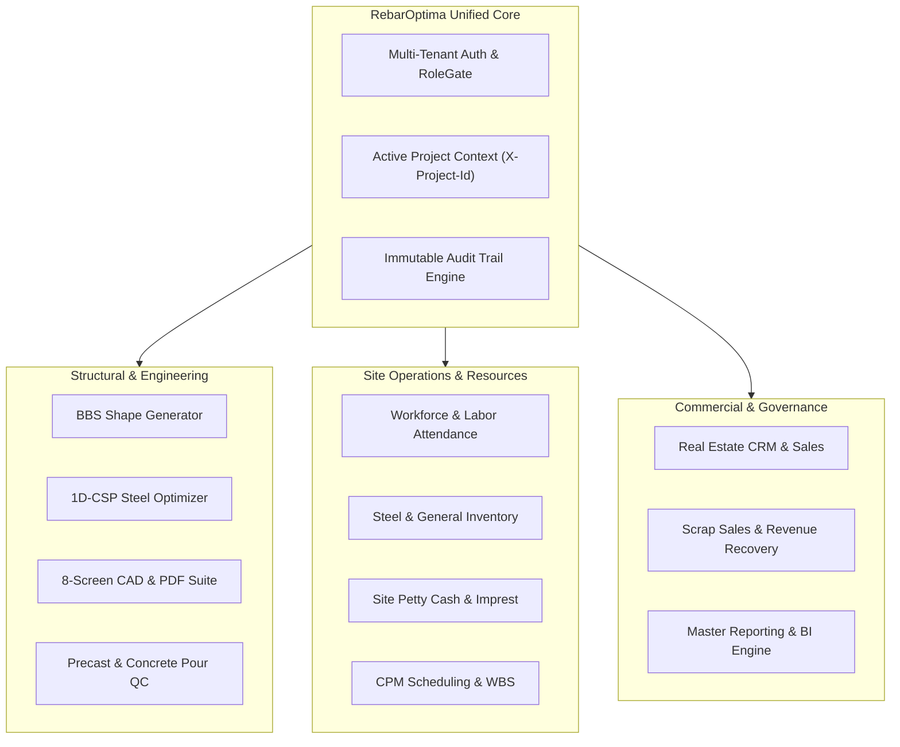
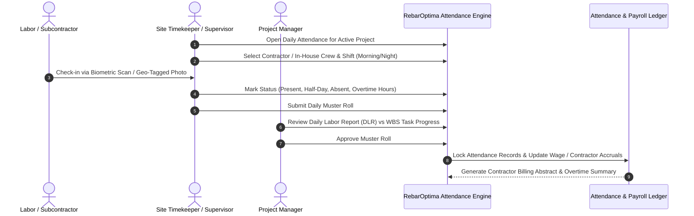
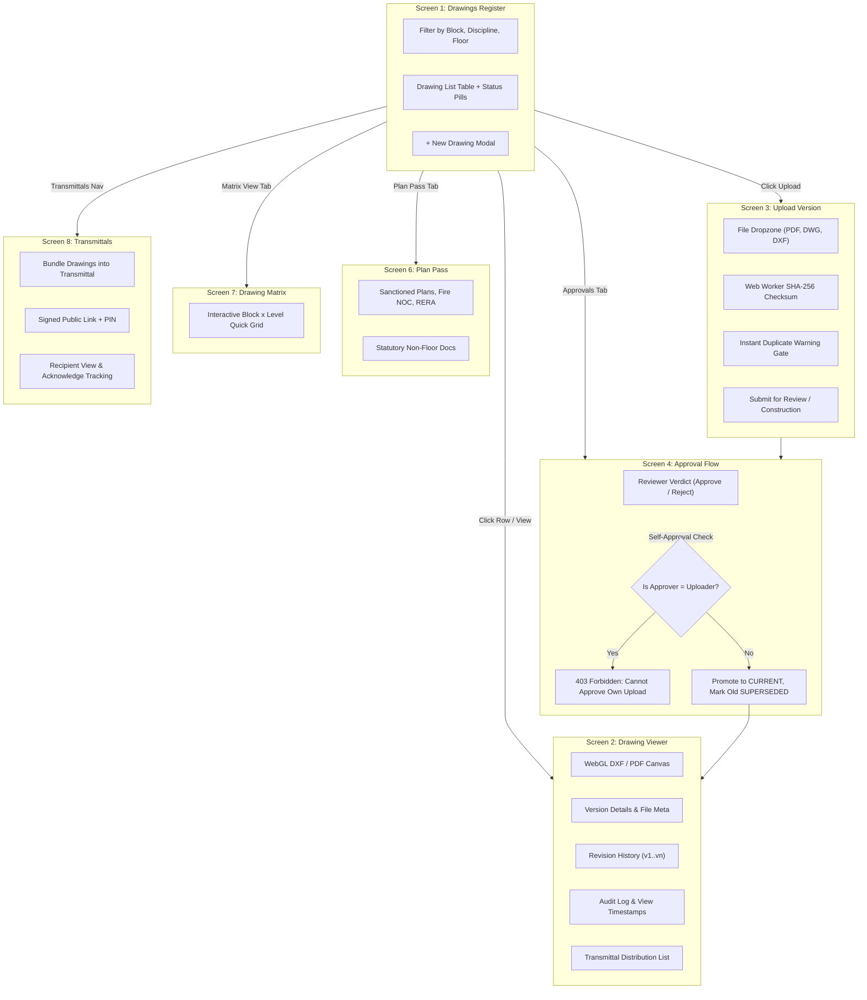
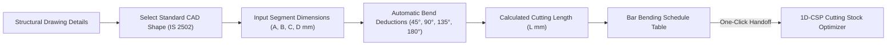
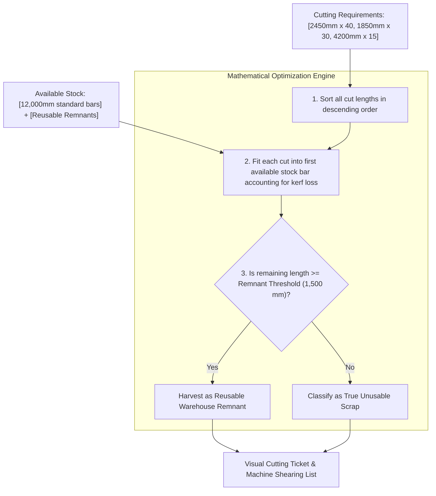
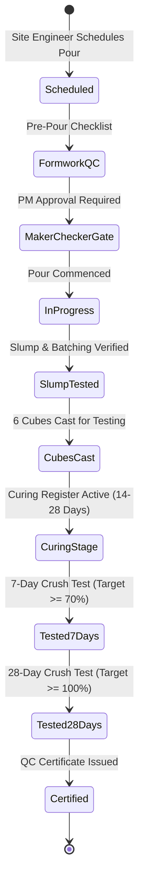

# RebarOptima — Complete Enterprise Features, Attendance & Master Reports Guide

> **The Unified Platform for Civil Engineering, Steel Cutting Optimization (1D-CSP), Bar Bending Schedule (BBS), Precast & In-Situ Casting, Site Attendance, Material Inventory, Real Estate CRM, Structural Drawings, and Project Operations.**

---

## 📑 Table of Contents

1. [Executive Product Overview](#1-executive-product-overview)
   - [1.1 The Construction Problem](#11-the-construction-problem)
   - [1.2 The RebarOptima Ecosystem](#12-the-rebaroptima-ecosystem)
   - [1.3 User Personas & Organizational Roles](#13-user-personas--organizational-roles)
2. [Workforce & Site Attendance Management](#2-workforce--site-attendance-management)
   - [2.1 Labor & Workforce Architecture](#21-labor--workforce-architecture)
   - [2.2 Trade & Skill Categorization](#22-trade--skill-categorization)
   - [2.3 Daily Attendance & Muster Roll Flow](#23-daily-attendance--muster-roll-flow)
   - [2.4 Biometric & Geo-Fenced Mobile Verification](#24-biometric--geo-fenced-mobile-verification)
   - [2.5 Shift Planning, Overtime & Wage Calculations](#25-shift-planning-overtime--wage-calculations)
   - [2.6 Subcontractor Labor Muster & Billing Verification](#26-subcontractor-labor-muster--billing-verification)
3. [Comprehensive Master Reports & Analytics Suite](#3-comprehensive-master-reports--analytics-suite)
   - [3.1 Steel Optimization & Cutting Reports](#31-steel-optimization--cutting-reports)
   - [3.2 Inventory & Stock Ledger Reports](#32-inventory--stock-ledger-reports)
   - [3.3 Concrete Casting & Quality Control (QC) Reports](#33-concrete-casting--quality-control-qc-reports)
   - [3.4 Site Petty Cash & Expense Reports](#34-site-petty-cash--expense-reports)
   - [3.5 Real Estate CRM & Sales Reports](#35-real-estate-crm--sales-reports)
   - [3.6 Project Management & CPM Progress Reports (DPR)](#36-project-management--cpm-progress-reports-dpr)
   - [3.7 Structural Drawings & Transmittal Delivery Reports](#37-structural-drawings--transmittal-delivery-reports)
   - [3.8 Labor Attendance & Muster Roll Reports](#38-labor-attendance--muster-roll-reports)
   - [3.9 System Audit Trail & Security Compliance Reports](#39-system-audit-trail--security-compliance-reports)
4. [Drawings & Engineering CAD Management (8-Screen System)](#4-drawings--engineering-cad-management-8-screen-system)
   - [4.1 Screen 1: Drawings Register & Multi-Filter Master](#41-screen-1-drawings-register--multi-filter-master)
   - [4.2 Screen 2: Universal WebGL CAD & PDF Sheet Viewer](#42-screen-2-universal-webgl-cad--pdf-sheet-viewer)
   - [4.3 Screen 3: Multi-Format Version Upload & Web Worker Hashing](#43-screen-3-multi-format-version-upload--web-worker-hashing)
   - [4.4 Screen 4: Maker-Checker Review & Approval Workflow](#44-screen-4-maker-checker-review--approval-workflow)
   - [4.5 Screen 5: Version History & Audit Trail](#45-screen-5-version-history--audit-trail)
   - [4.6 Screen 6: Plan Pass & Statutory Approvals (No-Floor Docs)](#46-screen-6-plan-pass--statutory-approvals-no-floor-docs)
   - [4.7 Screen 7: Drawing Matrix Quick-Access Grid](#47-screen-7-drawing-matrix-quick-access-grid)
   - [4.8 Screen 8: Drawing Transmittals & Public Tracking](#48-screen-8-drawing-transmittals--public-tracking)
5. [Bar Bending Schedule (BBS) & Shape Deduction Engine](#5-bar-bending-schedule-bbs--shape-deduction-engine)
   - [5.1 Standard Shape Library (IS 2502 & BS 8666)](#51-standard-shape-library-is-2502--bs-8666)
   - [5.2 Bend Deductions & Cutting Length Calculation](#52-bend-deductions--cutting-length-calculation)
   - [5.3 Direct Handoff to Cutting Stock Optimizer](#53-direct-handoff-to-cutting-stock-optimizer)
6. [1D Cutting Stock Optimization Engine (1D-CSP)](#6-1d-cutting-stock-optimization-engine-1d-csp)
   - [5.1 Mathematical FFD Optimization Algorithm](#61-mathematical-ffd-optimization-algorithm)
   - [6.2 Visual Cutting Tickets & Kerf Loss Modeling](#62-visual-cutting-tickets--kerf-loss-modeling)
   - [6.3 Automated Remnant Harvesting (>1,500 mm Threshold)](#63-automated-remnant-harvesting-1500-mm-threshold)
7. [Raw Steel & Scrap Management](#7-raw-steel--scrap-management)
   - [7.1 Inward Steel Verification (GRN, Heat Nos, Mill Test Certs)](#71-inward-steel-verification-grn-heat-nos-mill-test-certs)
   - [7.2 Remnant Stock Ledger & Priority Re-Cutting](#72-remnant-stock-ledger--priority-re-cutting)
   - [7.3 Scrap Auctions & Buyer Revenue Recovery](#73-scrap-auctions--buyer-revenue-recovery)
8. [Precast & In-Situ Casting Operations](#8-precast--in-situ-casting-operations)
   - [8.1 Concrete Mix Designs (M20 to M50)](#81-concrete-mix-designs-m20-to-m50)
   - [8.2 Multi-Point Pre-Pour Quality Inspection](#82-multi-point-pre-pour-quality-inspection)
   - [8.3 Maker-Checker Stock Consumption Gates](#83-maker-checker-stock-consumption-gates)
   - [8.4 Curing Registers & Compressive Cube Crush Tests (7, 14, 28 Days)](#84-curing-registers--compressive-cube-crush-tests-7-14-28-days)
9. [General Site Materials & Inventory (GI)](#9-general-site-materials--inventory-gi)
   - [9.1 Material Catalog (Cement, Sand, Aggregates, Ply, Blocks)](#91-material-catalog-cement-sand-aggregates-ply-blocks)
   - [9.2 Minimum Threshold Warnings & Inter-Site Transfers](#92-minimum-threshold-warnings--inter-site-transfers)
10. [Site Petty Cash & Imprest Management](#10-site-petty-cash--imprest-management)
    - [10.1 Site Cash Box & Imprest Lifecycle](#101-site-cash-box--imprest-lifecycle)
    - [10.2 Digital Voucher Creation & Bill Attachments](#102-digital-voucher-creation--bill-attachments)
    - [10.3 Approval Gates & Cash Reconciliation](#103-approval-gates--cash-reconciliation)
11. [Real Estate CRM, Units & Sales Pipeline](#11-real-estate-crm-units--sales-pipeline)
    - [11.1 Lead Acquisition & Follow-Up Lifecycle](#111-lead-acquisition--follow-up-lifecycle)
    - [11.2 Unit Master & Floor Plan Availability Grid](#112-unit-master--floor-plan-availability-grid)
    - [11.3 Booking Agreements & Milestone Demand Letters](#113-booking-agreements--milestone-demand-letters)
12. [Project Management, CPM Scheduling & WBS](#12-project-management-cpm-scheduling--wbs)
    - [12.1 Work Breakdown Structure (WBS) Hierarchy](#121-work-breakdown-structure-wbs-hierarchy)
    - [12.2 Critical Path Method (CPM) Calculation Engine](#122-critical-path-method-cpm-calculation-engine)
    - [12.3 Delay Logging, Weather Tracking & Schedule Simulation](#123-delay-logging-weather-tracking--schedule-simulation)
13. [Multi-Tenancy, Security & RBAC Governance](#13-multi-tenancy-security--rbac-governance)
    - [13.1 Strict Company Tenant Isolation](#131-strict-company-tenant-isolation)
    - [13.2 Fine-Grained RoleGate Permission Matrix](#132-fine-grained-rolegate-permission-matrix)
    - [13.3 Audit Logging & Session Security](#133-audit-logging--session-security)

---

# 1. Executive Product Overview

### 1.1 The Construction Problem
In civil infrastructure, residential high-rises, and industrial projects:
1. **Steel Rebar Wastage**: Steel reinforcement accounts for **15% to 25%** of structural construction cost. Mills deliver standard 12,000 mm straight bars, but construction drawings demand hundreds of variable cut lengths. Without mathematical optimization, cut-off pieces between 500 mm and 3,000 mm are abandoned as scrap, resulting in **8% to 15% scrap loss** ($50,000 to $200,000+ lost per tower).
2. **Attendance & Labor Leakage**: Site labor represents 30% of operating expenses. Manual muster rolls suffer from ghost workers, inaccurate overtime logging, contractor over-billing, and lack of trade-wise productivity metrics.
3. **Information Silos**: Structural revisions sent via email or WhatsApp lead to contractors building from superseded drawings. Pour approvals occur verbally without material verification, risking structural defects and safety audit failures.

### 1.2 The RebarOptima Ecosystem
**RebarOptima** unifies structural engineering algorithms, site resource management, and corporate ERP into a single high-performance cloud platform:

---

### 1.3 User Personas & Organizational Roles

| Role | Primary Modules Used | Key Daily Responsibilities |
| :--- | :--- | :--- |
| **Project Director / Founder** | Overview, Reports, Audit, Settings | Multi-project health, scrap recovery ROI, budget approvals, and executive decisions. |
| **Project Manager (PM)** | PM (CPM Tasks), Casting, Drawings, Approvals | Approving delay records, pour requests, drawing revisions, and schedule baselines. |
| **Site Engineer / Detailer** | BBS, Optimizer, Drawings, Casting | Drafting bar bending schedules, executing cutting optimizations, and inspecting pour prep. |
| **Store & Inventory Manager** | Inventory, General Inventory, Scrap Sales | Inward steel delivery vouchers (GRN), heat number logging, remnant classification, dispatch. |
| **Timekeeper / HR Officer** | Attendance, Labor Muster, Contractor Billing | Daily workforce muster roll, trade headcount, biometric check-in, overtime verification. |
| **Quality Control (QC) Inspector**| Casting QC, Cube Testing, Drawing Revisions | Slump tests, 7/14/28-day concrete cube crush tests, and compliance sign-offs. |
| **Site Accountant** | Petty Cash, Scrap Revenue, Inward Bills | Voucher verification, imprest box replenishment, vendor receipts, and cash audits. |
| **Real Estate Sales Executive** | CRM, Units Master, Bookings, Demand Letters | Lead qualification, customer site visits, unit reservations, and payment milestone calls. |

---

# 2. Workforce & Site Attendance Management

The Attendance Module gives developers, site engineers, and contractors full transparency over on-site manpower, preventing payroll inflation, ghost workers, and labor disputes.

### 2.1 Labor & Workforce Architecture
RebarOptima categorizes site labor into two clear models:
1. **Direct Company Labor (Payrolled)**: Fixed daily-wage or monthly personnel (site supervisors, store keepers, machine operators, watchmen).
2. **Subcontractor Labor (Piece-rate / Muster-rate)**: Gangs provided by labor contractors for steel fixing, shuttering, masonry, and concreting.

### 2.2 Trade & Skill Categorization
Every worker is profiled with skill levels that link directly to daily task productivity:

| Trade Code | Trade Name | Standard Skill Levels | Typical Unit of Productivity |
| :--- | :--- | :--- | :--- |
| **BAR-BND** | Rebar Steel Fixer / Bender | Master, Skilled, Helper | Metric Tons of steel tied per day |
| **CAR-SHT** | Shuttering Carpenter | Master, Skilled, Helper | Square meters ($m^2$) of formwork erected |
| **MAS-BRK** | Mason (Brick / Block work) | Skilled, Helper | Square meters ($m^2$) or number of blocks laid |
| **CON-POUR** | Concreting Gang | Helper, Vibrator Operator | Cubic meters ($m^3$) of concrete placed |
| **ELE-PLM** | MEP (Electrical & Plumbing) | Skilled, Helper | Running meters ($Rmt$) of piping/conduit |
| **GEN-HLP** | General Unskilled Labor | Helper | Site cleanup, material off-loading, shifting |

---

### 2.3 Daily Attendance & Muster Roll Flow
1. **Selection**: Supervisor selects the **Active Project**, **Contractor Name**, and **Work Shift** (Day: 08:00–17:00, Overtime: 17:30–21:30, Night: 20:00–05:00).
2. **Muster Roll Entry**:
   - High-density tabular layout listing all registered workers under that contractor.
   - Quick one-click status buttons: **Present (P)**, **Absent (A)**, **Half-Day (HD)**, **Overtime (OT Hours)**.
   - Batch mark buttons: *"Mark All Present"* with selective absent toggling for rapid morning roll call.
3. **Trade Count Reconciliation**:
   - The system computes instantaneous headcount: e.g., `42 Present (12 Bar Benders, 14 Carpenters, 6 Masons, 10 Helpers)`.
   - Compares headcount against planned manpower allocations on the project's active CPM tasks.

---

### 2.4 Biometric & Geo-Fenced Mobile Verification
- **Geo-Fencing Guard**: Mobile check-ins verify that device GPS coordinates match within a $150\text{ meter}$ radius of the project site perimeter.
- **Biometric Integration**: Supports USB/Bluetooth fingerprint scanners and facial recognition terminals stationed at site entry turnstiles.
- **Photo Attendance**: Supervisors capture a single photo of each gang during morning toolbox meetings for audit compliance.

---

### 2.5 Shift Planning, Overtime & Wage Calculations
- **Standard Working Shift**: Configurable default (typically $8\text{ hours} + 1\text{ hour break}$).
- **Overtime Rules**:
   - Normal Overtime: $1.5\times$ or $2.0\times$ hourly base rate calculated as $\frac{\text{Daily Wage}}{\text{Standard Hours}}$.
   - Night Differential: Flat incentive bonus added for pours or lifts executed between 22:00 and 06:00.
- **Automated Wage Accrual**: Daily total wages are accrued in real time against the site cost ledger, giving real-time visibility into project labor burn rates.

---

### 2.6 Subcontractor Labor Muster & Billing Verification
At the end of each billing cycle (weekly or monthly):
1. RebarOptima compiles the **Muster Roll Summary** for each subcontractor.
2. Cross-references the contractor’s submitted bill against the system's approved daily attendance logs.
3. Automatically flags discrepancies:
   - Claimed workers absent on site logs.
   - Billed overtime hours exceeding site supervisor approvals.
   - Productivity rates below benchmark standards (e.g., steel tying rate $<150\text{ kg/man-day}$).

---

# 3. Comprehensive Master Reports & Analytics Suite

RebarOptima features an enterprise reporting engine with direct exports to **print-ready PDF** and **raw CSV/Excel**:

```mermaid
graph LR
    subgraph DataSources["Operational Data Streams"]
        D1["BBS & Cutting Batches"]
        D2["Steel & Material Stores"]
        D3["Casting Pours & Cube Tests"]
        D4["Daily Labor Muster"]
        D5["Petty Cash Vouchers"]
        D6["CRM Bookings & Demands"]
        D7["CPM Task Delays"]
    end

    subgraph ReportEngine["RebarOptima Master Reporting Engine"]
        Aggregation["Data Aggregator & Multi-Tenant Guard"]
        Formatting["Formatting Engine (KaTeX, Charts, Tables)"]
        ExportPDF["PDF Generator (Letterhead, Watermarks, Signatures)"]
        ExportCSV["CSV / Excel Streaming Exporter"]
    end

    subgraph OutputReports["Enterprise Deliverables"]
        R1["Fabrication & Scrap Recovery Report"]
        R2["Stock Reconciliation & Material Ledger"]
        R3["Concrete Strength & QC Certificate"]
        R4["Labor Muster Roll & Contractor Abstract"]
        R5["Site Petty Cash & Imprest Summary"]
        R6["CRM Sales Aging & Demand Letters"]
        R7["Daily Progress Report (DPR)"]
    end

    DataSources --> Aggregation --> Formatting
    Formatting --> ExportPDF --> OutputReports
    Formatting --> ExportCSV --> OutputReports
```

---

### 3.1 Steel Optimization & Cutting Reports

#### A. Executive Steel Efficiency & Scrap Recovery Report
- **Purpose**: High-level board and founder report showing total steel weight purchased vs. utilized vs. scrapped.
- **Key Metrics**:
  - Total Steel Processed ($MT$) across 8mm, 10mm, 12mm, 16mm, 20mm, 25mm, 32mm.
  - Overall Utilization Efficiency percentage (target $>97.5\%$).
  - Total Off-Cut Remnants Saved to Warehouse Stock ($kg$ and dollar value).
  - True Unusable Scrap Generated ($kg$ and percentage).
  - Financial Scrap Loss avoided ($) compared to typical $12\%$ site scrap benchmark.

#### B. Shop-Floor Cutting Ticket & Bar Schedule Report
- **Purpose**: Printed sheet handed to machine shearing operators.
- **Contents**: Visual colored bar diagrams, stock length ($12,000\text{ mm}$), cut segment lengths with millimeter precision, bar mark numbers, and remnant salvage instructions (*"Save 2,450 mm off-cut to Rack B-3"*).

---

### 3.2 Inventory & Stock Ledger Reports

#### A. Comprehensive Stock Ledger & Valuation Report
- **Columns**: Material Code, Description, Diameter/Grade, Opening Balance ($MT$), Inward Receipts ($MT$), Outward Cutting Consumption ($MT$), Inter-Site Transfers ($MT$), Closing Balance ($MT$), Current Valuation ($/MT$).
- **Features**: Filterable by date range, specific diameter, project, or warehouse rack.

#### B. Goods Received Note (GRN) & Heat Traceability Summary
- **Purpose**: Structural audit documentation linking installed steel elements back to the manufacturer's mill test certificate.
- **Columns**: GRN Number, Delivery Date, Supplier Name, Mill (e.g., Tata Steel, JSW), Heat/Batch Number, Mill Test Certificate Reference, Ordered Quantity ($MT$), Weighed Quantity ($MT$), Weight Variance ($kg$), QC Acceptance Status.

---

### 3.3 Concrete Casting & Quality Control (QC) Reports

#### A. Official Concrete Compressive Strength Test Certificate
- **Purpose**: Submitted to structural consultants and municipal authorities for occupancy certification.
- **Contents**: Project Name, Structural Element (e.g., *Tower A, 4th Floor Slab & Beams*), Date of Pour, Concrete Grade (e.g., *M30*), Batch Plant Details, Slump Test Value ($mm$).
- **Crush Test Table**: Specimen ID, Age at Test ($7\text{ Days}, 14\text{ Days}, 28\text{ Days}$), Weight ($kg$), Cross-Sectional Area ($mm^2$), Failure Load ($kN$), Calculated Compressive Strength ($N/mm^2$), Required Characteristic Strength ($N/mm^2$), Pass/Fail Status, Lab Technician & Consultant Sign-off Blocks.

#### B. Monthly Pour Inspection & Material Consumption Register
- **Contents**: Element Name, Planned Volume ($m^3$), Actual Poured Volume ($m^3$), Cement Bags Consumed, Admixture Liters Used, Vibrator Compaction Sign-off, Curing Start & End Dates, Ambient Temperature during pour.

---

### 3.4 Site Petty Cash & Expense Reports

#### A. Daily Cash Imprest Ledger & Balance Sheet
- **Purpose**: Reconciles physical cash in the site safety locker with digital records.
- **Columns**: Voucher Number, Date & Time, Paid To, Expense Category (Hardware, Travel, Food & Refreshments, Labor Advance, Equipment Fuel, Minor Repairs), Description, Amount ($), Approved By, Digital Receipt Attachment Link.

#### B. Expense Category Distribution & Budget Variance Report
- **Contents**: Visual category spend breakdown, monthly cash burn trend, and comparison against the site's approved monthly petty cash ceiling.

---

### 3.5 Real Estate CRM & Sales Reports

#### A. Project Unit Inventory & Availability Matrix
- **Contents**: High-density grid of all towers, wings, and floors showing color-coded unit statuses: **Available (Green)**, **Booked (Blue)**, **Blocked/Under Offer (Yellow)**, **Reserved for Landowner (Purple)**.
- **Summary**: Total Units, Units Sold, Remaining Inventory Value, Total Carpet Area Sold ($sq.ft.$).

#### B. Payment Milestone Demand & Aging Receivables Report
- **Columns**: Customer Name, Unit Number, Total Agreement Value, Demanded Amount, Paid Amount, Overdue Balance, Days Overdue ($30, 60, 90+ \text{ days}$), Interest Accrued, Construction Stage Triggering Demand (e.g., *Completion of 5th Floor Slab*).

---

### 3.6 Project Management & CPM Progress Reports (DPR)

#### A. Daily Progress Report (DPR)
- **Purpose**: Daily site diary distributed every evening to clients, project directors, and consultants.
- **Sections**:
  1. **Weather & Site Condition**: Temperature, rain hours, ground condition.
  2. **Active Tasks & WBS Progress**: Tasks worked today, percentage completion, physical quantity achieved (e.g., *140 m² shuttering completed*).
  3. **Manpower Deployment**: Total labor present by trade (skilled vs. helper).
  4. **Equipment On Site**: Tower cranes, boom placers, bar bending machines operating hours vs. breakdown idle hours.
  5. **Material Inward**: Trucks received and unloaded today.
  6. **Delays & Obstacles**: Critical path hindrances with assigned responsibility.

#### B. CPM Critical Path & Variance Analysis Report
- **Contents**: Tasks on the Critical Path ($Float = 0$), scheduled vs. actual finish dates, delay impact in days, and early warning flags for handover milestones.

---

### 3.7 Structural Drawings & Transmittal Delivery Reports

#### A. Drawing Revision Status Matrix
- **Columns**: Drawing Number, Discipline (ARCH, STRUCT, MEPF), Title, Current Revision, Status (**CURRENT**, **IN_REVIEW**, **SUPERSEDED**, **VOID**), Last Release Date, Approved By, Transmittal References.

#### B. Transmittal Delivery & Recipient Acknowledgment Slip
- **Purpose**: Legal proof of drawing issuance to contractors, consultants, and municipal bodies.
- **Contents**: Transmittal Number, Release Date, Purpose of Issue (*For Construction*, *For Review*, *For Approval*), Drawing List with Revisions, Recipient Names & Organizations, Email Delivery Timestamp, Online View Timestamp, and Explicit User Acknowledgment Date/Time.

---

### 3.8 Labor Attendance & Muster Roll Reports

#### A. Monthly Labor Muster Roll Register
- **Format**: Master calendar grid (Day 1 through Day 31) showing attendance codes (`P`, `A`, `HD`, `OT-2`) for each worker.
- **Totals**: Total Days Worked, Total Overtime Hours, Total Payable Man-Days.

#### B. Contractor Labor Productivity & Billing Abstract
- **Purpose**: Accompanies contractor payment vouchers to substantiate labor expenses.
- **Columns**: Contractor Name, Trade, Billed Man-Days, Verified Muster Man-Days, Discrepancy Deductions, Base Wage Rate, Overtime Wage, Net Payable Amount ($), Site Engineer Verification Signature.

---

### 3.9 System Audit Trail & Security Compliance Reports

#### A. Comprehensive Activity Audit Log
- **Columns**: Timestamp (UTC & Local), User Name, Email, Role, IP Address, Device Fingerprint, Action (CREATE, UPDATE, DELETE, APPROVE, REJECT, EXPORT), Entity Type (Drawing, Pour, PettyCash, Batch), Entity ID, Old State Snapshot, New State Snapshot.
- **Security**: Tamper-proof, append-only MongoDB collection; exportable to immutable CSV for third-party security audits.

---

# 4. Drawings & Engineering CAD Management (8-Screen System)

RebarOptima includes a full-featured, zero-cloud-fee, 8-screen engineering drawings suite with real-time vector CAD rendering, maker-checker approvals, and public transmittals:

---

### 4.1 Screen 1: Drawings Register & Multi-Filter Master
- **Header & Scope**: Scoped to the currently selected project (`X-Project-Id`).
- **Filter Row**: Project (locked), Block (Block A, Block B, etc.), Discipline (Architectural, Structural, MEPF, Civil, Landscape, HVAC, Electrical, Fire, Interior, Infrastructure), Level/Floor (B2, B1, G, L1..Ln, Terrace, General).
- **Table Data**: Checkbox, Drawing Number, Title, Current Revision (`v3`), Status Pill (**CURRENT** [Green], **IN_REVIEW** [Amber], **REJECTED** [Red], **DRAFT** [Gray], **SUPERSEDED** [Gray-Blue], **VOID** [Dark Gray]), Last Updated Date, Updated By, Actions Menu.
- **Bulk Action Bar**: Selecting rows reveals floating bar: *"Create Transmittal (n)"* and *"Download Original (n)"*.

---

### 4.2 Screen 2: Universal WebGL CAD & PDF Sheet Viewer
- **Canvas Routing Engine**:
  - **PDF Documents**: Rendered via PDF.js with virtualized canvas rendering, smooth pan, zoom, and rotate.
  - **Images (PNG, JPG, SVG)**: Native high-dpi GPU-accelerated viewer.
  - **AutoCAD DWG / DXF Drawings**: Rendered directly in-browser using **Three.js WebGL linework**. Parses AutoCAD entities, polyline paths, layers, colors, blocks, and dimensions without requiring desktop CAD software or paid cloud APIs.
- **Superseded Safety Banner**: If viewing an older revision, a persistent red top banner warns: **"⚠️ SUPERSEDED — DO NOT USE FOR CONSTRUCTION"**.
- **Viewer Toolbar**: Sidebar toggle, Page selector (`1 / 3`), Zoom In/Out, Fit-to-Screen, 90° Rotation, Layer Visibility Panel, and Download Original button.

---

### 4.3 Screen 3: Multi-Format Version Upload & Web Worker Hashing
- **Drag-and-Drop Zone**: Accepts `.pdf`, `.dwg`, `.dxf`, `.png`, `.jpg` up to $500\text{ MB}$.
- **Client-Side SHA-256 Worker**: Computes cryptographic checksum in a background Web Worker chunk-by-chunk without freezing the browser UI.
- **Instant Duplicate Prevention**: Checks checksum against backend; if an identical file already exists on that drawing, displays a warning dialog before upload.
- **DWG-to-DXF Vector Pipeline**: Backend converts AutoCAD DWG into compact gzipped DXF linework using headless `LibreDWG`, caching vector geometry directly for instant viewer loading.

---

### 4.4 Screen 4: Maker-Checker Review & Approval Workflow
- **Review Card**: Shows thumbnail, drawing number, title, version, uploader name, change note, reason (`DESIGN_REVISION`, `CLIENT_REQUEST`, `SITE_ISSUE`, `AUTHORITY_COMMENT`), and purpose (`FOR_REVIEW`, `FOR_APPROVAL`, `FOR_CONSTRUCTION`).
- **Anti-Self-Approval Safety Rule**: If the logged-in user uploaded this revision, the action form is disabled with an amber warning: *"You cannot approve your own upload"*, enforced by the backend with HTTP 403.
- **Verdict Actions**:
  - **Approve**: Promotes revision to **CURRENT**, automatically demotes prior current version to **SUPERSEDED**, and writes an immutable audit entry.
  - **Reject**: Marks revision **REJECTED**, records rejection note, and alerts the detailing engineer.

---

### 4.5 Screen 5: Version History & Audit Trail
- Shows complete vertical timeline of all revisions (`v1, v2, v3...`).
- Shows who uploaded each version, change notes, approval verdicts, timestamps, and one-click *"View File"* or *"Compare Revisions"* buttons.

---

### 4.6 Screen 6: Plan Pass & Statutory Approvals (No-Floor Docs)
- Dedicated repository for project-wide legal, town planning, and statutory documents not tied to a specific floor level.
- Categorized tabs: **Sanctioned Plan**, **Commencement Certificate (CC)**, **Fire NOC**, **Environmental Clearance (EC)**, **RERA Approvals**, and **Airport Authority NOC**.

---

### 4.7 Screen 7: Drawing Matrix Quick-Access Grid
- **Interactive Matrix View**: Rows display drawings (Floor Plan, Elevation, Section, Column Schedule), columns display Floors (`B2, B1, G, L1, L2, L3, Terrace`).
- **Cell Status Icons**:
  - `✔` (Green): Approved current drawing available.
  - `●` (Amber): Revision currently under review.
  - `✕` (Red): Rejected drawing requiring re-submission.
  - `—` (Dash): Drawing not required for this floor.
- Clicking any cell opens the drawing viewer immediately.

---

### 4.8 Screen 8: Drawing Transmittals & Public Tracking
- **Transmittal Bundle**: Select multiple approved drawings into a formal issuance package.
- **Recipient Types**: Internal team members or external consultants/contractors.
- **Public Secured Link**: External parties receive a secure link (`/public/t/:token`) to preview and download drawings.
- **Receipt Tracking**: Records exact timestamp when recipient opens the link and logs explicit *"Acknowledge Receipt"* button clicks.

---

# 5. Bar Bending Schedule (BBS) & Shape Deduction Engine

The BBS module automates cutting length calculation with strict adherence to structural engineering standards:

### 5.1 Standard Shape Library (IS 2502 & BS 8666)
- Over **50 standard parametric shapes**: Straight bars, L-bends, U-bars, Column ties, Rectangular stirrups, Triangular stirrups, Diamond ties, Spiral rings, and Cranked slab bars.
- Live canvas preview updates as the engineer alters segment dimensions ($A, B, C, D, E, R$).

### 5.2 Bend Deductions & Cutting Length Calculation
Due to steel bar elongation during cold bending, actual cut length is less than the sum of outer dimensions:
- **$45^\circ$ Bend**: Deduct $1d$ (where $d = \text{bar diameter in mm}$).
- **$90^\circ$ Standard Bend**: Deduct $2d$.
- **$135^\circ$ Seismic Hook Bend**: Deduct $3d$.
- **$180^\circ$ Full Hook**: Deduct $4d$.
- **Hook Extension**: Automatically adds standard anchorages ($10d$ or $75\text{ mm}$ minimum) according to seismic codes.

### 5.3 Direct Handoff to Cutting Stock Optimizer
Engineers click *"Transfer to Optimizer"*, instantly converting the entire BBS schedule into cutting orders grouped by diameter, ready for mathematical stock planning.

---

# 6. 1D Cutting Stock Optimization Engine (1D-CSP)

RebarOptima executes a high-speed, client-side First Fit Decreasing (FFD) optimization algorithm to minimize off-cut scrap:

### 6.1 Mathematical FFD Optimization Algorithm
1. **Input Sorting**: Sorts all demanded piece lengths in descending order ($L_1 \ge L_2 \ge \dots \ge L_n$).
2. **First-Fit Allocation**: Tests each piece sequentially against active bars, placing it into the first bar with sufficient residual capacity.
3. **Kerf Loss Accounting**: Every shear cut deducts $3\text{ mm}$ to $5\text{ mm}$ of blade kerf loss, ensuring actual cut pieces never exceed stock bar capacity.

### 6.2 Visual Cutting Tickets & Kerf Loss Modeling
- High-contrast visual representation of each $12\text{ m}$ bar.
- Color-coded segments labeled with bar mark, cut length, and piece quantity.
- Operators view cutting tickets on water-resistant tablets or laminated physical printouts.

### 6.3 Automated Remnant Harvesting (>1,500 mm Threshold)
- Residual pieces $\ge 1,500\text{ mm}$ are automatically assigned a unique Remnant Tag ID (e.g., `REM-12-0042`) and added back to warehouse stock.
- The optimizer prioritizes existing remnants in future runs before cutting fresh $12\text{ m}$ straight bars.

---

# 7. Raw Steel & Scrap Management

### 7.1 Inward Steel Verification (GRN, Heat Nos, Mill Test Certs)
- **Weighbridge Integration**: Compares gross truck weight against supplier delivery challans, identifying weighbridge shortages immediately.
- **Quality Verification**: Stores Heat Number, Mill Name, and chemical composition test certificates.

### 7.2 Remnant Stock Ledger & Priority Re-Cutting
- Remnants are tracked by diameter, grade (Fe500D, Fe550D), length, and warehouse rack location.
- Prevents valuable off-cuts from being buried under heavy bundles or mistakenly sold as scrap.

### 7.3 Scrap Auctions & Buyer Revenue Recovery
- Records scrap merchant bids, truck tare/gross weighments, gate passes, and generated revenue.
- Computes net project scrap cost: $\text{Procurement Cost} - \text{Scrap Revenue Recovered}$.

---

# 8. Precast & In-Situ Casting Operations

Manages the entire lifecycle of concrete pours from mix design to structural compliance:

### 8.1 Concrete Mix Designs (M20 to M50)
- Presets for M20, M25, M30, M35, M40, M50 standard concrete grades.
- Specifies cement, fly ash, micro-silica, coarse aggregates ($10\text{ mm}, 20\text{ mm}$), sand, water-cement ratio, and chemical admixture dosages per cubic meter ($m^3$).

### 8.2 Multi-Point Pre-Pour Quality Inspection
Before any pour begins, engineers verify digital checklists:
- Formwork dimensions and alignment.
- Rebar cover blocks, lap lengths, and chair spacing.
- Embedded conduits, plumbing sleeves, and box-outs.
- Formwork cleanliness and shuttering oil application.

### 8.3 Maker-Checker Stock Consumption Gates
Once the Project Manager signs off on the pour approval, the system atomically deducts:
- Theoretical concrete volume ($m^3$) or raw ingredients from store stock.
- Rebar cage assembly weight from fabricated steel stock.

### 8.4 Curing Registers & Compressive Cube Crush Tests
- Tracks daily curing methods (ponding, wet burlap, curing compound).
- Test schedule alerts:
  - **7-Day Test**: Verifies early strength development (target $\ge 70\%$ of characteristic strength $f_{ck}$).
  - **14-Day Test**: Intermediate check for post-tensioned or high-early-strength elements.
  - **28-Day Test**: Definitive legal compliance check (target $\ge 100\% f_{ck}$).

---

# 9. General Site Materials & Inventory (GI)

Tracks civil materials beyond rebar steel:
- **Catalog**: Cement (OPC 43/53, PPC), River Sand, M-Sand, Aggregates ($10\text{ mm}, 20\text{ mm}, 40\text{ mm}$), AAC Blocks, Red Clay Bricks, Shuttering Plywood, Binding Wire, Safety PPE, and Diesel fuel.
- **Minimum Stock Alerts**: Automatic warning triggers when cement drops below 500 bags or diesel drops below 200 liters.
- **Inter-Site Transfer Vouchers**: Authorizes and tracks material transfers between company projects with transit loss logging.

---

# 10. Site Petty Cash & Imprest Management

Enables site teams to handle urgent daily expenses while maintaining tight financial control:
- **Imprest System**: Site safety box is allocated a fixed revolving float (e.g., $2,000$).
- **Digital Vouchers**: Supervisors take a mobile camera photo of the vendor bill, enter the amount, select the category, and submit.
- **Multi-Level Approval**: Vouchers $> $100 require Project Manager approval; vouchers $> $500 require Head Office Accountant sign-off.
- **Replenishment**: When float balance drops below 20%, an automatic replenishment claim is prepared with all attached receipt photos for HO bank transfer.

---

# 11. Real Estate CRM, Units & Sales Pipeline

Bridges construction progress with real estate revenue:
- **Lead Pipeline**: Tracks inquiries from digital ads, walk-ins, and broker channel partners through stages (**New**, **Contacted**, **Site Visit Scheduled**, **Negotiation**, **Booked**, **Lost**).
- **Unit Inventory Master**: Complete database of every unit across towers, wings, and floors with BHK configuration, carpet area, balcony area, super built-up area, base rate, floor rise premium, and facing charges.
- **Construction-Linked Demands**: Links payment milestones directly to the PM module's completed slabs (e.g., *Plinth Completion (15%)*, *5th Floor Slab (10%)*, *Brickwork (10%)*, *Flooring (10%)*, *Possession (5%)*).

---

# 12. Project Management, CPM Scheduling & WBS

Ensures projects meet strict RERA deadlines and contract completion dates:
- **WBS Hierarchy**: `Project > Phase / Block > Floor / Level > Element > Activity`.
- **CPM Engine**: Computes **Early Start (ES)**, **Early Finish (EF)**, **Late Start (LS)**, **Late Finish (LF)**, and **Total Float**.
- **Dependency Relationships**: Supports Finish-to-Start (FS), Start-to-Start (SS), Finish-to-Finish (FF), and Start-to-Finish (SF) with lead/lag days.
- **Delay Attribution**: Classifies delays into **Contractor Delays**, **Material Delays**, **Weather / Force Majeure**, and **Client / Consultant Design Clarifications** for contract extension claims.

---

# 13. Multi-Tenancy, Security & RBAC Governance

### 13.1 Strict Company Tenant Isolation
RebarOptima enforces multi-tenant boundary checks at the database query layer:
- Every document carries an indexed `companyId`.
- API endpoints verify that the authenticated user's JWT `companyId` matches the requested resource.
- Cross-tenant data leakage is structurally impossible.

### 13.2 Fine-Grained RoleGate Permission Matrix
Granular permissions prevent unauthorized operations across all modules:

| Permission Key | Description | Typical Roles Authorized |
| :--- | :--- | :--- |
| `overview:view` / `export` | Access executive KPI dashboard and export summaries | Admin, PM, Director |
| `inventory:view` / `inward` | View stock, log Goods Received Notes (GRN) | Store Keeper, Site Engineer |
| `optimizer:view` / `create` | View cutting orders, run 1D-CSP cutting optimization | Site Engineer, Detailer |
| `history:view` / `edit` | View historical cutting batches and modify cutting plans | Site Engineer, PM |
| `scrapSales:create` | Record scrap auctions and buyer invoices | Store Manager, Accountant |
| `casting:create` / `edit` | Plan concrete pours and log cube crush tests | QC Engineer, Site Engineer |
| `casting:approve` | Maker-checker approval to initiate concrete pours | Project Manager |
| `drawings:view` / `upload` | Access CAD/PDF viewer, upload new revisions | Civil Engineer, Architect |
| `drawings:approve` | Approve/Reject drawing revisions (maker-checker) | Project Lead, Lead Consultant |
| `attendance:view` / `mark` | View and record daily labor muster rolls | Site Timekeeper, Supervisor |
| `attendance:approve` | Approve contractor labor billing abstracts | Project Manager |
| `pettyCash:create` | Record petty cash site vouchers | Site Supervisor, Engineer |
| `pettyCash:approve` | Authorize petty cash reimbursements | PM, Site Accountant |
| `crm:leads` / `bookings` | Manage customer inquiries and book units | Sales Executive, CRM Manager |
| `pm:tasks` / `reschedule` | Manage CPM task schedules and approve delay claims | Project Manager, Scheduler |
| `settings:edit` | Configure company profiles, densities, bar lengths | System Administrator |

### 13.3 Audit Logging & Session Security
- **Inactivity Watchdog**: Automatically locks active sessions after 30 minutes of inactivity to prevent unauthorized access from shared site office PCs.
- **Immutable Audit Trail**: Captures user ID, IP address, timestamp, action, and full before/after state diffs on every critical transaction.

---

## 🎯 Summary

RebarOptima combines **civil engineering precision**, **workforce accountability**, and **enterprise financial controls** into one unified system. From the moment rebar arrives at the site weighbridge to the final concrete cube crush test and apartment handover, every kilogram of steel, every man-hour of labor, and every structural drawing is tracked, optimized, and audited.
