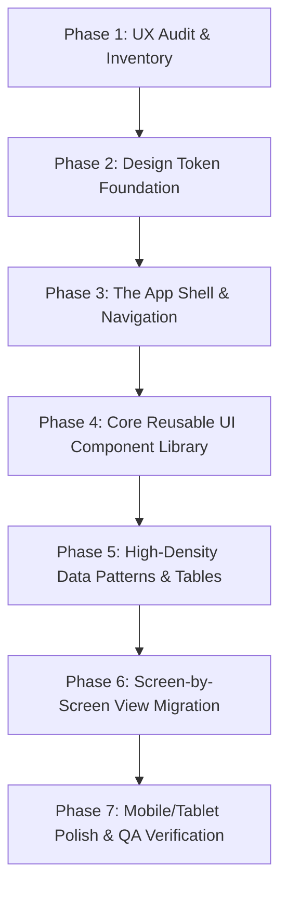

# Enterprise SaaS UI/UX Design System & Redesign Master Blueprint
*A practical guide for building human-crafted, industry-standard, globally responsive SaaS applications.*

---

## 1. Executive Summary: What Makes a SaaS Look "Human-Crafted" vs. "AI-Generated"

When people describe a SaaS interface as looking **"AI-generated"**, they are referring to a distinct set of superficial design tropes created by AI image tools and generic frontend prompts:
- Purple/violet/cyan neon glowing gradients on dark backgrounds.
- Excessive `border-radius: 24px` on every card making the app look like a toy or a consumer mobile widget.
- Giant floating cards with blurry 40px drop shadows (`box-shadow: 0 20px 40px rgba(...)`).
- Low information density: huge empty white spaces with 3 giant metrics taking up an entire 1080p monitor.
- Stock 3D isometric illustrations or generic Lucide icon spam without contextual meaning.
- Broken responsive behavior: desktop tables merely shrink until text is truncated or illegible, instead of adapting layout patterns.
- Missing enterprise states: no loading skeletons, no zero-data onboarding states, no error boundary states, no keyboard navigation.

In contrast, an **experienced human designer** builds for **utility, speed, clarity, and trust** (inspired by platforms like Linear, Stripe, Figma, GitHub, Autodesk BIM 360, Procore):
- **High Information Density with Breathability**: Clean, compact data grids where engineers and operations managers can view 20–30 rows of data without scrolling indefinitely.
- **Hairline Precision**: 1px subtle borders (`rgba(226, 232, 240, 1)` or dark-mode equivalent `rgba(255, 255, 255, 0.08)`) with crisp 6px–8px corners.
- **Tabular & Monospace Discipline**: Numbers, dimensions, weights, currency, and IDs use `font-variant-numeric: tabular-nums` or monospace accents so columns align vertically.
- **Adaptive Ergonomics**: Desktop uses compact 32px–36px controls with hover tooltips and keyboard shortcuts; Mobile transforms into bottom-sheets, 44px+ touch targets, and swipeable cards.
- **Visual Restraint**: 90% of the UI consists of polished neutral surfaces (whites, slates, grays); color is reserved strictly for status (Success, Warning, Danger) and the primary user action (Accent).

---

## 2. Comparison: AI-Generated Tropes vs. Human Professional Design

| Element | AI-Generated Signature Style (To Avoid) | Human Senior Designer Standard (To Use) |
| :--- | :--- | :--- |
| **Color Palette** | Purple/violet/indigo neon gradients, multi-color gradient text, saturated backgrounds. | Neutral monochrome base (Slate/Zinc) with **one** deliberate brand accent and semantic status colors. |
| **Borders & Radii** | Enormous pill corners (`rounded-3xl` / 24–32px), heavy glowing borders. | Intentional radii scale: `4px` (tags/badges), `6px` (buttons/inputs), `8px` (cards/modals). Crisp 1px hairline borders. |
| **Shadows & Depth** | Blurry, dark, floating drop shadows (`0 20px 50px rgba(0,0,0,0.2)`). | Multi-layered micro-shadows combined with 1px border: `box-shadow: 0 1px 2px 0 rgba(0,0,0,0.05)`. |
| **Typography** | Generic system sans with standard letter-spacing, huge oversized headings. | Inter / Geist / Plus Jakarta Sans. Tight headings (`letter-spacing: -0.02em`), tabular numbers for data. |
| **Data Tables** | Low density, 3 rows visible on screen, text cut off with `...` without tooltip. | High/medium density toggles, frozen headers, sticky column actions, full inline tooltips, horizontal scroll containers. |
| **Spacing System** | Inconsistent margins (13px, 19px, 27px scattered arbitrarily). | Strict **8-point spatial grid** (4px, 8px, 12px, 16px, 24px, 32px, 48px, 64px). |
| **Empty States** | "No data found" in grey text with a generic cartoon graphic. | Contextual zero-state: explains *what* is missing, *why* it is useful, with a direct primary action button ("Create your first Rebar Batch"). |
| **Loading Feedback** | Full-screen spinning spinner or nothing at all. | Content-aware skeleton loaders that mirror the exact layout of the arriving content. |
| **Modals & Drawers** | Giant centered modals for everything, even simple single-field edits. | Right-side sliding Drawers for complex forms/details; compact focused Modals for confirmations only. |

---

## 3. Global Responsive Architecture (320px Mobile to 4K Ultrawide)

A premium SaaS cannot simply be "scaled down". Different devices demand different UX paradigms:

```
┌────────────────────────────────────────────────────────────────────────┐
│                          GLOBAL SCREEN TIERS                           │
├───────────────┬──────────────────┬──────────────────┬──────────────────┤
│ Mobile        │ Tablet           │ Laptop / Desktop │ Ultra-wide / 4K  │
│ (320px-639px) │ (640px-1023px)   │ (1024px-1536px)  │ (1537px-2560px+) │
├───────────────┼──────────────────┼──────────────────┼──────────────────┤
│ Bottom Nav /  │ Collapsible icon │ Full Sidebar     │ Fixed Sidebar +  │
│ Off-canvas    │ sidebar          │ (240px-260px)    │ Max Content-cap  │
│ Drawer        │                  │                  │ (1440px-1600px)  │
├───────────────┼──────────────────┼──────────────────┼──────────────────┤
│ Stacked cards │ Compact table /  │ Multi-column     │ Multi-panel split│
│ instead of    │ horizontal swipe │ data table with  │ view (e.g. CAD + │
│ wide tables   │ with sticky col  │ sticky actions   │ properties pane) │
├───────────────┼──────────────────┼──────────────────┼──────────────────┤
│ Bottom Sheets │ Centered Modals  │ Sliding Drawers  │ Side-by-side     │
│ (slide up)    │ or Drawers       │ (480px-640px)    │ pinned panels    │
├───────────────┼──────────────────┼──────────────────┼──────────────────┤
│ 44px+ touch   │ 38px-40px touch  │ 32px-36px dense  │ 32px-36px dense  │
│ targets       │ targets          │ mouse targets    │ mouse targets    │
└───────────────┴──────────────────┴──────────────────┴──────────────────┘
```

### Key Responsive Rules:
1. **Never allow accidental horizontal body scroll**: All page containers must use `width: 100%; max-width: 100%; overflow-x: hidden;`.
2. **Tables on Mobile**:
   - *Option A (Preferred for complex data)*: Convert table rows into structured card summaries on screens `< 768px`.
   - *Option B (For wide data entry)*: Wrap table in a scroll container with a sticky first column (e.g. Rebar Mark / ID) and a subtle right shadow indicating more columns exist.
3. **Ultrawide Containment**: On screens `> 1600px`, never let dashboard content stretch infinitely across the monitor. Keep content centered or introduce a secondary contextual inspector pane (e.g., Drawing viewer on the left, BOM schedule on the right).

---

## 4. The 7 Core Pillars of High-End SaaS UI

### Pillar 1: Mathematical Typography & Hierarchy
- **Font Choice**: Use clean, modern neo-grotesque typefaces like `Inter`, `Geist Sans`, or `Plus Jakarta Sans`. For numerical CAD/BIM/Rebar calculations, always use `font-variant-numeric: tabular-nums`.
- **Scale**:
  - `Display / Page Title`: 24px–28px, Semi-Bold (`font-weight: 600`), Line Height 1.2, Letter Spacing `-0.02em`.
  - `Section Header`: 18px–20px, Semi-Bold, Line Height 1.3, Letter Spacing `-0.01em`.
  - `Card Header / Group Label`: 14px–15px, Semi-Bold, Line Height 1.4.
  - `Body / Default`: 13px–14px, Regular (`font-weight: 400`), Line Height 1.5.
  - `Small / Metadata / Helper`: 12px, Regular or Medium (`font-weight: 500`), Line Height 1.4.
  - `Micro / Overline Tags`: 11px, Semi-Bold, Uppercase, Letter Spacing `+0.05em`.

### Pillar 2: The 8-Point Spatial System
Every padding, margin, width, and gap must be a multiple of `4px` or `8px`:
- `4px` (`0.25rem`): Micro gaps (icon-to-text, tag padding).
- `8px` (`0.5rem`): Small padding inside buttons, list item gaps.
- `12px` (`0.75rem`): Standard input padding, compact card padding.
- `16px` (`1rem`): Standard card padding, modal content padding.
- `24px` (`1.5rem`): Section gaps, large container padding.
- `32px` (`2rem`): Page layout gutter, dashboard grid gap.

### Pillar 3: Purposeful Color Token Architecture
Never use arbitrary hex codes inline. Structure your palette into **semantic layers**:
- **Backgrounds**:
  - Base canvas: `#F8FAFC` (Slate 50)
  - Card / Surface: `#FFFFFF`
  - Subtle elevated / hovered: `#F1F5F9` (Slate 100)
- **Borders & Dividers**:
  - Hairline border: `#E2E8F0` (Slate 200)
  - Subtle divider: `#F1F5F9` (Slate 100)
  - Focused interactive border: `#0F172A` (or Brand Accent)
- **Text & Foreground**:
  - Primary text: `#0F172A` (Slate 900) - High contrast, readable
  - Secondary text: `#475569` (Slate 600) - Descriptions, labels
  - Tertiary / Muted: `#94A3B8` (Slate 400) - Placeholders, timestamps
- **Brand Accent**:
  - Single primary color (e.g., Deep Emerald `#047857` or Architectural Indigo `#2563EB`).
  - Reserve for the single primary call-to-action on a screen.
- **Semantic Feedback**:
  - Success: `#059669` (Green)
  - Warning: `#D97706` (Amber)
  - Danger / Error: `#DC2626` (Red)
  - Info: `#2563EB` (Blue)

### Pillar 4: Tactile Depth & Micro-Elevation
- Replace heavy blurry drop shadows with **subtle multi-layer shadows**:
  ```css
  /* Subtle card elevation */
  box-shadow: 0 1px 3px 0 rgba(15, 23, 42, 0.05), 0 1px 2px -1px rgba(15, 23, 42, 0.05);
  border: 1px solid #E2E8F0;

  /* Elevated popover / dropdown */
  box-shadow: 0 10px 15px -3px rgba(15, 23, 42, 0.08), 0 4px 6px -4px rgba(15, 23, 42, 0.04);
  border: 1px solid #E2E8F0;
  ```

### Pillar 5: Micro-Interactions & Transitions
Human-crafted UI feels snappy and tactile:
- Transition duration: `120ms` to `150ms` (never sluggish 400ms bounces).
- Timing function: `cubic-bezier(0.16, 1, 0.3, 1)` (ease-out curve).
- Explicit hover and active states for every clickable element:
  - Default: standard surface.
  - `:hover`: 2% darker surface or subtle border color shift.
  - `:active`: 1px slight scale down (`transform: scale(0.99)`).
  - `:focus-visible`: 2px offset focus ring (`outline: 2px solid var(--accent); outline-offset: 2px;`).

### Pillar 6: The 5 Essential UI States
Every view, card, and data table must explicitly account for all 5 states:
1. **Empty State**: No data yet. Shows an educational illustration or clean icon, explains what belongs here, and provides an immediate CTA.
2. **Loading State**: Content-shaped shimmer skeletons matching the exact rows and columns of incoming data (not a generic central spinner).
3. **Partial / Filtered State**: "No items match your filter criteria" + "Clear Filters" button.
4. **Error State**: Non-technical explanation of failure + "Retry" button.
5. **Success / Active State**: The fully populated, dense, interactive UI.

### Pillar 7: High-Density Table Architecture
For complex SaaS tools like RebarOptima:
- **Compact Row Height**: 40px–48px per row.
- **Sticky Column Headers**: Table header remains anchored when scrolling vertically.
- **Sticky Actions**: Action buttons (Edit, Delete, Download, View) pinned on the right edge so users don't have to scroll 15 columns to access them.
- **Zebra or Border Distinction**: 1px subtle bottom border between rows, subtle row highlight on `:hover`.
- **Batch Actions Toolbar**: Floating bar at bottom or top when 1 or more rows are selected (e.g., "5 items selected: [Export PDF] [Assign to Project] [Delete]").

---

## 5. Step-by-Step SaaS Redesign Strategy & Execution Plan

A complete product redesign must be executed systematically without breaking existing business logic, APIs, or database integrity.



### Phase 1: UX Audit & Inventory (Do Not Touch Code Yet)
1. **Catalog All Views**: List every page, modal, drawer, and tab in the application (e.g. BBS Wizard, Cutting Optimizer, CAD Viewer, Petty Cash, Roles).
2. **Catalog All Interactive Elements**: Document buttons, inputs, dropdowns, status pills, date pickers, table types.
3. **Identify Friction Points**:
   - Where are users confused?
   - Where does data overflow or get cut off?
   - Where are mobile users experiencing layout breaks?

### Phase 2: Design Token Foundation (CSS Variables)
1. Build or normalize the central token sheet (`index.css` or design system CSS).
2. Establish strict variables for:
   - Surface colors (`--bg-canvas`, `--bg-surface`, `--bg-subtle`)
   - Text colors (`--text-main`, `--text-secondary`, `--text-muted`)
   - Border colors (`--border-subtle`, `--border-strong`)
   - Radii scale (`--radius-sm: 4px`, `--radius-md: 6px`, `--radius-lg: 8px`)
   - Spacing scale (`--space-1: 4px`, `--space-2: 8px`, `--space-3: 12px`, `--space-4: 16px`, `--space-6: 24px`, `--space-8: 32px`)
   - Font scale (`--text-xs: 11px`, `--text-sm: 13px`, `--text-base: 14px`, `--text-lg: 16px`, `--text-xl: 20px`)

### Phase 3: The Global Application Shell
1. **Sidebar Navigation**:
   - Desktop: Clean 240px sidebar with high-contrast icon + text labels, active state indicator bar, project selector, and company/tenant switcher.
   - Tablet: Collapses smoothly into a 64px icon-only rail with tooltips on hover.
   - Mobile: Hidden by default; opens as an off-canvas drawer with a smooth gesture or hamburger toggle.
2. **Top Utility Bar**:
   - Universal search / Command palette (`Cmd + K`).
   - Breadcrumb trail indicating exact location (e.g., `Projects / Metro Line A / BBS Schedules`).
   - Quick project context badge.
   - Notifications bell & Profile dropdown.
3. **Mobile Bottom Navigation Bar**:
   - For mobile screens (`< 768px`), place the 4–5 most frequent operational actions (e.g., Overview, Drawings, BBS, Tracker, More) in an ergonomic thumb-zone bottom navigation bar.

### Phase 4: Core Reusable UI Component Library
Build and standardize the foundational atoms:
- `Button`: Primary, Secondary, Outline, Ghost, Danger (sizes: sm=32px, md=38px, lg=44px).
- `TextInput` & `Select`: Clear labels, inline prefix/suffix icons, subtle borders, focus ring, helper text, error message.
- `StatusBadge` / `Pill`: Compact colored chips for statuses (Pending, Approved, Cut, Scrapped) with WCAG-compliant contrast.
- `Skeleton`: Shimmer placeholder for cards and table rows.
- `Drawer` (Slide-over): For deep property inspection and side-panel editing.
- `Modal` / `Dialog`: Reserved for quick actions, confirmations, or short forms.
- `Tooltip`: Fast, lightweight tooltip for truncated data and icon buttons.

### Phase 5: High-Density Data Patterns & Tables
1. Standardize all data grids to use a shared `DataTable` layout.
2. Implement sticky headers and sticky action columns.
3. Integrate search, status filters, date range filters, and export buttons into a unified `FilterBar` above every table.
4. Support mobile card transformation for complex multi-column grids.

### Phase 6: Screen-by-Screen View Migration (Iterative, Safe)
Never rewrite the entire application in one shot. Migrate page by page:
1. **Batch 1 (High Traffic & First Impressions)**: Sign In / Sign Up, Dashboard / Overview, Project Management.
2. **Batch 2 (Core Engineering Workflows)**: BBS Wizard, Cutting Optimizer / Results, CAD & Drawings Viewer.
3. **Batch 3 (Operations & Management)**: Inventory & Scrap Rules, Petty Cash, Manpower / Attendance.
4. **Batch 4 (Governance & Admin)**: Roles & Permissions Matrix, Activity Logs, Settings.

### Phase 7: Polish, Accessibility & Global Device QA
1. **Device Emulation Testing**: Test across iPhone SE (375px), iPhone 14/15/16 Pro (393px), iPad Air (820px), iPad Pro (1024px), 13" MacBook (1280px), 1080p Desktop (1920px), and 2K/4K Monitors.
2. **WCAG Accessibility Audit**: Ensure all text has at least `4.5:1` contrast ratio against its background (`3:1` for large text and UI components).
3. **Keyboard Usability**: Ensure `Tab`, `Shift+Tab`, `Enter`, and `Escape` navigate all forms, drawers, and dialogs seamlessly.

---

## 6. The 20 Non-Negotiable Human UI/UX Rules

1. **No Gratuitous Gradients**: Gradients should never be used as full-card backgrounds. Use clean, solid, neutral surfaces.
2. **1px Hairline Borders Over Heavy Shadows**: Depth is created with razor-thin borders and 2px micro-elevations, not fuzzy 30px drop shadows.
3. **One Primary Action Per View**: Every screen should have exactly ONE prominent primary button (e.g. "Create Batch"). All other actions must be secondary or ghost buttons.
4. **Numbers Must Align Vertically**: Whenever currency, rebar weights (kg/tons), lengths (mm/m), or quantities are displayed in tables, use right-aligned text with `font-variant-numeric: tabular-nums`.
5. **No Mysterious Icons**: Never use an icon alone without a tooltip or visible text label unless it is universally unambiguous (e.g. Search, Close, Trash).
6. **Instant Feedback on Click**: Buttons must instantly show a subtle state change on click (`:active`) or a mini loading spinner when triggering asynchronous server actions.
7. **Never Let Text Truncate Mysteriously**: If a project name or rebar code is truncated with `...`, hovering over it must reveal the full text via a tooltip.
8. **Responsive Forms Must Stack Naturally**: Multi-column form layouts on desktop (e.g. 3 columns) must smoothly collapse to 2 columns on tablet and 1 column on mobile.
9. **Never Trap the User**: Every drawer, modal, or dropdown must close via the `Escape` key, an explicit `X` button, and clicking outside on the backdrop.
10. **Touch Targets Must Be at Least 44px on Mobile**: Even if desktop controls are 32px dense, mobile viewport must provide at least 44px tap targets to prevent mis-clicks.
11. **Empty States Must Be Actionable**: Never show a blank screen. Tell the user what's empty and give them a button to create the first record.
12. **Content-Aware Skeletons Over Spinners**: Skeletons maintain visual stability and prevent sudden layout shifts (CLS) when data arrives.
13. **Preserve Filter State**: When a user filters a table and navigates to view a row details, returning back should preserve their search term and active page.
14. **Confirm Destructive Actions with Clarity**: When deleting or archiving critical data, the confirmation modal must specify the item's name and consequences in plain language.
15. **Status Colors Must Be Semantic**: Green means Good/Completed; Amber means In-Progress/Attention; Red means Error/Danger/Scrap; Blue means Informational. Never invent arbitrary colors for statuses.
16. **No "Flash of White" in Dark Mode & Vice-Versa**: Theme tokens must be loaded synchronously at the root level before DOM paint.
17. **Keep Table Column Widths Sensible**: Status pills and IDs need small fixed widths (80px–120px); Descriptions and Titles should have flexible expanding widths.
18. **Breadcrumbs on Deep Workflows**: Whenever a user is deeper than 1 level in the navigation hierarchy, provide a clickable breadcrumb trail.
19. **Snappy Micro-animations**: Keep all UI transitions under `150ms`. Interface tools must feel instant, not cinematic.
20. **Respect Operating System Conventions**: Support standard system shortcuts (Copy, Paste, Undo, Enter to submit forms).
