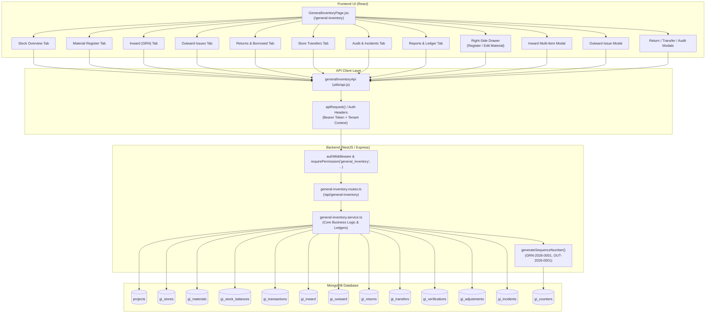
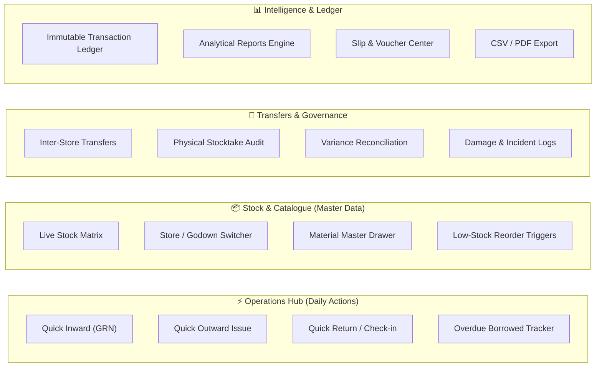

# 🏗️ Site Inventory (General Inventory) — Full Architecture, Connection Map & UX Redesign Blueprint

> **System:** RebarOptima / CraveToBuild  
> **Module:** Site Operations → Site Inventory (`GeneralInventoryPage`)  
> **Route:** `/general-inventory`  
> **Purpose:** Non-steel site inventory management — site consumables, safety gear (PPE), power & hand tools, chemicals, electrical fittings, plumbing, machinery, and temporary fixtures.

---

## 1. Executive Summary & Domain Scope

In construction project operations, **Steel / Rebar Inventory** (`/inventory`) handles millimetric bar optimization, cutting scrap, and offcuts. In parallel, **Site Inventory (General Inventory)** manages the vast array of **general materials, tools, equipment, and consumables** delivered to, stored in, and issued from on-site stores and godowns.

```
┌─────────────────────────────────────────────────────────────────────────────┐
│                            PROJECT SITE ECOSYSTEM                           │
├────────────────────────────────────────┬────────────────────────────────────┤
│         REBAR INVENTORY (/inventory)   │    SITE INVENTORY (/general-inv)   │
├────────────────────────────────────────┼────────────────────────────────────┤
│ • Reinforcement steel (TMT bars)       │ • Electrical, plumbing, masonry    │
│ • Fixed 12m stock & custom lengths     │ • Safety PPE (helmets, vests)      │
│ • Millimetric 1D-CSP cutting optimizer │ • Power tools & machinery          │
│ • Remnant offcuts & scrap salvage      │ • Returnable tools / borrowing log │
│ • Kerf, trim & cutting layouts         │ • Multi-store & godown transfers   │
│ • Bar Bending Schedule (BBS) links     │ • Physical counts, audits, losses  │
└────────────────────────────────────────┴────────────────────────────────────┘
```

### Core Business Objectives
1. **Multi-Store Segregation:** Keep stock separated across multiple on-site stores (e.g. *Main Godown*, *Tower A Site Shed*, *Basement Electrical Room*).
2. **Loss & Theft Prevention:** Track who received what material, which contractor/subcontractor is accountable, and alert immediately when returnable tools are overdue.
3. **Double-Entry Transaction Ledger:** Guarantee that every stock balance change has an immutable, traceable audit trail (Inward, Outward, Return, Transfer, Adjustment).
4. **Zero Stockout Protection:** Configurable low-stock alert thresholds per material with real-time KPI alerts.

---

## 2. Complete Connection Map (Frontend ↔ Backend ↔ Database)



---

## 3. Database Collections & Data Models

| Collection | Schema Interface | Purpose | Key Fields |
|:---|:---|:---|:---|
| `projects` | `IGeneralProject` | Project context & site identification | `_id`, `companyId`, `name`, `code`, `status` |
| `gi_stores` | `IGeneralStore` | Godowns, sheds, store rooms on site | `companyId`, `projectId`, `name`, `code`, `location`, `isDefault` |
| `gi_materials` | `IGeneralMaterial` | Material master item register | `companyId`, `projectId`, `name`, `category`, `subcategory`, `uom`, `lowStockThreshold`, `brandOrModel`, `sizeOrSpec`, `isActive` |
| `gi_stock_balances` | `IGeneralStockBalance` | Fast real-time store balances | `companyId`, `projectId`, `storeId`, `materialId`, `currentBalance` |
| `gi_transactions` | `IGeneralTransaction` | Immutable double-entry movement ledger | `companyId`, `projectId`, `storeId`, `materialId`, `transactionType`, `quantity`, `balanceAfter`, `referenceType`, `referenceNumber`, `performedBy`, `date` |
| `gi_inward` | `IInwardEntry` | Goods Receipt Notes (GRN from vendors) | `companyId`, `projectId`, `storeId`, `grnNumber`, `receiptDate`, `vendorName`, `challanNumber`, `invoiceNumber`, `items[]` |
| `gi_outward` | `IOutwardEntry` | Material issue slips to workers/contractors | `companyId`, `projectId`, `storeId`, `issueNumber`, `issueDateTime`, `personReceiving`, `agency`, `returnClassification`, `expectedReturnDate`, `status` |
| `gi_returns` | `IMaterialReturnEntry` | Consumable surplus & tool returns | `companyId`, `projectId`, `storeId`, `returnNumber`, `returnType`, `outwardReferenceId`, `quantityReturned`, `condition` |
| `gi_transfers` | `IStoreTransfer` | Inter-store movements | `companyId`, `projectId`, `transferNumber`, `fromStoreId`, `toStoreId`, `items[]`, `status` |
| `gi_verifications`| `IStockVerification` | Physical stocktaking audits | `companyId`, `projectId`, `storeId`, `verificationDate`, `counts[]`, `totalVariance` |
| `gi_adjustments` | `IStockAdjustment` | Reconciliations (damage, surplus) | `companyId`, `projectId`, `storeId`, `adjustmentNumber`, `type`, `quantity`, `reason` |
| `gi_incidents` | `IIncidentReport` | Loss, theft, site damage reporting | `companyId`, `projectId`, `incidentNumber`, `type`, `materialId`, `quantity`, `reportedBy` |
| `gi_counters` | Dynamic counter | Human-readable sequence numbers | `_id` (`companyId_prefix_year`), `seq` |

---

## 4. Complete REST API Matrix (29 Endpoints)

All endpoints reside under `/api/general-inventory` and are protected with JWT auth and project access verification.

### 4.1 Project & Store Management
- `GET /projects` — Fetches accessible projects (mirrored from main projects table).
- `GET /projects/:projectId/stores` — Lists all stores/godowns for the selected project.
- `POST /projects/:projectId/stores` — Creates a new store location (`name`, `code`, `location`).

### 4.2 Material Master Register
- `GET /projects/:projectId/materials` — Lists registered materials (supports `search`, `category`, `status`).
- `POST /projects/:projectId/materials` — Registers a new material with duplicate detection warning.
- `PUT /projects/:projectId/materials/:materialId` — Updates material specifications, category, UOM, or threshold.
- `DELETE /projects/:projectId/materials/:materialId` — Soft-deactivates material.

### 4.3 Real-Time Stock & Initial Balances
- `GET /projects/:projectId/stock` — Fetches real-time stock balances across all stores or filtered by `?storeId=...`.
- `POST /projects/:projectId/stock/opening-balance` — Sets opening balance for a material in a store with an audit transaction.

### 4.4 Inward Goods (GRN)
- `GET /projects/:projectId/inward` — Lists inward delivery receipts with search, vendor, date range.
- `GET /projects/:projectId/inward/:id` — Fetches full details for a single GRN receipt slip.
- `POST /projects/:projectId/inward` — Multi-item inward delivery submission. Auto-increments stock balances and logs transactions.

### 4.5 Outward Issues & Requisitions
- `GET /projects/:projectId/outward` — Lists outward issues (contractor, date, status, returnable flag).
- `GET /projects/:projectId/outward/:id` — Fetches full issue slip details.
- `GET /projects/:projectId/outward/returnable/eligible` — Lists all active borrowed returnable tools pending return.
- `POST /projects/:projectId/outward` — Issues material. Validates store balance sufficiency before decrementing.

### 4.6 Material Returns & Tool Recovery
- `GET /projects/:projectId/returns` — Lists material returns history.
- `POST /projects/:projectId/returns` — Records return of unused consumables or borrowed tools. Restores store balance and updates original issue status.

### 4.7 Inter-Store Transfers
- `GET /projects/:projectId/transfers` — Lists store-to-store transfer dispatches.
- `POST /projects/:projectId/transfers` — Executes transfer. Atomically decrements source store and increments destination store with dual ledger entries.

### 4.8 Audits, Physical Counts & Incidents
- `GET /projects/:projectId/verifications` — Lists physical stock audit records.
- `POST /projects/:projectId/verifications` — Records physical audit (system count vs physical count).
- `GET /projects/:projectId/adjustments` — Lists stock adjustments.
- `POST /projects/:projectId/adjustments` — Adjusts stock (surplus add / defect deduct).
- `GET /projects/:projectId/incidents` — Lists theft, damage, and loss incidents.
- `POST /projects/:projectId/incidents` — Reports site incident, automatically adjusting stock.

### 4.9 Ledger & Analytical Reports
- `GET /projects/:projectId/ledger` — Complete immutable chronological movement ledger.
- `GET /projects/:projectId/reports/:reportType` — Generates aggregated reports:
  - `store-wise-stock`
  - `low-stock-alert`
  - `material-movement`
  - `vendor-receipts`
  - `contractor-issues`
  - `borrowed-overdue`
  - `damage-loss-summary`

---

## 5. Current UI Teardown: 8 Tabs & 11 Modals

Currently, `GeneralInventoryPage.jsx` is a single 3,729-line monolithic component containing:

### 5.1 Top Bar & KPI Section
1. **Context Bar:** Project selector + Store selector dropdown (`All Stores` vs specific godown).
2. **Overdue Banner:** Red alert banner appearing when borrowed returnable tools are overdue.
3. **KPI Grid (4 Cards):**
   - *Registered Materials*
   - *Normal Stock*
   - *Low-Stock Alert*
   - *Out of Stock*

### 5.2 The 8 Navigation Tabs
1. `overview` (Stock Overview): Live stock cards, status badges, search & category filter, quick Inward/Outward/Material buttons.
2. `materials` (Material Register): Material catalogue, codes, UOM, thresholds, vendors, active/deactivated status.
3. `inward` (Inward Goods / GRN): Delivery receipt table, vendor, challan, received/accepted items count.
4. `outward` (Outward Issues): Issue vouchers, contractor/agency, person receiving, returnable indicator.
5. `returns` (Returns & Borrowed): Two tables: Return entries history + Active Borrowed Tools tracker with overdue chips.
6. `transfers` (Store Transfers): Inter-godown movement table with items count and timestamps.
7. `audit` (Audit & Incidents): Contains 3 nested sub-tabs (`verification`, `adjustments`, `incidents`).
8. `reports` (Reports & Ledger): Report dropdown selector, date filter, CSV export, and transaction ledger table.

### 5.3 The 11 Popups / Drawers
1. `showStoreModal` (Modal): Add Store/Godown.
2. `showMaterialModal` (Right Drawer): Register / Edit Material (Slide-over panel with custom Category & UOM).
3. `showOpeningModal` (Modal): Set Initial Opening Balance.
4. `showInwardModal` (Large Modal): Multi-item GRN submission.
5. `showOutwardModal` (Modal): Issue material to contractor.
6. `showReturnModal` (Modal): Return consumable or borrowed equipment.
7. `showTransferModal` (Modal): Move items between stores.
8. `showVerificationModal` (Large Modal): Physical audit count.
9. `showAdjustmentModal` (Modal): Manual balance adjustment.
10. `showIncidentModal` (Modal): Damage/Theft/Loss incident.
11. `activeSlip` (Modal): Printable GRN receipt or Outward issue voucher.

---

## 6. UX Audit: Current Friction Points & Opportunities

```
┌─────────────────────────────────────────────────────────────────────────────┐
│                       CURRENT UX FRICTION POINTS                            │
├─────────────────────────┬───────────────────────────────────────────────────┤
│ 1. Tab Overload         │ 8 horizontal tabs + 3 sub-tabs cause cognitive    │
│                         │ load and horizontal overflow on laptop/tablet.    │
├─────────────────────────┼───────────────────────────────────────────────────┤
│ 2. Modal Fatigue        │ 11 separate popup dialogs interrupt workflow and   │
│                         │ hide the background context.                      │
├─────────────────────────┼───────────────────────────────────────────────────┤
│ 3. Disconnected Actions │ To issue material, a user checks "Stock Overview",│
│                         │ switches to "Outward Issues", then opens a modal. │
├─────────────────────────┼───────────────────────────────────────────────────┤
│ 4. Table Density        │ 8-10 columns per table make viewing difficult on  │
│                         │ tablet/mobile without horizontal scrolling.       │
├─────────────────────────┼───────────────────────────────────────────────────┤
│ 5. Slip Access          │ Viewing or re-printing receipts requires digging  │
│                         │ into table rows rather than a clean drawer view.  │
└─────────────────────────┴───────────────────────────────────────────────────┘
```

---

## 7. UX Redesign Blueprint: The 4-Hub Modern Architecture

Instead of 8 sprawling tabs and 11 fragmented modals, consolidate Site Inventory into **4 Action-Driven Hubs** with a **unified right-side drawer system**:



### 7.1 Hub Breakdown & User Journeys

#### Hub 1: ⚡ Daily Operations (High-Frequency Site Work)
- **Primary Site Hero Bar:** Three prominent primary action buttons at the top:
  - `[ + Inward Delivery ]` (Opens Right-Side Inward Drawer)
  - `[ - Issue Material ]` (Opens Right-Side Outward Drawer)
  - `[ ↩ Return Material / Tool ]` (Opens Quick Return Drawer)
- **Live Overdue Attention Strip:** Visual alert card for borrowed tools past their due date with 1-click `[ Return Now ]` or `[ Extend Date ]`.
- **Recent Activity Feed:** Last 10 site movements (who took what, which store received goods) with instant slip preview.

#### Hub 2: 📦 Stock & Catalogue (Real-Time Yard Inventory)
- **Store-Selector Pills:** Segmented buttons (`All Godowns` | `Main Godown` | `Shed A` | `+ Add Store`).
- **Interactive Stock Matrix:**
  - Material Name, Category Badge, Brand.
  - Visual Stock Level Indicator: Progress bar showing current stock relative to minimum threshold (Green = Healthy, Yellow = Reorder Soon, Red = Critical).
  - Quick Row Actions: `[ + Inward ]`, `[ - Issue ]`, `[ Edit Material ]`, `[ Set Opening ]`.
- **Slide-Over Material Drawer:** The recently upgraded right-side drawer with dynamic Category and UOM customization.

#### Hub 3: 🔄 Transfers & Governance (Audits & Loss Control)
- **Two Clean Sub-Views:**
  - *Store Transfers:* Visual card flow showing source store ➜ destination store with transit status.
  - *Physical Audit & Incidents:* Guided 3-step stocktake count sheet (Expected ➜ Actual Count ➜ Variance Summary ➜ 1-Click Reconciliation).

#### Hub 4: 📊 Intelligence & Ledger (Compliance & Reporting)
- **Unified Timeline Ledger:** Chronological transaction stream with search, date-range picker, and transaction-type filter pills (`All` | `Inward` | `Outward` | `Returns` | `Transfers` | `Adjustments`).
- **One-Click Printable Vouchers:** Clean digital receipts with QR code verification, supervisor signatures, and printable PDF formats.
- **Visual Analytics:** Monthly consumption charts, top issued contractors, and scrap/loss summaries.

---

## 8. Component Refactoring & File Decomposition Plan

Currently, `GeneralInventoryPage.jsx` is 3,729 lines in one file. Without altering any backend route or breaking existing data, the page can be modularized cleanly:

```
frontend/src/pages/GeneralInventoryPage/
├── GeneralInventoryPage.jsx              # Main orchestrator (state & project context)
├── GeneralInventoryPage.css              # Theme-aware CSS & drawer keyframes
├── components/
│   ├── OperationsHub/
│   │   ├── OperationsHeroBar.jsx         # +Inward, -Issue, Return quick buttons
│   │   ├── OverdueTrackerCard.jsx        # Borrowed tools countdown alert
│   │   └── RecentMovementFeed.jsx        # Live site activity list
│   ├── StockHub/
│   │   ├── StoreSelectorBar.jsx          # Godown filter pills & Add Store drawer
│   │   ├── StockMatrixTable.jsx          # Stock items with visual threshold bars
│   │   └── MaterialRegisterDrawer.jsx    # Right-side material register/edit drawer
│   ├── GovernanceHub/
│   │   ├── StoreTransferManager.jsx      # Inter-store movement workflows
│   │   ├── PhysicalVerificationSheet.jsx # Stocktake audit reconciliation
│   │   └── IncidentLoggerDrawer.jsx      # Damage, theft, and loss reports
│   ├── IntelligenceHub/
│   │   ├── TransactionLedgerTable.jsx    # Double-entry audit history
│   │   ├── SiteReportsEngine.jsx         # Report selector & CSV generator
│   │   └── DigitalSlipModal.jsx          # Printable GRN and Outward issue slips
│   └── drawers/
│       ├── InwardEntryDrawer.jsx         # Multi-item GRN right drawer
│       ├── OutwardIssueDrawer.jsx        # Material issue right drawer
│       └── MaterialReturnDrawer.jsx      # Tool return right drawer
```

---

## 9. Recommended Next Steps for Implementation

1. **Phase 1 (Visual Quick Wins — Zero Risk):**
   - Consolidate the 8 tabs into the 4 structured Hubs (`Operations`, `Stock & Catalogue`, `Transfers & Audit`, `Ledger & Reports`).
   - Add the visual stock threshold health bars to the Stock table.
2. **Phase 2 (Modal to Drawer Migration):**
   - Convert Inward and Outward modals into right-side slide-over drawers (matching the Material Register drawer).
3. **Phase 3 (Slip & Print Modernization):**
   - Enhance the digital voucher preview for GRN slips and Outward issue slips with modern printable layouts.
4. **Phase 4 (Component Modularization):**
   - Split `GeneralInventoryPage.jsx` into the subcomponent structure detailed in Section 8.

