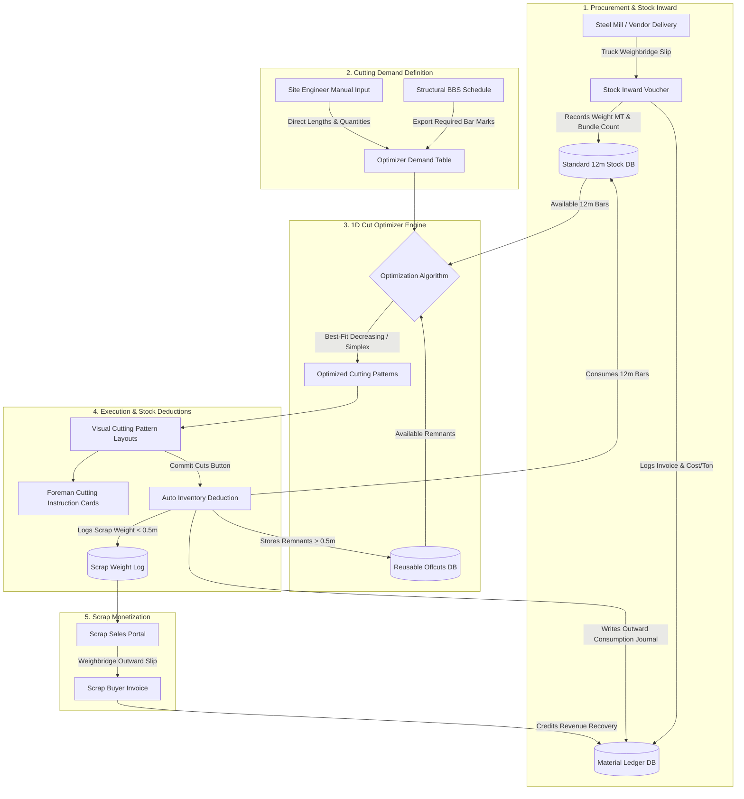

# CRAVETOBUILD / REBAROPTIMA — STEEL MODULE ARCHITECTURE & UI/UX BLUEPRINT

> **Comprehensive Technical, Data Flow, and UI/UX State Analysis of the Steel & Rebar Optimization Suite**  
> *Author: Senior Full-Stack Engineering & Product Architecture Team*  
> *Target Audience: Product Owners, Non-Technical Developers, UI/UX Designers, Site Engineers*

---

## 1. Executive Overview & Business Domain

The **Steel Module** is the foundational core of **RebarOptima (CraveToBuild)**. In structural concrete construction, high-tensile reinforcement steel (TMT Rebar) represents **20% to 35% of total project material expenditure**. 

Standard commercial rebar is manufactured and delivered by steel mills in standard **12-meter (12,000 mm)** stock lengths across standardized diameters:
$$\varnothing 8\text{mm}, \varnothing 10\text{mm}, \varnothing 12\text{mm}, \varnothing 16\text{mm}, \varnothing 20\text{mm}, \varnothing 25\text{mm}, \varnothing 32\text{mm}$$

### The Core Problem Solved by the Steel Module:
Manual on-site bar cutting without algorithmic optimization generates **8% to 15% scrap wastage**, costing millions of rupees per project. 
The Steel Module uses a **1D Cutting Stock Optimization Engine (Column Generation & Best-Fit Bin Packing)** to reduce scrap to **below 1.8%**, while simultaneously providing:
1. Real-time diameter-wise stock accounting (Standard 12m Bars + Reusable Remnants).
2. Double-entry Material Ledger with running stock balances, inward valuation, and physical reconciliation.
3. Production cutting patterns, visual dimensional bar layouts, and foreman tags.
4. Scrap disposal and commercial sales logging with revenue recovery tracking.

---

## 2. Steel Module Navigation Architecture

In the primary sidebar, **Steel & BBS** contains the Steel suite:

```
SIDEBAR: STEEL & BBS
└── 📦 Steel (Expandable Group)
    ├── 1. Inventory        (/inventory)
    ├── 2. Material Ledger  (/ledger)
    ├── 3. Run Optimizer    (/inputs ➔ /results)
    └── 4. Batch History    (/history)
```

---

## 3. End-to-End Operational Lifecycle & Data Flow



---

## 4. Current UI Screens & Visual Breakdown

### 4.1 Sub-Module 1: Rebar Inventory (`/inventory`)

#### Currently Supported Tabs:
1. **`Stock List` (`list`)**:
   - **Header Metrics**: Total Stock (Tonnes), Remnant Stock (Tonnes), Estimated Inventory Valuation (₹), Low-Stock Diameter Alerts.
   - **Standard Stock Table (12,000 mm)**:
     - Columns: `Diameter (mm)`, `Available Quantity (Bars)`, `Weight per Meter (kg/m)`, `Total Weight (Tonnes)`, `Stock Level Status` (Healthy, Low, Depleted), `Actions` (Edit Stock, Reconcile).
     - Standard Weight Formula: 
       $$\text{Unit Weight} = \frac{d^2}{162.2} \text{ kg/m}$$
   - **Remnants / Usable Offcuts Table**:
     - Lists reclaimed steel pieces from previous cutting batches ($0.5\text{m} \le L < 12.0\text{m}$).
     - Columns: `Tag ID`, `Diameter`, `Exact Length (mm)`, `Quantity`, `Source Batch`, `Actions` (Consume, Delete).
2. **`Inward Voucher` (`inward`)**:
   - Multi-diameter inwarding form pre-populated for all 7 standard diameters ($8, 10, 12, 16, 20, 25, 32$ mm).
   - Fields per row: `Weight (Tons)`, `Price per Ton (excl. GST)`, `GST %`, `Total Price (incl. GST)`, `Brand / Mill Name` (e.g. Tata Tiscon, JSW NeoSteel, Jindal Panther), `Vendor / Supplier`.
3. **`Scrap Classification Rules` (`rules`)**:
   - Configuration table specifying minimum threshold lengths per diameter.
   - Example: For 25mm rebar, pieces $< 800$ mm are marked as scrap; pieces $\ge 800$ mm are returned to usable inventory as remnants.
4. **`Scrap Sales Portal` (`scrapsales`)**:
   - Logs sale of accumulated non-reusable scrap to recyclers.
   - Fields: `Date`, `Scrap Buyer`, `Total Weight (kg / Tonnes)`, `Rate per kg (₹)`, `Total Amount (₹)`.
5. **`Batch Scrap Records` (`batchscrap`)**:
   - Audit trail of scrap generated per historical cutting run.

```
┌─────────────────────────────────────────────────────────────────────────────────────────────────┐
│ REBAR INVENTORY (/inventory)                                                                    │
├─────────────────────────────────────────────────────────────────────────────────────────────────┤
│ [Stock List]    [+ Inward Voucher]    [Scrap Rules]    [Scrap Sales]    [Batch Scrap Audit]     │
├─────────────────────────────────────────────────────────────────────────────────────────────────┤
│  ┌──────────────────┐  ┌──────────────────┐  ┌──────────────────┐  ┌──────────────────┐         │
│  │ TOTAL INVENTORY  │  │ REUSABLE OFF-CUT │  │ SCRAP GENERATED  │  │ TOTAL VALUATION  │         │
│  │ 142.80 Tonnes    │  │ 4.15 Tonnes      │  │ 2.10 Tonnes      │  │ ₹ 84,25,000      │         │
│  └──────────────────┘  └──────────────────┘  └──────────────────┘  └──────────────────┘         │
│                                                                                                 │
│ STANDARD STOCK (12,000 mm Lengths)                                                              │
│ ┌──────────┬──────────────┬──────────────┬──────────────┬──────────────┬──────────────────────┐ │
│ │ Diameter │ Bar Quantity │ kg / Meter   │ Total Weight │ Status       │ Actions              │ │
│ ├──────────┼──────────────┼──────────────┼──────────────┼──────────────┼──────────────────────┤ │
│ │ 8 mm     │ 1,200 Bars   │ 0.395 kg/m   │ 5.688 MT     │ [In Stock]   │ [Edit] [Reconcile]   │ │
│ │ 10 mm    │ 850 Bars     │ 0.617 kg/m   │ 6.293 MT     │ [In Stock]   │ [Edit] [Reconcile]   │ │
│ │ 12 mm    │ 420 Bars     │ 0.888 kg/m   │ 4.475 MT     │ [Low Stock!] │ [Edit] [Reconcile]   │ │
│ │ 16 mm    │ 980 Bars     │ 1.580 kg/m   │ 18.580 MT    │ [In Stock]   │ [Edit] [Reconcile]   │ │
│ │ 20 mm    │ 640 Bars     │ 2.470 kg/m   │ 18.969 MT    │ [In Stock]   │ [Edit] [Reconcile]   │ │
│ │ 25 mm    │ 310 Bars     │ 3.850 kg/m   │ 14.322 MT    │ [In Stock]   │ [Edit] [Reconcile]   │ │
│ │ 32 mm    │ 150 Bars     │ 6.310 kg/m   │ 11.358 MT    │ [In Stock]   │ [Edit] [Reconcile]   │ │
│ └──────────┴──────────────┴──────────────┴──────────────┴──────────────┴──────────────────────┘ │
└─────────────────────────────────────────────────────────────────────────────────────────────────┘
```

---

### 4.2 Sub-Module 2: Material Ledger & Procurement (`/ledger`)

#### Currently Supported Tabs:
1. **`Material Ledger` (`ledger`)**:
   - Double-entry debit/credit ledger tracking every gram of steel entering or leaving the site.
   - **Transaction Types**:
     - `INWARD`: Rebar arrived on site from supplier.
     - `OUTWARD (CONSUMPTION)`: Bars cut and issued to yard/contractor for fabrication.
     - `SCRAP_SALE`: Scrap rebar dispatched to scrap trader.
     - `RECONCILIATION`: Periodic stock audit adjustment.
   - **View Modes**:
     - *Batch-grouped view*: Summarizes total bars consumed per batch.
     - *Flat chronological view*: Complete journal with running balance column.
   - **Export Capabilities**: High-res PDF statement and formatted Excel export.
2. **`Inward Cost Analytics` (`inward-cost`)**:
   - Weighted average cost analysis per tonne across vendors and delivery tranches.
3. **`Purchase Orders` (`orders`)**:
   - Tracks procurement orders, expected delivery dates, and pending quantities.
4. **`Site Requisitions` (`requests`)**:
   - Site supervisors can request diameter-specific steel for upcoming slab/beam pours.

---

### 4.3 Sub-Module 3: 1D Cut Optimizer Inputs (`/inputs`)

#### Purpose:
The input console where engineers specify the cutting job requirements.

#### Current UI Layout & Fields:
- **Batch Name**: Defaults to `Batch #DD/MM/YYYY` (editable).
- **Available Stock Table**:
  - `Diameter (mm)`
  - `Stock Length (mm)` (Default: 12,000 mm)
  - `Available Quantity` (Leave blank for infinite / unconstrained stock)
- **Required Cut Parts Table**:
  - `Diameter (mm)`
  - `Cut Length (mm)` (e.g. 4,500 mm for beam bottom bar)
  - `Required Quantity` (e.g. 180 bars)
  - `Bar Mark / Label` (e.g. `B1-BOT-01`, `C2-MAIN`)
- **Key Accelerators**:
  - **Auto Add Row on Tab/Enter**: Tabbing out of the last field automatically creates a new row.
  - **Pull from Predefined Cuts**: Modal allowing selection of saved BBS element templates.
  - **Include Inventory Remnants Checkbox**: Instructs optimizer to prioritize cutting from warehouse offcuts before pulling new 12m stock.
- **Engine Tuning Parameters (Collapsible)**:
  - `Kerf (Saw Blade Width)`: Defaults to 2 mm or 3 mm.
  - `Trim Margin`: End trim clearance (defaults to 10 mm per bar).

```
┌─────────────────────────────────────────────────────────────────────────────────────────────────┐
│ RUN 1D CUT OPTIMIZER (/inputs)                                                                  │
├─────────────────────────────────────────────────────────────────────────────────────────────────┤
│ Batch Name: [ Batch #15/11/2026 - Tower A Level 3 Beams            ]   Project: Dashtech        │
│                                                                                                 │
│ 1. AVAILABLE STOCK CONFIGURATION                                                                │
│ ┌────┬──────────────┬──────────────────┬────────────────────┬─────────────────────────────────┐ │
│ │ #  │ Diameter     │ Stock Length(mm) │ Available Quantity │ Notes                           │ │
│ ├────┼──────────────┼──────────────────┼────────────────────┼─────────────────────────────────┤ │
│ │ 1  │ 20 mm        │ 12,000 mm        │ 120 Bars           │ Standard Full Stock             │ │
│ │ 2  │ 20 mm        │ 4,850 mm         │ 14 Bars            │ Reusable Offcut from Batch #4   │ │
│ └────┴──────────────┴──────────────────┴────────────────────┴─────────────────────────────────┘ │
│                                                                                                 │
│ 2. REQUIRED CUT PARTS (DEMAND)                      [+ Pull from BBS]  [+ Add Row]              │
│ ┌────┬──────────────┬──────────────────┬────────────────────┬────────────────────┬────────────┐ │
│ │ #  │ Diameter     │ Cut Length (mm)  │ Required Quantity  │ Bar Mark / Label   │ Action     │ │
│ ├────┼──────────────┼──────────────────┼────────────────────┼────────────────────┼────────────┤ │
│ │ 1  │ 20 mm        │ 4,500 mm         │ 80                 │ B1-BOTTOM-MAIN     │ [Delete]   │ │
│ │ 2  │ 20 mm        │ 3,200 mm         │ 80                 │ B1-TOP-MAIN        │ [Delete]   │ │
│ │ 3  │ 20 mm        │ 1,850 mm         │ 40                 │ B1-EXTRA-SUPPORT   │ [Delete]   │ │
│ └────┴──────────────┴──────────────────┴────────────────────┴────────────────────┴────────────┘ │
│                                                                                                 │
│ [⚙️ Optimization Settings: Kerf: 2mm, Trim: 10mm]                  [🚀 RUN OPTIMIZER BUTTON]   │
└─────────────────────────────────────────────────────────────────────────────────────────────────┘
```

---

### 4.4 Sub-Module 4: Results & Cutting Layout Patterns (`/results`)

#### Purpose:
Visualizes the optimal mathematical cutting layouts, offcut classifications, and provides the authoritative button to commit deductions to site inventory.

#### Current UI Layout & Components:
1. **Hero KPI Cards**:
   - **Total Wastage %**: Target $< 1.8\%$ (highlighted green).
   - **Stock Bars Required**: Number of 12m bars needed.
   - **Total Steel Weight Cut**: In metric tonnes.
   - **Usable Offcuts Generated**: Count and total weight of offcuts $\ge 500$ mm preserved.
   - **Scrap Generated**: Total weight of unusable drops $< 500$ mm.
2. **Visual 1D Cutting Pattern Bars**:
   - Each pattern shows a horizontal proportional bar representing 12,000 mm.
   - Each cut piece inside the bar is color-coded with its exact length in mm and Bar Mark label.
   - The rightmost tail of the bar shows the remnant:
     - **Green striped**: Reusable Remnant (with exact length, e.g. `1,420 mm`).
     - **Red diagonal**: Scrap (e.g. `40 mm`).
   - Repetition multiplier: e.g. `Pattern A (Repeat 24 Times)`.
3. **Foreman Cutting List & Printable Bar Tags**:
   - Printable cutting instructions for rebar bending machine operators on site.
4. **Primary Execution Action**:
   - **`[Commit Cuts & Deduct Stock]`**:
     - Automatically deducts the utilized 12m bars from `/inventory`.
     - Automatically registers all generated offcuts into the Remnants Table.
     - Logs the transaction into `/ledger`.
     - Saves the batch permanently into `/history`.

---

### 4.5 Sub-Module 5: Batch History (`/history`)

#### Purpose:
The immutable archive of all past cutting batches executed for the active project.

#### Current Features:
- Filterable by Date range, Diameter, and Project.
- Accordion expansion showing full pattern details, scrap percentage, and bars consumed.
- Actions:
  - `Print Foreman Cutting Sheet` (PDF).
  - `Print Management Wastage Audit` (PDF).
  - `Re-Run / Clone Batch`: Loads the historical parts back into `/inputs` for repetition.
  - `Rename Batch`.

---

## 5. Current User Flow Bottlenecks & UX Friction Points

While the underlying calculation and optimization algorithms are world-class, the **current user experience suffers from 5 major friction areas**:

### 🔴 Problem 1: Disconnected Stock vs. Optimization Workflow
- **Current Flow**: The user enters `/inventory` to check if 16mm rebar is in stock. Then they must manually navigate to `/inputs` and type in `16mm, 12,000mm, 200 bars`.
- **Friction**: The optimizer does not automatically auto-populate available inventory. The user has to remember or cross-check stock quantities manually.

### 🔴 Problem 2: Inline Tables Pushing Content & Bloated Forms
- In `/inventory`, switching between tabs (`list`, `inward`, `rules`, `scrapsales`) changes the entire page. 
- The Stock Inward form is an enormous 7-row table taking up the whole screen, making it impossible to see current stock while inwarding.

### 🔴 Problem 3: Fragmented Scrap Management
- Scrap rules are in `/inventory/rules`.
- Scrap generation is in `/results`.
- Scrap sales logging is in `/inventory/scrapsales`.
- Financial recovery from scrap is logged in `/ledger`.
- A user trying to track the scrap lifecycle has to click through 4 different screens.

### 🔴 Problem 4: Manual Bar Input instead of 1-Click BBS Sync
- Structural engineers prepare BBS schedules in the BBS module (`/bbs`).
- However, site engineers often re-type or re-enter cut lengths manually in `/inputs`.
- There should be a **1-Click "Send BBS to Optimizer"** action that eliminates manual data entry entirely.

### 🔴 Problem 5: Lack of Slide-Over Drawers (Modern SaaS Pattern)
- Editing stock levels, inwarding a shipment, or logging a scrap invoice currently uses inline page forms or modal dialogs rather than right-side slide-over drawers.

---

## 6. Proposed RebarOptima Steel Suite Redesign

### 6.1 Unified Sub-Navigation Architecture
To align with the redesigned **Governance** and **Site Inventory** modules, the Steel module will feature a unified **Steel Hub Navigation Header**:

```
┌────────────────────────────────────────────────────────────────────────────────────────────────┐
│ STEEL OPERATIONS                                                       [Dashtech (Active)]     │
│ Enterprise Rebar Inventory, 1D Cutting Stock Optimization, and Material Accounting             │
├────────────────────────────────────────────────────────────────────────────────────────────────┤
│ [📦 Inventory & Stock]   [⚡ Run Optimizer]   [📊 Results & Patterns]   [📋 History]   [📖 Ledger] │
└────────────────────────────────────────────────────────────────────────────────────────────────┘
```

### 6.2 Key UX Enhancements to Implement:

| Area | Current Behavior | Proposed Redesigned Experience |
|---|---|---|
| **Stock Inwarding** | Multi-row inline page in `/inventory` | **Right-side Slide-Over Drawer**: Quickly inward bundles by diameter without leaving the stock overview table. |
| **Inventory-Aware Optimizer** | User manually enters stock in `/inputs` | **Live Inventory Auto-Fill**: Optimizer displays live available stock bars and remnants; 1-click "Use Live Inventory". |
| **BBS Direct Optimization** | Manual typing of cut lengths | **"Import from BBS" Drawer**: Select any approved BBS schedule (e.g. *Tower A - Level 4 Columns*); parts auto-fill in 1 second. |
| **Results & Execution** | Fixed results page | **Split-Screen Interactive Review**: Left side shows KPI summary & printable tags; right side shows zoomable dimensional pattern bars. |
| **Commit Cuts Workflow** | Standard confirmation popup | **Audit Drawer**: Displays exact bars to be deducted, offcuts to be added, and ledger entry before confirming. |
| **Mobile & Tablet Friendly** | Wide horizontal scroll tables | **Responsive Cards & Touch-friendly Bar Cutters**: Rebar cutter operators on site can tap through cut instructions with $\ge 44$px targets. |

---

## 7. Database Collections & Entity Relationships

```
┌──────────────────┐          ┌───────────────────┐          ┌──────────────────┐
│   inventories    │ 1      * │  inventoryledgers │ *      1 │    companies     │
│ (Rebar Stock)    ├──────────┤ (Material Ledger) ├──────────┤   & Projects     │
└────────┬─────────┘          └───────────────────┘          └──────────────────┘
         │ 1
         │
         │ *
┌────────┴─────────┐ 1      * ┌───────────────────┐
│     batches      ├──────────┤   batchscraps     │
│ (Optimizer Runs) │          │  (Wastage Logs)   │
└──────────────────┘          └───────────────────┘
```

### 7.1 Schema Specifications:

#### `inventories` (Standard & Remnant Stock)
```typescript
interface RebarInventoryItem {
  _id: ObjectId;
  companyId: ObjectId;
  projectId: ObjectId;
  diameter: number;          // 8, 10, 12, 16, 20, 25, 32
  length: number;            // 12000 (standard) or custom mm (remnant)
  quantity: number;          // Total bars available
  totalWeightInTons: number; // Derived: (qty * length * unitWeight) / 1,000,000
  isRemnant: boolean;        // false = Mill Bar (12m), true = Usable Offcut
  sourceBatchId?: ObjectId;  // Linked batch where remnant was generated
  updatedAt: Date;
}
```

#### `batches` (Optimization Pattern Archive)
```typescript
interface BatchRecord {
  _id: ObjectId;
  companyId: ObjectId;
  projectId: ObjectId;
  batchName: string;
  diameter: number;
  totalStockUsed: number;
  totalWeightCutMT: number;
  totalWastageMT: number;
  wastagePercentage: number; // e.g. 1.45%
  kerf: number;
  trimMargin: number;
  layouts: {
    patternId: string;
    repetition: number;
    stockLength: number;
    cuts: { length: number; label: string; color: string }[];
    remnantLength: number;
    isScrap: boolean;
  }[];
  isCommittedToStock: boolean;
  createdAt: Date;
}
```

---

## 8. Summary & Next Implementation Steps

This blueprint establishes the authoritative specification of the Steel Module's business logic, calculation engines, data schemas, and current UI layouts.

**Recommended Implementation Strategy**:
1. Preserve 100% of the optimization algorithms, mathematical scrap calculations, and inventory deduction routines.
2. Build unified shared navigation header matching the new Governance & Site Inventory modules.
3. Migrate inwarding, scrap sales, and reconciliation dialogs into accessible right-side slide-over drawers.
4. Add the 1-Click "Optimize from BBS Schedule" data pipeline.

