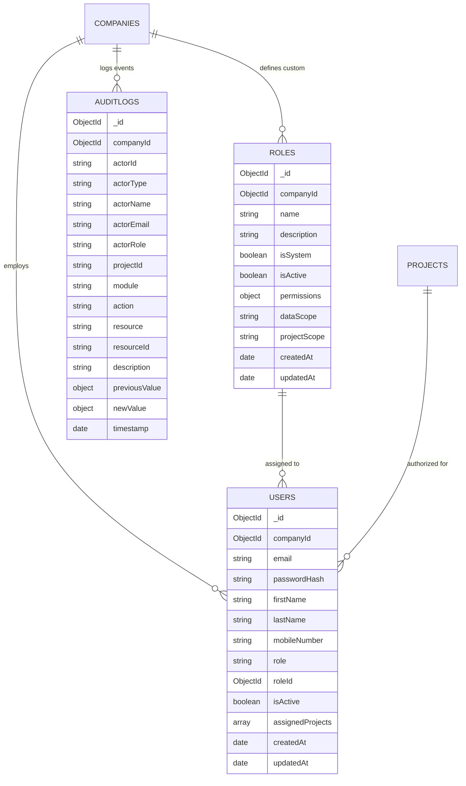
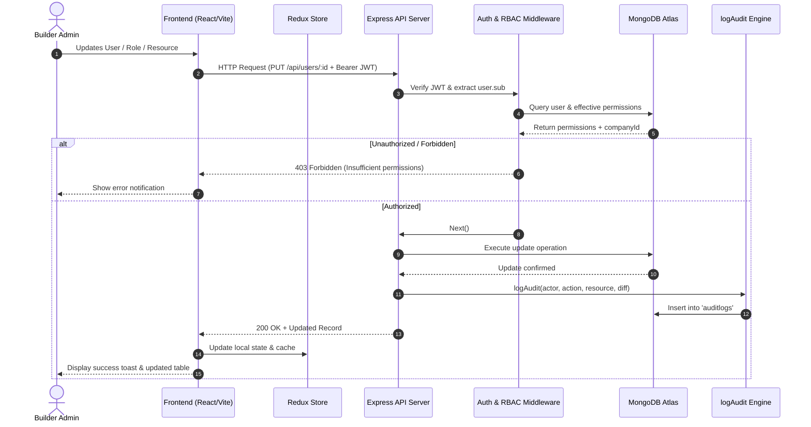

# 🛡️ Enterprise Governance: User Management, Roles & Permissions, and Activity Logs — Architecture, UI/UX Workflows & Redesign Blueprint

> **System:** CraveToBuild / RebarOptima Enterprise Suite  
> **Modules:**  
> 1. Team & Identity: **User Management** (`/users`)  
> 2. Access Control: **Roles & Permissions** (`/roles`)  
> 3. Compliance & Auditing: **Activity Logs** (`/activity-logs`)  
> **Target Audience:** Non-Technical Founders, Product Owners, UI/UX Designers, Security Auditors, and Full-Stack Engineers.  
> **Version:** 2.0 (Production Architecture & Redesign Specification)  
> **Companion Codebase Files:**  
> - Users Frontend: [`frontend/src/pages/UsersPage/UsersPage.jsx`](file:///Users/darshanpatel/Desktop/Projects%20/RebarOptima/frontend/src/pages/UsersPage/UsersPage.jsx)  
> - Roles Frontend: [`frontend/src/pages/RolesPage/RolesPage.jsx`](file:///Users/darshanpatel/Desktop/Projects%20/RebarOptima/frontend/src/pages/RolesPage/RolesPage.jsx)  
> - Permission Matrix Engine: [`frontend/src/pages/RolesPage/permissionMatrix.js`](file:///Users/darshanpatel/Desktop/Projects%20/RebarOptima/frontend/src/pages/RolesPage/permissionMatrix.js)  
> - Activity Logs Frontend: [`frontend/src/pages/ActivityLogsPage/ActivityLogsPage.jsx`](file:///Users/darshanpatel/Desktop/Projects%20/RebarOptima/frontend/src/pages/ActivityLogsPage/ActivityLogsPage.jsx)  
> - Backend Routes & RBAC Engine: [`backend/src/main.ts`](file:///Users/darshanpatel/Desktop/Projects%20/RebarOptima/backend/src/main.ts) (`/api/users`, `/api/roles`, `/api/permissions/effective`, `/api/activity-logs`)  
> - API Client Adapters: [`frontend/src/utils/api.js`](file:///Users/darshanpatel/Desktop/Projects%20/RebarOptima/frontend/src/utils/api.js)  

---

## 1. Executive Summary & The Governance Triad

In modern construction and real estate development SaaS, operational safety relies on the **Governance Triad**:

```
                  ┌──────────────────────────────────────────────┐
                  │            GOVERNANCE TRIAD                  │
                  │   Identity ─── Access ─── Accountability     │
                  └──────────────────────┬───────────────────────┘
                                         │
         ┌───────────────────────────────┼───────────────────────────────┐
         │                               │                               │
         ▼                               ▼                               ▼
┌──────────────────┐           ┌──────────────────┐           ┌──────────────────┐
│ USER MANAGEMENT  │           │ ROLES & POLICIES │           │  ACTIVITY LOGS   │
│  "WHO are you?"  │ ────────> │ "WHAT can you    │ ────────> │ "WHAT did you do │
│                  │           │     do & see?"   │           │   and when?"     │
│ • User Profiles  │           │ • Granular RBAC  │           │ • Forensic Trail │
│ • Active Status  │           │ • Data Scopes    │           │ • Before vs After│
│ • Project Grants │           │ • Module Gates   │           │ • Export Reports │
└──────────────────┘           └──────────────────┘           └──────────────────┘
```

1. **User Management (`/users`)**: Governs team membership, personal credentials, active/suspended employment status, and multi-project authorizations.
2. **Roles & Permissions (`/roles`)**: Governs fine-grained functional capabilities across all 14 application modules (viewing, inwarding, approving, editing, deleting, exporting) and geographic/project data scopes (`organization`, `project`, `own`).
3. **Activity Logs (`/activity-logs`)**: Provides an immutable, tamper-evident audit ledger capturing every critical modification (who changed it, timestamp, old value, new value, and resource IDs) for financial, structural, and legal accountability.

---

## 2. Core Architecture & Multi-Tenant Data Models

The system enforces multi-tenant isolation through MongoDB schemas. Every query is partitioned by `companyId` so one builder firm can never access another firm's staff, roles, or audit trails.

### 2.1 MongoDB Database Schemas



### 2.2 The 4-Tier Permission Evaluation Engine

Access is evaluated dynamically via the backend engine (`getEffectivePermissions` in `backend/src/main.ts`):

```
┌────────────────────────────────────────────────────────────────────────┐
│ LEVEL 1: SUBSCRIPTION PLAN TIER (Company Level)                        │
│ Checks if the module is enabled in the builder's subscription plan.    │
│ If expired or un-purchased ➔ Module is forcibly disabled for all users.│
└───────────────────────────────────┬────────────────────────────────────┘
                                    │ PASS
                                    ▼
┌────────────────────────────────────────────────────────────────────────┐
│ LEVEL 2: ROLE-BASED ACCESS CONTROL (RBAC)                              │
│ Checks role permissions matrix: e.g. `inventory.edit = false`.        │
│ Disables specific CRUD actions (View, Create, Edit, Delete, Export).   │
└───────────────────────────────────┬────────────────────────────────────┘
                                    │ PASS
                                    ▼
┌────────────────────────────────────────────────────────────────────────┐
│ LEVEL 3: DATA VISIBILITY SCOPE                                         │
│ • Organization: Access all projects & company records.                 │
│ • Project: Scoped strictly to projects in `user.assignedProjects`.     │
│ • Own: Scoped strictly to records where `createdBy === user._id`.     │
└───────────────────────────────────┬────────────────────────────────────┘
                                    │ PASS
                                    ▼
┌────────────────────────────────────────────────────────────────────────┐
│ LEVEL 4: UI GUARDS & BACKEND MIDDLEWARE INTERCEPTOR                    │
│ Frontend hides buttons / routes; Backend returns 403 Forbidden.        │
└────────────────────────────────────────────────────────────────────────┘
```

---

## 3. UI/UX Workflow Breakdown

### 3.1 Module 1: User Management (`/users`)

#### Current UI Layout & Components
- **Top Header**: Title, active project context tag, and "+ Add Team Member" primary action button.
- **Search & Filters**: Search bar (matches name, email, role), Status filter toggle (`All`, `Active`, `Inactive`), and optional "Filter by Active Project" checkbox.
- **Inline Form Card**: Appears above the list when creating or editing a user.
- **Data Table / Cards**: Columns for Member (Avatar, Name, Email, Mobile), Assigned Role, Project Access Count, Status Badge (`Active` / `Inactive`), and Actions (`Edit`, `Deactivate / Reactivate`).

#### End-to-End User Journeys
1. **Adding a New Team Member**:
   - Admin clicks "+ Add Team Member".
   - Fills in First Name, Last Name, Email, Temporary Password, Phone Number.
   - Selects a Role from the dropdown (loaded from `/api/roles`).
   - Checks project checkboxes for authorization (or defaults to the currently active project).
   - Submits ➔ Triggers `POST /api/users`. Password is encrypted using `bcrypt.hash(password, 10)` and an audit log (`USER_CREATED`) is automatically recorded.
2. **Editing an Existing User**:
   - Admin clicks `Edit` (pencil icon).
   - Form pre-fills with existing data (Password field is optional).
   - Admin updates phone, reassigns role (e.g. from *Site Supervisor* to *Project Manager*), or modifies project assignments.
   - Submits ➔ Triggers `PUT /api/users/:id` with change logging (`USER_UPDATED`).
3. **Deactivating / Suspending Access**:
   - Admin clicks Deactivate.
   - **Safety Check**: The system checks if `currentUser.id === targetUser.id`. Admins cannot deactivate their own account.
   - Confirmation modal opens to prevent accidental lockout.
   - On confirmation ➔ Triggers `PUT /api/users/:id/status` (`isActive: false`). The user is immediately blocked from logging in on future sessions.

---

### 3.2 Module 2: Roles & Permissions (`/roles`)

#### Pre-Configured System Roles
CraveToBuild provides 9 production-grade construction & real estate roles pre-seeded in the database:
1. **Admin**: Unrestricted access across all modules, company settings, and financial logs.
2. **Project Manager**: Full access to site operations, BBS, Casting, Drawings, Contractors, and Site Inventory; restricted access to company billing/subscription settings.
3. **Senior Site Engineer**: Full execution access to drawings, bar bending schedules, material requisition, and casting inspection.
4. **Site Supervisor**: Day-to-day site operations, daily contractor attendance marking, and site receipt entries.
5. **Junior Site Engineer**: Read access to drawings and cutting schedules, input entry for daily logs.
6. **Purchase Manager**: Material inwarding, PO tracking, scrap sales, and site inventory ledger.
7. **Accountant**: Financial ledger, petty cash voucher approvals, CRM booking receipts, and CLP milestone demand notes.
8. **Sales Executive**: Real estate leads, guided follow-up queue, unit availability inspection, and customer site tours.
9. **Store Keeper**: Warehouse inventory check-in/check-out, physical verification, and scrap logging.

#### Matrix Architecture & UI Layout
- **Left Panel (Roles Sidebar)**:
  - Lists System Roles (pinned with shield icons) and Custom Company Roles.
  - Displays user count badges per role (e.g., *Site Supervisor: 6 users*).
  - Primary button: "+ Create Custom Role".
- **Right Panel (Role Detail & Matrix)**:
  - **Tabs**: `Permissions Matrix` and `Assigned Members`.
  - **Data Scope Selector**: Radio buttons for *Entire Organization*, *Assigned Projects Only*, or *Own Data Only*.
  - **Granular Matrix**: Grouped by operational domains (*Steel & Cutting*, *Site Operations*, *Sales & CRM*, *Administration*).
  - Each module features a **CRUD Column Split**:
    - **View**: Read access to list and detail views.
    - **Create**: Inwarding, adding, or uploading new records.
    - **Edit**: Modifying existing entries, changing stages, or updating statuses.
    - **Delete**: Soft-deleting records or voiding entries.
    - **More Features**: Specialized actions (e.g., *Approve Vouchers*, *Run Optimizer*, *Generate PDF*, *Export CSV*).

#### Cloning & Custom Role Creation Workflow
- System roles are protected against direct editing (`Cannot modify system roles`).
- When an admin wants to tailor a *Site Supervisor* role (e.g. grant access to Petty Cash), they click **"Copy / Duplicate"**.
- The system automatically generates a unique name: `Site Supervisor (Custom)`, deep-clones the permissions matrix, and allows customization without breaking system defaults.

---

### 3.3 Module 3: Activity Logs & Audit Trail (`/activity-logs`)

#### UI Layout & Forensics Tools
- **Hero Metric Tiles**:
  - `Total Audit Events`: Cumulative logs recorded for the company.
  - `Actions Today`: Activity spike tracker.
  - `Active Team Members`: Count of distinct staff members who performed actions today.
  - `Critical Modifications`: High-risk actions flagged (e.g. *Inventory Deletions*, *Payment Reversals*, *User Lockouts*, *Role Changes*).
- **Multi-Parameter Filter Toolbar**:
  - Module selector (`Steel Inventory`, `Drawings`, `Petty Cash`, `CRM`, `Users`, `Roles`...).
  - Action selector (`CREATE`, `UPDATE`, `DELETE`, `STATUS_CHANGE`...).
  - User selector (Filter by specific staff member).
  - Date Range (`Today`, `Last 7 Days`, `Last 30 Days`, `Custom`).
  - Search Input (Real-time regex search across user names, emails, descriptions, resource IDs).
- **Paginated Audit Table**:
  - Columns: Timestamp (formatted en-IN), Actor (Avatar, Name, Email, Role), Module Tag, Action Badge, Description, and an `Inspect Diff` eye button.
- **Before vs. After Diff Inspector Modal**:
  - Opens a JSON diff viewer showing `previousValue` (red background) vs. `newValue` (green background).
- **Export Engine**:
  - "Export CSV" generates compliant spreadsheets containing full timestamps, actor emails, descriptions, and resource IDs for external auditing.

---

## 4. End-to-End Data Flow



---

## 5. Critical Assessment: "Do We Need to Redesign These Modules?"

### 5.1 The Honest Diagnosis

| Architectural Layer | Status | Grade | Recommendation |
| :--- | :--- | :---: | :--- |
| **Backend API & MongoDB Schema** | **Rock Solid** | **A (92%)** | **DO NOT REWRITE**. Multi-tenant scoping, password hashing (`bcrypt`), effective permission calculation, and audit logging are implemented securely. |
| **RBAC Matrix Logic (`permissionMatrix.js`)** | **Highly Capable** | **A- (88%)** | **KEEP & EXTEND**. Handles CRUD aliasing (`upload` ➔ `create`, `review` ➔ `edit`) cleanly and supports forward compatibility. |
| **Frontend UI/UX & Interaction Design** | **Dated / Fragmented** | **C+ (68%)** | **YES, REDESIGN & POLISH**. The interface needs modernization to reach modern SaaS standards. |

---

### 5.2 Current Pain Points & UX Gaps

```
┌────────────────────────────────────────────────────────────────────────────────────────┐
│                        IDENTIFIED UX GAPS & FRICTION POINTS                            │
├───────────────────────┬────────────────────────────────────────────────────────────────┤
│ MODULE                │ CURRENT DEFICIENCY & USER IMPACT                               │
├───────────────────────┼────────────────────────────────────────────────────────────────┤
│ 1. User Management    │ • Inline form expands inside page, pushing table off-screen.   │
│                       │ • Admin must manually type passwords; no invite link generation.│
│                       │ • Plain HTML checkboxes for multi-project assignment.          │
│                       │ • No "Last Active" or login timestamp visible on user cards.   │
├───────────────────────┼────────────────────────────────────────────────────────────────┤
│ 2. Roles & Permissions│ • Dense matrix (>50 checkboxes) can overwhelm non-coders.      │
│                       │ • No "Role Preview" simulator (Admin cannot see what navigation│
│                       │   the user will actually see when assigned this role).         │
│                       │ • Lack of side-by-side comparison between two roles.           │
├───────────────────────┼────────────────────────────────────────────────────────────────┤
│ 3. Activity Logs      │ • JSON diff modal renders raw unformatted objects.             │
│                       │ • No live auto-polling or WebSocket push for new events.       │
│                       │ • IP addresses and client user-agents are not captured yet.    │
└───────────────────────┴────────────────────────────────────────────────────────────────┘
```

---

## 6. Recommended Redesign & Modernization Blueprint

### 6.1 Phase 1: User Management Redesign

1. **Slide-Over Drawer (Sheet) instead of Inline Card**:
   - Replace the expanding form card with a slide-over drawer from the right.
   - Keeps the user list visible in the background while adding/editing.
2. **Modern Project Tag Picker**:
   - Replace raw checkboxes with searchable multi-select chips/pills for projects.
   - Includes a quick toggle: *"All Current & Future Projects"* vs. *"Specific Projects"*.
3. **One-Click Magic Invite Links**:
   - Give admins the option to either set a temporary password or generate a 72-hour secure invitation link (`/invite?token=...`).
4. **Member Activity & Status Indicators**:
   - Add a subtle green pulse dot for users active within the last 15 minutes.
   - Show `Last Login` timestamp (e.g., *Today at 09:45 AM*).

---

### 6.2 Phase 2: Roles & Permissions Redesign

1. **"Navigation Preview" Simulator**:
   - Add a live interactive preview pane showing the left sidebar as it will appear to someone with this role.
   - Toggling *Site Inventory* on/off immediately adds/removes the item in the preview sidebar.
2. **Preset Role Templates**:
   - One-click templates: *"Residential Site Team"*, *"Commercial High-Rise Team"*, *"Sales & Channel Partner Team"*.
3. **Role Comparison Tool**:
   - Select any two roles (e.g. *Senior Site Engineer* vs *Site Supervisor*) to view a side-by-side comparison highlighting permission differences.

---

### 6.3 Phase 3: Activity Logs Redesign

1. **Visual Git-Style Before/After Diff Inspector**:
   - Format modifications with visual highlights: red strikethrough for deleted/previous values, green highlight for new values.
2. **IP Address & Client Device Fingerprinting**:
   - Enrich `logAudit` in `backend/src/main.ts` with `req.ip` and `req.headers['user-agent']` to show device type (*Chrome on macOS*, *Mobile App on Android*).
3. **Live Activity Stream / Real-time Socket**:
   - Connect to existing `ChatSocketGateway` so admins can see audit events update in real time without manual browser refreshes.

---

## 7. Summary & Verdict

> [!IMPORTANT]
> **Summary Decision**:
> 1. **Do NOT throw away or rewrite the backend**: The MongoDB schema, multi-tenant isolation, JWT middleware, and audit engine are production-ready.
> 2. **Execute a targeted UI/UX modernization**: Upgrade the frontend components with slide-over drawers, project chip selectors, side-by-side role previews, and visual diff inspectors.

