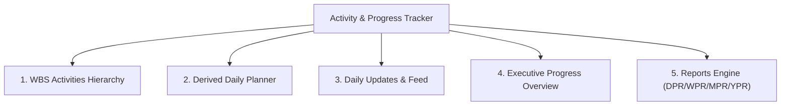

# Activity & Progress Tracker — Product Overview

## 1. Executive Summary

The **Activity & Progress Tracker** is an independent, production-grade module designed for **RebarOptima (CraveToBuild)**. It provides multi-tenant construction teams with a purpose-built system for tracking field progress, planning daily activities, managing 2-level work breakdown structures (WBS), capturing real site photographs, and computing mathematical period progress reports (DPR, WPR, MPR, YPR, and custom date ranges).

The module is designed specifically for **construction execution**, intentionally eliminating unnecessary parallel-ERP complexities (such as Primavera critical-path network schedules, CPM float calculations, Gantt drag-and-drop engines, and financial valuations). Instead, it focuses on what site teams and senior management actually need:

1. **Fast, 1-2 Minute Daily Logging for Supervisors:** Field engineers can quickly record cumulative progress, work descriptions, obstruction delays, and site photos from any device.
2. **Mathematical Period Progress Engine:** Accurate $\Delta P = P_{\text{end}} - P_{\text{start}}$ delta calculations that accurately isolate work accomplished during any reporting window without retrospective distortion.
3. **Strict 2-Level WBS & Weighted Hierarchy:** Level 1 parent summary activities with automatic or manual progress calculation derived from Level 2 child tasks with versioned historical weightages.
4. **Independent, Non-Destructive Architecture:** Reuses existing project, block, floor, and user entities in a read-only fashion, storing all tracker data in dedicated collections (`activities`, `activity_daily_updates`, `activity_photos`) with zero alterations to existing project management or task schemas.

---

## 2. Five Core Sections

### Section 1: WBS Activities Hierarchy
- **Strict 2-Level WBS:** Level 1 Summary Activities $\rightarrow$ Level 2 Child Tasks. A Level 2 activity cannot have children (preventing arbitrary nesting complexity).
- **Progress Calculation Modes:**
  - `AUTOMATIC`: Cumulative parent progress is dynamically computed from child tasks using weightages totaling 100.00%.
  - `MANUAL`: Cumulative progress is directly entered via supervisor daily updates.
- **Floor / Level Association:** Read-only link to `project_floors` belonging to the selected block.
- **Status Lifecycle:** `NOT_STARTED` ($0\%$), `IN_PROGRESS` ($1-99\%$), `COMPLETED` ($100\%$), `ON_HOLD`, `CANCELLED`.
- **Overdue Indicator:** Evaluated dynamically when $\text{today} > \text{endDate}$ and status $\neq \text{COMPLETED}$.

### Section 2: Derived Daily Planner
- Derived entirely on-the-fly from scheduled activities and daily update records; no duplicate scheduling collections.
- **Today's Planner:** Activities active today, highlighting whether today's update is pending or logged.
- **Upcoming Lookahead:** Next 7 days (default), 14 days, or 30 days.
- **Historical Schedule:** Historical planner view for any past date.

### Section 3: Daily Updates & Audit Feed
- **Single Canonical Document per Activity per Date:** Composite unique index on `{ activityId: 1, updateDate: 1 }`.
- **Intra-Day Log History:** Multiple updates on the same calendar day update canonical fields and archive earlier checks into `dayLogHistory`.
- **Obstruction Delay Tracking:** Flagging delays with root cause reasons and site photos.
- **Immutable Correction Audit Trail:** Authorized supervisors/managers can correct historical records, preserving original values, timestamp, user, and mandatory correction reason.

### Section 4: Executive Progress Overview
- Block-level cumulative progress % and planned vs. actual schedule.
- Status distribution counters (Completed, In Progress, Not Started, Overdue).
- Work package breakdown and critical path alerts.

### Section 5: Independent Reports Engine
- Generates DPR (Daily), WPR (Weekly), MPR (Monthly), YPR (Yearly), and Custom Date Range reports.
- Computes Starting Progress ($P_{\text{start}}$), Ending Progress ($P_{\text{end}}$), Period Progress Delta ($\Delta P$), and Days Worked.
- Direct streaming download of branded PDF (PDFKit) and Excel (ExcelJS) documents.

