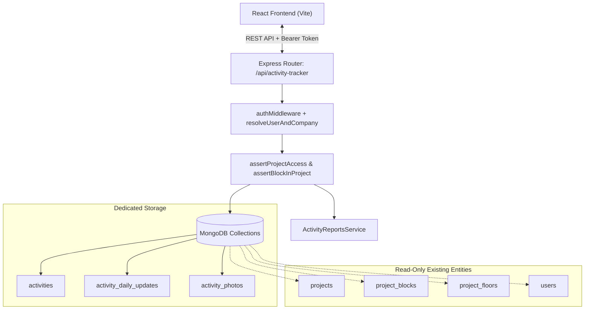

# Activity & Progress Tracker — Architecture and Database Design

## 1. System Architecture

The Activity & Progress Tracker is designed following the **Modular Monolith** architectural pattern within RebarOptima:

- **Strict Multi-Tenant Isolation:** Enforced via `companyId` on every collection, query, and aggregation pipeline.
- **Project & Block Scoping:** Every activity is strictly associated with a `projectId` and `blockId`.
- **Zero Cross-Module Mutations:** The module reads `projects`, `project_blocks`, `project_floors`, and `users` without altering their schemas or writing to them. Existing modules such as Project Management (`pm_tasks`) remain completely untouched.

---

## 2. Dedicated Database Collections

### Collection 1: `activities`

Stores the Work Breakdown Structure (WBS) records.

| Field | Type | Description |
|---|---|---|
| `_id` | `ObjectId` | Primary Key |
| `companyId` | `ObjectId` | Multi-tenant company identifier |
| `projectId` | `ObjectId` | Reference to parent project |
| `blockId` | `ObjectId` | Reference to parent block |
| `floorId` | `ObjectId` / `null` | Optional reference to `project_floors` |
| `parentActivityId` | `ObjectId` / `null` | Level 1 if `null`; Level 2 if points to Level 1 |
| `level` | `number` | `1` (Summary Activity) or `2` (Child Task) |
| `name` | `string` | Activity title / description |
| `code` | `string` | WBS code (e.g., `ACT-001`, `SUB-01`) |
| `description` | `string` | Scope description |
| `progressMode` | `enum` | `'AUTOMATIC'` \| `'MANUAL'` |
| `currentProgress` | `number` | Cumulative progress percentage (0.00 to 100.00) |
| `weightage` | `number` | Weight of Level 2 child in Level 1 parent (0 to 100) |
| `weightageHistory` | `Array<ActivityWeightagePeriod>` | Effective-dated weightage versions |
| `status` | `enum` | `'NOT_STARTED'` \| `'IN_PROGRESS'` \| `'COMPLETED'` \| `'ON_HOLD'` \| `'CANCELLED'` |
| `startDate` | `string` | Planned start date (`YYYY-MM-DD`) |
| `endDate` | `string` | Planned completion date (`YYYY-MM-DD`) |
| `actualStartDate` | `string` / `null` | Derived first update date (`YYYY-MM-DD`) |
| `actualEndDate` | `string` / `null` | Derived 100% completion date (`YYYY-MM-DD`) |
| `assignedUserIds` | `Array<ObjectId>` | Assigned team members |
| `isArchived` | `boolean` | Soft archive flag |
| `version` | `number` | Concurrency control version |
| `createdAt` | `Date` | Timestamp |
| `updatedAt` | `Date` | Timestamp |

**Indexes:**
- `{ companyId: 1, projectId: 1, blockId: 1, isArchived: 1 }`
- `{ parentActivityId: 1 }`
- `{ companyId: 1, code: 1 }`

---

### Collection 2: `activity_daily_updates`

Stores canonical daily updates, one document per activity per calendar date.

| Field | Type | Description |
|---|---|---|
| `_id` | `ObjectId` | Primary Key |
| `companyId` | `ObjectId` | Multi-tenant company identifier |
| `projectId` | `ObjectId` | Reference to parent project |
| `blockId` | `ObjectId` | Reference to parent block |
| `activityId` | `ObjectId` | Reference to `activities` |
| `floorId` | `ObjectId` / `null` | Reference to floor |
| `updateDate` | `string` | Target date (`YYYY-MM-DD`) |
| `cumulativeProgress` | `number` | Cumulative progress at end of day (0.00 to 100.00) |
| `previousProgress` | `number` | Prior cumulative progress value |
| `progressDelta` | `number` | Progress change recorded on this day |
| `workDescription` | `string` | Summary of work executed |
| `isDelayed` | `boolean` | Obstruction flag |
| `delayReason` | `string` / `null` | Delay root cause description |
| `remarks` | `string` / `null` | Additional notes |
| `photoIds` | `Array<ObjectId>` | References to `activity_photos` |
| `dayLogHistory` | `Array<IntraDayLog>` | Intra-day update snapshots on same date |
| `editHistory` | `Array<CorrectionAudit>` | Audited corrections (old, new, user, reason) |
| `createdBy` | `ObjectId` | User who submitted update |
| `createdByName` | `string` | User display name |
| `createdAt` | `Date` | Timestamp |
| `updatedAt` | `Date` | Timestamp |

**Indexes:**
- `{ activityId: 1, updateDate: 1 }` (Unique compound index)
- `{ companyId: 1, blockId: 1, updateDate: 1 }`
- `{ companyId: 1, isDelayed: 1 }`

---

### Collection 3: `activity_photos`

Stores raw photographic site evidence securely.

| Field | Type | Description |
|---|---|---|
| `_id` | `ObjectId` | Primary Key |
| `companyId` | `ObjectId` | Multi-tenant company identifier |
| `projectId` | `ObjectId` | Scoped project |
| `blockId` | `ObjectId` | Scoped block |
| `activityId` | `ObjectId` | Reference to activity |
| `filename` | `string` | Original file name |
| `mimeType` | `string` | Verified MIME type (`image/jpeg`, `image/png`, `image/webp`) |
| `sizeBytes` | `number` | File size (Max 10 MB) |
| `buffer` | `Buffer` | Raw binary image storage |
| `uploadedBy` | `ObjectId` | Submitting user |
| `createdAt` | `Date` | Timestamp |

**Streaming Security:** Served exclusively via authenticated streaming route `/api/activity-tracker/photos/:photoId` with `Cache-Control: private, no-cache, must-revalidate` to prevent unauthorized cross-tenant or unauthenticated access.

