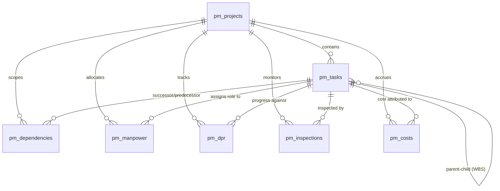

# Project Management (PM) Module Architecture & Data Flow
**Project:** RebarOptima Construction Management SaaS  
**Document:** System Architecture, Data Flow, and Schema Specifications  
**Status:** Approved for Phase 0 Audit Baseline

---

## 1. System Overview & Technology Stack

The RebarOptima Project Management module is designed to give construction managers, project engineers, and contractors a single source of truth for planning, scheduling, daily execution, and cost control.

```
┌─────────────────────────────────────────────────────────────────────────────┐
│                           REACT FRONTEND (Vite)                             │
│   ProjectManagementPage ──┬── PmTasksView (WBS & Activity Hierarchy)        │
│                           ├── PmGanttView (Critical Path Gantt Timeline)    │
│                           ├── PmManpowerView (Labor Allocations & Gangs)   │
│                           ├── PmDailyProgressView (DPR Submissions)         │
│                           ├── PmQualityView (QA/QC Inspection Gates)        │
│                           ├── PmCalendarView (Working Days & Shifts)        │
│                           └── PmDashboardView (Executive KPIs & Progress)   │
└─────────────────────────────────────┬───────────────────────────────────────┘
                                      │ HTTP / REST (JWT Auth + Company Header)
┌─────────────────────────────────────▼───────────────────────────────────────┐
│                        NODE.JS / EXPRESS BACKEND                            │
│   pm.routes.ts ─────────── Routes & Authorization Middlewares               │
│   pm.service.ts ────────── Business Logic, Database Access & Aggregations   │
│   pm.cpm.engine.ts ─────── Deterministic CPM Math & Calendar Algorithms     │
└─────────────────────────────────────┬───────────────────────────────────────┘
                                      │ Native MongoDB Driver (BSON)
┌─────────────────────────────────────▼───────────────────────────────────────┐
│                           MONGODB DATABASE                                  │
│   pm_projects       pm_tasks           pm_dependencies    pm_manpower       │
│   pm_dpr            pm_inspections     pm_costs           pm_productivity   │
└─────────────────────────────────────────────────────────────────────────────┘
```

---

## 2. Database Collections & Relationship Map

All collections are multi-tenant and enforce tenancy scoping via `companyId`.



### 2.1 Collection Schemas

#### 1. `pm_projects`
Stores high-level project parameters, contractual calendars, baseline lock status, and rolled-up project KPIs.
- `_id`: ObjectId
- `companyId`: String (Indexed)
- `code`: String (e.g., "SKY-TOW-01")
- `name`: String
- `description`: String
- `status`: `'PLANNED' | 'ACTIVE' | 'DELAYED' | 'AT_RISK' | 'COMPLETED' | 'ON_HOLD'`
- `plannedStart`: String (YYYY-MM-DD)
- `plannedFinish`: String (YYYY-MM-DD)
- `forecastFinish`: String (YYYY-MM-DD)
- `baselineFinish`: String (YYYY-MM-DD)
- `isBaselineLocked`: Boolean
- `baselineLockedAt`: ISO Date String
- `baselineLockedBy`: String
- `calendar`: Embedded Object (`workStartTime`, `workEndTime`, `workingDaysPerWeek`, `holidays`, `lunchDurationMinutes`, `recessIntervalsMinutes`)
- `approvedBudget`: Number (INR)
- `progressPercentage`: Number (0–100)
- `criticalPathLengthDays`: Number

#### 2. `pm_tasks`
Represents both Work Breakdown Structure (WBS) summary levels and executable work activities.
- `_id`: ObjectId
- `companyId`: String (Indexed)
- `projectId`: String (Indexed)
- `parentId`: String | null (Self-referencing foreign key for WBS hierarchy)
- `wbsCode`: String (e.g. "1.0", "1.1", "1.1.1")
- `name`: String
- `description`: String
- `status`: `'NOT_STARTED' | 'IN_PROGRESS' | 'UNDER_INSPECTION' | 'REWORK_REQUIRED' | 'COMPLETED' | 'BLOCKED'`
- `priority`: `'LOW' | 'MEDIUM' | 'HIGH' | 'CRITICAL'`
- `isMilestone`: Boolean
- `durationDays`: Number (Calendar/Working duration)
- `plannedStart`, `plannedFinish`: String (YYYY-MM-DD)
- `earlyStart`, `earlyFinish`: String (Calculated by CPM)
- `lateStart`, `lateFinish`: String (Calculated by CPM)
- `forecastStart`, `forecastFinish`: String
- `baselineStart`, `baselineFinish`: String
- `actualStart`, `actualFinish`: String | null
- `totalFloatDays`: Number (Working days of float)
- `isCritical`: Boolean (True if on Critical Path)
- `plannedQty`, `completedQty`, `acceptedQty`: Number
- `unit`: String (m3, MT, Rmt, Nos, Sqm)
- `plannedCost`, `actualCost`: Number
- `assignedRole`: String (e.g., Steel Fixer Lead, Carpenter Foreman, Site Engineer)
- `requiresInspection`: Boolean
- `inspectionPassed`: Boolean

#### 3. `pm_dependencies`
Represents precedence logic between tasks.
- `_id`: ObjectId
- `companyId`: String (Indexed)
- `projectId`: String (Indexed)
- `taskId`: String (Successor Task ID)
- `predecessorTaskId`: String (Predecessor Task ID)
- `type`: `'FS' | 'SS' | 'FF' | 'SF'` (Finish-to-Start, Start-to-Start, Finish-to-Finish, Start-to-Finish)
- `lagDays`: Number (Positive for lag, negative for lead)

#### 4. `pm_dpr` (Daily Progress Reports)
Captures actual site execution logs per shift.
- `_id`: ObjectId
- `companyId`: String
- `projectId`: String
- `taskId`: String
- `reportDate`: String (YYYY-MM-DD)
- `shift`: `'DAY' | 'NIGHT'`
- `supervisorName`: String
- `plannedQty`, `completedQty`, `acceptedQty`: Number
- `labourCount`: Number
- `actualLabourHours`: Number
- `equipmentUsed`: Array of equipment identifiers
- `materialsConsumed`: Array of material records
- `status`: `'SUBMITTED' | 'APPROVED' | 'REJECTED'`
- `reviewedBy`, `reviewedAt`: String

#### 5. `pm_inspections` (Quality & Rework)
Controls quality gates before dependent work or concrete pours proceed.
- `_id`: ObjectId
- `companyId`: String
- `projectId`: String
- `taskId`: String
- `inspectionName`: String
- `inspectorName`: String
- `inspectionDate`: String
- `checklistItems`: Array of `{ checkItem: string, passed: boolean, notes: string }`
- `outcome`: `'PASSED' | 'FAILED' | 'REWORK_REQUIRED'`
- `status`: `'OPEN' | 'RESOLVED'`

---

## 3. End-to-End Data Flow Workflows

### 3.1 Project & WBS Activity Creation Flow
```
User clicks "Add Activity" (Frontend)
   │
   ▼
PmTasksView.jsx validates form (Main vs Sub, WBS code, Duration, Role, Qty)
   │
   ▼
POST /api/pm/projects/:projectId/tasks
   │
   ▼
PmService.createTask:
   - Validates project exists
   - Inserts task into `pm_tasks`
   - Invokes recalculateProjectCPM(companyId, projectId)
   │
   ▼
CpmSchedulingEngine runs:
   - Topological sort of tasks
   - Forward pass sets earlyStart, earlyFinish, forecastDates
   - Backward pass sets lateStart, lateFinish, totalFloatDays, isCritical
   │
   ▼
Updates persisted to MongoDB (`pm_tasks` & `pm_projects`)
   │
   ▼
Frontend receives response and updates WBS Table & Gantt View
```

### 3.2 Dependency & Schedule Recalculation Flow
```
User links Task A -> Task B (or adds dependency via API)
   │
   ▼
POST /api/pm/dependencies
   │
   ▼
PmService.createDependency:
   1. Validates task does not depend on itself
   2. Checks for cycle using CpmSchedulingEngine.detectCycle(tasks, testDeps)
      - If circular: aborts immediately with 400 Bad Request ("Circular dependency: A -> B -> A")
   3. Inserts dependency into `pm_dependencies`
   4. Triggers recalculateProjectCPM(companyId, projectId)
   │
   ▼
CPM recalculation updates all downstream successor dates and project forecast finish
```

### 3.3 Daily Progress Report (DPR) & Progress Rollup Flow
```
Site Supervisor fills Daily Progress (PmDailyProgressView)
   │
   ▼
POST /api/pm/dpr  (status: 'SUBMITTED')
   │
   ▼
Project Manager reviews and clicks "Approve DPR"
   │
   ▼
PUT /api/pm/dpr/:id/approve
   │
   ▼
PmService.approveDpr:
   1. Updates `pm_dpr` status to 'APPROVED'
   2. Increments `acceptedQty` and `completedQty` on `pm_tasks`
   3. Recalculates `progressPercentage` = Math.min(100, Math.round(acceptedQty / plannedQty * 100))
   4. If progress >= 100%, marks status = 'COMPLETED'
   5. Calls recalculateProjectCPM to update project overall progress and health
```

---

## 4. Multi-Tenant Isolation & Security Architecture

1. **Authentication:**
   All routes are protected by JWT Bearer token authentication (`authMiddleware`).
2. **Tenant Scoping:**
   The user's `companyId` is extracted from the verified token (`req.user.companyId`) or trusted session context.
3. **Database Guardrails:**
   Every query to any PM collection (`pm_projects`, `pm_tasks`, `pm_dependencies`, `pm_dpr`, `pm_inspections`, `pm_costs`) MUST include `companyId` in its filter criteria.
4. **Current Vulnerability Identified:**
   As uncovered in the Phase 0 audit, several `updateOne` calls in `pm.service.ts` filtered strictly by `_id: new ObjectId(...)` and omitted `companyId`. This will be remediated in the authorized implementation phase.

